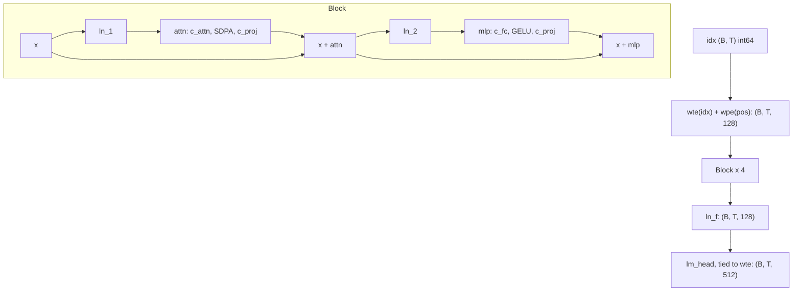

# 32 — The GPT Model, Line by Line

> **Prerequisites:** modules 10–13 and 31.
> **You will learn:** every line of a GPT-2-style decoder in PyTorch, with the shape after each operation; why the attention path has two implementations (SDPA and manual) and how to prove they agree; weight tying, GPT-2 initialization with residual scaling, and why the initial loss must be ln V; exact parameter accounting (875,264) and the FLOPs-per-token rule of thumb; a static, preallocated KV cache and the offset-chunk causal mask it requires.

Module 31 turned the Sherlock Holmes corpus into `(B, T)` batches of token ids. This module builds the function that maps such a batch to `(B, T, V)` logits: a 4-layer, 875,264-parameter GPT-2-style decoder in [`code/llm/model.py`](./code/llm/model.py). Modules 33–38 train, evaluate, sample, fine-tune, scale and export it, so its interface is frozen.

The same code with `n_layer=12, n_head=12, d_model=768, vocab_size=50257, block_size=1024` is GPT-2 small to the last parameter. The layers themselves were covered in modules 10–13; what is new here is where they interact: the tied head that sets the logit scale at initialization, the causal mask that silently breaks when queries are offset, and the parameter that `state_dict()` lists twice and `parameters()` yields once.

---

## 32.1 The architecture in one table and one diagram

| Field | Value | Note |
|---|---|---|
| `vocab_size` V | 512 | module 30's byte-level BPE |
| `block_size` | 128 | context; learned positions make it a hard limit |
| `n_layer` L | 4 | |
| `n_head` H | 4 | |
| `d_model` | 128 | `d_head` = 32 |
| `d_ff` | 512 | 4 · `d_model` |
| `dropout` | 0.0 | wired in, off by default |
| `bias` | True | Linear and LayerNorm biases |
| Parameters | **875,264** | tied head counted once |



| | GPT-2 small | capstone |
|---|---|---|
| V | 50,257 | 512 |
| `block_size` | 1,024 | 128 |
| L / H / `d_model` | 12 / 12 / 768 | 4 / 4 / 128 |
| `d_head` | 64 | 32 |
| Parameters (tied) | 124,439,808 | 875,264 |
| Embedding share | 31.6 % | 9.4 % |

Pre-norm versus post-norm is argued in [Transformers 06](../transformers/06-transformer-block-anatomy.md); the modern variant (RMSNorm, RoPE, SwiGLU, GQA) is [Transformers 16](../transformers/16-end-to-end-forward-pass.md), code at [`/courses/transformers/code/modern_decoder.py`](/courses/transformers/code/modern_decoder.py). We stay classic on purpose: fewer moving parts, stock `nn.LayerNorm` and `nn.GELU()` from [module 12](./12-normalization-dropout-attention-layers.md), and learned positions that make the context limit explicit. `wpe` has 128 rows, so the model raises at position 128 instead of extrapolating, which makes the cache's stopping rule (module 35) and the export shape bound (module 38) concrete.

## 32.2 `GPTConfig` and embeddings

`GPTConfig` is a dataclass with the seven fields above; `__post_init__` calls `validate()`, which raises `ValueError` for non-positive sizes, `d_model % n_head != 0` or dropout outside `[0, 1)`, so a bad config fails at construction with a sentence instead of deep inside `view`. `d_head` and `d_ff` are properties, not fields: `dataclasses.asdict(cfg)` holds only free choices, which module 33 stores in its manifest and rebuilds with `GPTConfig(**manifest["config"])`. A stored derived field could disagree with its inputs.

The embedding step is two lookups and an add:

```python
start = 0 if cache is None else cache.length
if start + T > self.config.block_size:
    raise ValueError(f"sequence of {start + T} positions exceeds block_size=...")
pos = torch.arange(start, start + T, device=idx.device)   # (T,)
x = self.drop(self.wte(idx) + self.wpe(pos))               # (B, T, d) + (T, d) -> (B, T, d)
```

`wpe(pos)` is `(T, d_model)` and broadcasts over the batch ([module 04](./04-indexing-broadcasting-shapes.md)). Without the explicit check, `wpe` fails with `IndexError: index out of range in self` on CPU (a device-side assert on CUDA), which names neither the limit nor the length. `start` is `cache.length` when a KV cache is attached, so a token generated at step 40 gets position 40 even though it arrives alone.

## 32.3 Causal self-attention, both ways

The derivations are in [Transformers 03](../transformers/03-self-attention-from-scratch.md) (attention, scaling) and [04](../transformers/04-multi-head-attention.md) (heads); here is what PyTorch sees:

```python
B, T, C = x.shape
q, k, v = self.c_attn(x).split(C, dim=2)                       # 3 x (B, T, d_model)
q = q.view(B, T, self.n_head, self.d_head).transpose(1, 2)    # (B, H, T, d_head)
k = k.view(B, T, self.n_head, self.d_head).transpose(1, 2)
v = v.view(B, T, self.n_head, self.d_head).transpose(1, 2)
```

One fused `c_attn: Linear(d, 3d)` replaces three `Linear(d, d)` with the same `3d² + 3d` parameters and one GEMM instead of three. `view(B, T, H, d_head)` splits the last axis into heads; `transpose(1, 2)` moves heads next to batch so attention batches over `(B, H)`. Skipping the transpose with `reshape(B, H, T, d_head)` runs silently and mixes tokens across heads; a local experiment showed the causality test catching it (earlier logits moved by 0.08), as it catches merging heads without the transpose back.

Then the two paths:

```python
if attn_impl == "sdpa":
    if mask is None:
        y = F.scaled_dot_product_attention(q, k, v, dropout_p=p, is_causal=True)
    else:
        y = F.scaled_dot_product_attention(q, k, v, attn_mask=mask, dropout_p=p)
else:  # "manual"
    if mask is None:
        mask = causal_mask(T, k.size(-2), k.size(-2) - T)
    att = (q @ k.transpose(-2, -1)) * (1.0 / math.sqrt(self.d_head))  # (B, H, T, T_k)
    att = att.masked_fill(~mask, float("-inf"))
    att = F.dropout(att.softmax(dim=-1), p=p, training=self.training)
    y = att @ v                                                        # (B, H, T, d_head)
y = y.transpose(1, 2).contiguous().view(B, T, C)
```

SDPA is the production path; on CUDA it can pick FlashAttention or memory-efficient kernels that never materialize the `(T, T)` scores ([module 12](./12-normalization-dropout-attention-layers.md)). The manual path is the specification SDPA must match, exposes the attention matrix, and is the path `FlopCounterMode` can count on CPU (32.7). One local run measured a maximum logit difference of 8.3e-7 between them on an `(8, 128)` batch; the test bar is `atol=1e-5`. After `transpose(1, 2)` the strides no longer describe a row-major `(B, T, C)` layout, so a bare `view` would raise; `.contiguous().view` makes the copy explicit where `reshape` would hide it.

### Why `is_causal=True` is wrong for an offset chunk

The PyTorch 2.8 [SDPA documentation](https://docs.pytorch.org/docs/2.8/generated/torch.nn.functional.scaled_dot_product_attention.html) is precise: with `is_causal=True` "the attention masking is a lower triangular matrix when the mask is a square matrix" and "has the form of the upper left causal bias" when it is not; its reference implementation is `torch.ones(L, S, dtype=torch.bool).tril(diagonal=0)`. That triangle (why decoders mask at all is [Transformers 08](../transformers/08-encoder-decoder-masking.md)) assumes query `i` sits at position `i`. With a KV cache, two new queries at absolute positions 3 and 4 attend to five keys at positions 0–4:

| | k0 | k1 | k2 | k3 | k4 |
|---|---|---|---|---|---|
| correct, q at pos 3 | 1 | 1 | 1 | 1 | 0 |
| correct, q at pos 4 | 1 | 1 | 1 | 1 | 1 |
| `is_causal=True`, row 0 | 1 | 0 | 0 | 0 | 0 |
| `is_causal=True`, row 1 | 1 | 1 | 0 | 0 | 0 |

The top-left triangle hides three past keys from each query. Nothing errors, outputs stay finite, and generation quality quietly degrades. Hence a helper that states the offset:

```python
def causal_mask(q_len, k_len, offset=0, device=None):
    q_pos = torch.arange(offset, offset + q_len, device=device)
    k_pos = torch.arange(k_len, device=device)
    return k_pos[None, :] <= q_pos[:, None]          # (q_len, k_len), True = may attend
```

The model uses `is_causal=True` only with no cache and no padding mask, where both triangles coincide; fence 1 shows the mismatch numerically.

## 32.4 MLP, block, and the residual stream

```python
x = x + self.attn(self.ln_1(x), mask=mask, cache=cache, attn_impl=attn_impl)   # Block.forward
return x + self.mlp(self.ln_2(x))          # mlp: c_proj(gelu(c_fc(.))), d -> 4d -> d
```

The MLP is the 4× expand–contract of [Transformers 07](../transformers/07-ffn-and-activations.md) with exact erf GELU (`nn.GELU()` default; GPT-2's released code used the tanh form). Pre-LN sublayers read a normalized copy of the stream and add back, so `x_L = x_0 + Σ f_i(·)` and the gradient reaching `x_0` always has an identity term; the price is variance growing with depth, which `ln_f` normalizes once before the head.

Full shape trace for `idx` of shape `(2, 16)`, printed by `model.shape_trace(idx)`:

| Step | Tensor | Shape |
|---|---|---|
| input | `idx` | (2, 16) |
| token embedding | `wte(idx)` | (2, 16, 128) |
| position embedding | `wpe(arange(16))` | (16, 128) |
| sum | `x` | (2, 16, 128) |
| block 0 | `ln_1(x)` | (2, 16, 128) |
| | `c_attn(...)` | (2, 16, 384) |
| | q, k, v after view + transpose | (2, 4, 16, 32) each |
| | scores `q @ kᵀ / √32` | (2, 4, 16, 16) |
| | `softmax(scores) @ v` | (2, 4, 16, 32) |
| | heads merged | (2, 16, 128) |
| | `x + c_proj(...)` | (2, 16, 128) |
| | `c_fc` / GELU | (2, 16, 512) |
| | `x + mlp.c_proj(...)` | (2, 16, 128) |
| blocks 1–3 | same as block 0 | (2, 16, 128) |
| final norm | `ln_f(x)` | (2, 16, 128) |
| head | `lm_head` → logits | (2, 16, 512) |

The only tensor whose size grows with T² is the score matrix, `B·H·T²` floats per layer: 524,288 floats, 2 MiB, per layer at `(8, 128)` in fp32. That is the tensor FlashAttention never writes to memory.

## 32.5 Weight tying and the output head

```python
self.lm_head = nn.Linear(cfg.d_model, cfg.vocab_size, bias=False)
self.lm_head.weight = self.wte.weight      # one Parameter, registered twice
```

`nn.Module.__setattr__` ([module 10](./10-nn-module-internals.md)) stores the *same* `Parameter` object in `lm_head._parameters["weight"]`; shapes line up because both `nn.Embedding(V, d).weight` and `nn.Linear(d, V).weight` are `(V, d)`.

| Question | Answer for the capstone |
|---|---|
| `model.lm_head.weight is model.wte.weight` | True |
| `len(list(model.parameters()))` | 52 (deduplicated by identity) |
| `len(model.state_dict())` | 53: both `wte.weight` and `lm_head.weight` |
| same storage | `sd["wte.weight"].data_ptr() == sd["lm_head.weight"].data_ptr()` |
| bytes on disk | 3,518,663 for `torch.save(state_dict)` (one local run), vs 3,501,056 for 875,264 fp32 values |
| parameter count effect | −65,536 (V · d_model) |

`torch.save` writes each storage once even when two tensors view it ([serialization notes](https://docs.pytorch.org/docs/2.8/notes/serialization.html)), and `load_state_dict` copies into the already-tied parameter, so tying survives a round trip. Two ways to lose it: `load_state_dict(..., assign=True)` swaps in the loaded tensors, which in one local run left 53 distinct `Parameter` objects that an optimizer would update independently; and `safetensors.torch.save` refuses the dict ("Some tensors share memory") until you drop one key.

Used twice in the graph, the weight accumulates both contributions in one `.grad`; rows for tokens absent from the batch still get gradient through the full-vocabulary softmax, which is Press and Wolf's argument for tying ([arXiv:1608.05859](https://arxiv.org/abs/1608.05859)).

Tying also biases the untrained head toward copying: with `targets = idx` (the forgotten shift) one local run scored 5.21 instead of 6.26, because `ln_f(x)` still contains `wte[idx]`. A step-0 loss clearly *below* ln V is a leak, not a lucky init.

## 32.6 Initialization and the ln V sanity check

`_init_weights`, applied to every submodule, draws Linear and Embedding weights from `N(0, 0.02)` and zeros biases; then the two residual projections per block are redrawn:

```python
resid_std = 0.02 / math.sqrt(2 * cfg.n_layer)  # 0.00707 for L = 4
for block in self.blocks:
    nn.init.normal_(block.attn.c_proj.weight, std=resid_std)
    nn.init.normal_(block.mlp.c_proj.weight, std=resid_std)
```

LayerNorms keep their defaults (weight 1, bias 0). The residual scaling is the GPT-2 paper's "scale the weights of residual layers at initialization by a factor of 1/√N where N is the number of residual layers" ([Radford et al. 2019](https://cdn.openai.com/better-language-models/language_models_are_unsupervised_multitask_learners.pdf)). In three lines: (1) after L blocks the stream is `x_0` plus 2L branch outputs; (2) at init the branches are roughly independent, so `Var(x_L) ≈ Var(x_0) + 2L·σ²_branch`; (3) a branch's output variance scales with the square of its output projection's std, so std `·1/√(2L)` makes the total `2L · σ²/(2L) = σ²`, independent of depth. Only the projections that write into the stream get the factor ([module 13](./13-initialization-and-losses.md) covers fan-based alternatives).

With all logits equal, softmax is uniform and cross-entropy is `ln 512 = 6.238`. Ours are nearly equal: `ln_f` emits unit-variance features and the tied head has std 0.02, so each logit has std about `0.02 · √128 = 0.226`, and a second-order expansion of log-sum-exp gives `E[CE] ≈ ln V + σ²/2 = 6.264`. The lab measured 6.262.

Without this init, PyTorch's defaults apply: `N(0, 1)` for `nn.Embedding`, `U(−1/√fan_in, 1/√fan_in)` for `nn.Linear` ([nn.init docs](https://docs.pytorch.org/docs/2.8/nn.init.html)). A head tied to an `N(0, 1)` embedding gives each logit std about `√128 ≈ 11.3`; one local run measured logit std 11.96 and an initial loss of **86.0**. The first loss you print is the cheapest test you will run: `|loss₀ − ln V| > 0.1` means logit scale, masking or label alignment is wrong.

## 32.7 Parameter and FLOP accounting

| Component | Formula | Parameters |
|---|---|---|
| `wte` | V · d | 65,536 |
| `wpe` | block_size · d | 16,384 |
| `ln_1` | 2d | 256 |
| `attn.c_attn` | d · 3d + 3d | 49,536 |
| `attn.c_proj` | d · d + d | 16,512 |
| `ln_2` | 2d | 256 |
| `mlp.c_fc` | d · 4d + 4d | 66,048 |
| `mlp.c_proj` | 4d · d + d | 65,664 |
| one block | 12d² + 13d | 198,272 |
| 4 blocks | | 793,088 |
| `ln_f` | 2d | 256 |
| `lm_head` | tied | 0 |
| **total** | V·d + T·d + L(12d² + 13d) + 2d | **875,264** (3.50 MB fp32) |

`model.param_table()` returns these rows per module (the head with `numel` 0 and `tied_to: "wte.weight"`); the test asserts they sum to `num_params()`.

`num_params(non_embedding=True)` subtracts only `wpe` (858,880), nanoGPT's convention. Kaplan et al. ([arXiv:2001.08361](https://arxiv.org/abs/2001.08361)) exclude embeddings from N because lookups cost no FLOPs, but a tied `wte` is also the head, a `2·V·d`-FLOP matmul per token.

Forward costs about `2N` FLOPs per token (a multiply and an add per weight), backward about `4N` (input and weight gradients), so training costs `6N`. Attention adds weightless matmuls: `q kᵀ` and `att @ v` each cost `2·T·d` per token per layer forward, `12·L·T·d` per token for training, the term nanoGPT's `estimate_mfu` adds after PaLM's appendix ([arXiv:2204.02311](https://arxiv.org/abs/2204.02311)). It ignores causal sparsity, as dense kernels do.

The lab measured one forward+backward on a `(4, 64)` batch (256 tokens) with `torch.utils.flop_counter.FlopCounterMode` ([module 21](./21-profiling-and-benchmarking.md)):

| Quantity | FLOPs |
|---|---|
| `6 · 858,880 · 256` | 1,319,239,680 |
| attention term `12 · 4 · 64 · 128 · 256` | 100,663,296 |
| formula total | 1,419,902,976 |
| measured, `attn_impl="manual"` | 1,409,286,144 (−0.75 %) |
| measured, `attn_impl="sdpa"` | 1,308,622,848 |

The manual path's `aten.mm` + `aten.addmm` total is exactly `6 · 851,968 · 256`, 851,968 being the *matrix* weights; the 0.75 % gap is biases and LayerNorm parameters that `6N` counts and no matmul touches. The SDPA path is short by exactly the attention term: PyTorch 2.8's `flop_counter.py` has formulas for the CUDA flash, efficient and cuDNN SDPA ops but not `_scaled_dot_product_flash_attention_for_cpu` ([source at v2.8.0](https://github.com/pytorch/pytorch/blob/v2.8.0/torch/utils/flop_counter.py)). Read a FLOP counter's per-op table before trusting an MFU number.

## 32.8 The KV cache path

`KVCache(cfg, batch_size, max_len, dtype=torch.float32, device="cpu")` preallocates `k`, `v` of shape `(L, B, H, max_len, d_head)` and an int `length`; `reset()` zeroes `length`. Attention writes the chunk, then reads everything so far:

```python
start, end = cache.length, cache.length + T
cache.k[self.layer_idx, :, :, start:end] = k        # (B, H, T, d_head) written in place
cache.v[self.layer_idx, :, :, start:end] = v
k = cache.k[self.layer_idx, :, :, :end]             # (B, H, start + T, d_head)
v = cache.v[self.layer_idx, :, :, :end]
```

`GPT.forward` builds one mask for all layers, `causal_mask(T, start + T, start)`, and advances `cache.length` once, after the last block; advancing it per layer would shift every later layer's slice by T. Positions use the same `start`, and a second guard rejects `start + T > cache.max_len`.

Growing the cache with `torch.cat` copies everything every step (quadratic total) and changes shapes, which defeats CUDA graphs and `torch.compile` guards; a static buffer keeps one shape.

Memory is `2 · L · B · H · max_len · d_head · bytes` = `2 · 4 · 1 · 4 · 128 · 32 · 4` = 262,144 bytes (256 KiB) per sequence, 7.5 % of our weights. GPT-2 small at 1,024 tokens needs 36 MiB per sequence in bf16, more than its 249 MB of weights from batch 7 up; see [Transformers 14](../transformers/14-inference-optimizations.md).

Two keyword-only extras, `position_ids` (B, T) and `key_mask` (B, T_k), serve [module 35](./35-capstone-generation-kv-cache.md)'s left-padded batches. A padding query would see no key and softmax over all `−inf` is NaN, so the combined mask always lets a query see itself. The test checks that a left-padded prompt reproduces the unpadded logits within `1e-5`.

Here we prove one step: prefill 12 tokens, feed token 13 alone, compare with the uncached forward over all 13. One local run: maximum difference 3.4e-7, `cache.length == 13`. Module 35 runs 64 steps.

## 32.9 Tests that catch real bugs

`site/test_pytorch_32_model.py` is the model's specification; each test targets a bug that produces plausible output:

| Test | Bug it catches |
|---|---|
| change `idx[:, 10]`, logits `[:, :10]` identical (`atol=1e-6`) | missing or inverted mask; head split or merge without its transpose |
| rows 0, 2, 3 unchanged when row 1 changes; row alone equals row in batch | batch and time axes swapped in a reshape (caught locally: 0.19 change); any reduction over the batch axis |
| SDPA equals manual (`atol=1e-5`) | wrong scale, mask polarity (True = keep in SDPA), a bug in only one path |
| initial loss within 0.1 of ln 512; `ignore_index=-100` matches a hand-sliced loss | bad init or untied scale; label shift; ignored positions counted |
| overfit one 4×64 batch, loss < 0.5 | detached graph, frozen params, optimizer missing groups |
| `lm_head.weight is wte.weight`; shared `data_ptr` | tying lost by `load_state_dict(assign=True)` or by rebuilding `lm_head` after tying |
| 12-token prefill + 1 cached step equals uncached; length 13 | offset mask, position offset, per-layer `length` advance |
| left-padded prompt equals unpadded | wrong position ids under padding; NaN rows |
| `ValueError` at T = 129, cache overflow, bad config | silent `IndexError` or device assert deep in embedding |
| optimizer groups cover each parameter once | tied weight in two groups, LayerNorm weights decayed |

Causality and batch independence are invariance tests ([module 18](./18-debugging-and-testing.md)): no reference implementation, only a statement of what must *not* change. Locally the earlier logits were bitwise identical (masked scores become exact zeros after softmax); the `1e-6` tolerance only keeps another backend's reduction order from failing a test meant to catch differences of order 0.1.

## Reconciling the sources

nanoGPT's [`model.py`](https://github.com/karpathy/nanoGPT/blob/3adf61e154c3fe3fca428ad6bc3818b27a3b8291/model.py) is the closest relative: same module names, the `0.02/√(2L)` init on every `c_proj.weight`, a `bias` flag, `get_num_params` subtracting `wpe`, and `is_causal=True` unconditionally, correct there because it has no cache. Raschka's chapter 4 ([notebook](https://github.com/rasbt/LLMs-from-scratch/blob/cdbd33e6d57a71e20ea31434841095fac50cecd8/ch04/01_main-chapter-code/ch04.ipynb)) uses separate `W_query/W_key/W_value` with `qkv_bias=False` and 0.1 dropout including attention weights: easier to read, three GEMMs instead of one. The GPT-2 paper's three departures from [Vaswani et al.](https://arxiv.org/abs/1706.03762) (LayerNorm at each sub-block's input, a final LayerNorm, residual-scaled init) are all here. Ours differs in three ways: dropout wired but 0.0 (800 steps of 4,096 tokens see the 217K-token train split about 15 times; module 33 watches the train/val gap), an explicit offset mask whenever queries and keys are misaligned, and a static cache.

## Worked model verification

Four self-contained checks, each runnable without `code/`.

**Fence 1**: two queries at positions 3 and 4 against five keys. SDPA with the offset mask equals manual attention; `is_causal=True` equals the top-left triangle and differs. It proves the alignment pitfall, not the model's cache wiring (the lab test covers that).

```python pytorch-check
import math
import torch
import torch.nn.functional as F

torch.manual_seed(0)
d = 8
q = torch.randn(1, 1, 2, d)            # two new queries at absolute positions 3 and 4
k = torch.randn(1, 1, 5, d)            # keys at positions 0..4 (3 cached + 2 new)
v = torch.randn(1, 1, 5, d)
q_pos, k_pos = torch.arange(3, 5), torch.arange(5)
offset_mask = k_pos[None, :] <= q_pos[:, None]                 # bottom-right aligned
top_left = torch.ones(2, 5, dtype=torch.bool).tril()           # what is_causal builds
scores = q @ k.transpose(-2, -1) / math.sqrt(d)

def manual(mask):
    return scores.masked_fill(~mask, float("-inf")).softmax(-1) @ v

with_mask = F.scaled_dot_product_attention(q, k, v, attn_mask=offset_mask)
with_flag = F.scaled_dot_product_attention(q, k, v, is_causal=True)
torch.testing.assert_close(with_mask, manual(offset_mask), atol=1e-6, rtol=0)
torch.testing.assert_close(with_flag, manual(top_left), atol=1e-6, rtol=0)
assert offset_mask.int().tolist() == [[1, 1, 1, 1, 0], [1, 1, 1, 1, 1]]
assert top_left.int().tolist() == [[1, 0, 0, 0, 0], [1, 1, 0, 0, 0]]
gap = (with_flag - with_mask).abs().max().item()
assert gap > 1e-2
print(f"offset mask matches manual; is_causal=True differs by {gap:.3f}")
```

**Fence 2** counts a block of stock `nn.Linear`/`nn.LayerNorm` at d = 128 and the closed form for the whole model. It proves the table, not that `llm/model.py` uses these layers (the test's `num_params() == 875_264` does).

```python pytorch-check
import torch.nn as nn

d, V, T, L = 128, 512, 128, 4
block = nn.ModuleDict({
    "ln_1": nn.LayerNorm(d), "c_attn": nn.Linear(d, 3 * d), "attn_c_proj": nn.Linear(d, d),
    "ln_2": nn.LayerNorm(d), "c_fc": nn.Linear(d, 4 * d), "mlp_c_proj": nn.Linear(4 * d, d),
})
per_block = sum(p.numel() for p in block.parameters())
assert per_block == 12 * d * d + 13 * d == 198_272
assert [sum(p.numel() for p in m.parameters()) for m in block.values()] == [
    256, 49_536, 16_512, 256, 66_048, 65_664]
total = V * d + T * d + L * per_block + 2 * d
assert total == 875_264
print(f"per block {per_block:,}; total {total:,} = {total * 4 / 1e6:.2f} MB fp32")
```

**Fence 3** ties a head to an embedding: one fewer `parameters()` entry, two `state_dict` keys on one storage, and a gradient equal to the input-use plus output-use gradients of independent copies. Optimizer grouping is left to the test.

```python pytorch-check
import torch
import torch.nn as nn
import torch.nn.functional as F

torch.manual_seed(0)
V, d = 11, 6

class Tiny(nn.Module):
    def __init__(self, tie):
        super().__init__()
        self.emb = nn.Embedding(V, d)
        self.head = nn.Linear(d, V, bias=False)
        if tie:
            self.head.weight = self.emb.weight

    def forward(self, idx):
        return self.head(self.emb(idx))

tied, untied = Tiny(True), Tiny(False)
assert len(list(untied.parameters())) - len(list(tied.parameters())) == 1
sd = tied.state_dict()
assert set(sd) == {"emb.weight", "head.weight"}
assert sd["emb.weight"].data_ptr() == sd["head.weight"].data_ptr()

idx, y = torch.randint(0, V, (4, 3)), torch.randint(0, V, (4, 3))
F.cross_entropy(tied(idx).reshape(-1, V), y.reshape(-1)).backward()
w_in = tied.emb.weight.detach().clone().requires_grad_()
w_out = tied.emb.weight.detach().clone().requires_grad_()
F.cross_entropy((F.embedding(idx, w_in) @ w_out.T).reshape(-1, V), y.reshape(-1)).backward()
torch.testing.assert_close(tied.emb.weight.grad, w_in.grad + w_out.grad, atol=1e-6, rtol=0)
assert w_in.grad.abs().sum() > 0 and w_out.grad.abs().sum() > 0
print(f"one tied Parameter, grad = input-use + output-use, max {tied.emb.weight.grad.abs().max():.4f}")
```

**Fence 4**: unit-variance features (what `ln_f` emits) against a tied table of std 0.02 give a loss within 0.05 of ln 512; std 1.0, the `nn.Embedding` default, gives more than 10. It proves the logit-scale mechanism, not the real model's init (the test does).

```python pytorch-check
import math
import torch
import torch.nn.functional as F

torch.manual_seed(0)
V, d, N = 512, 128, 4096

def initial_loss(std):
    table = torch.randn(V, d) * std                       # embedding == head weight (tied)
    idx, y = torch.randint(0, V, (N,)), torch.randint(0, V, (N,))
    h = F.layer_norm(table[idx] + 0.02 * torch.randn(N, d), (d,))   # ln_f output, unit variance
    logits = h @ table.T                                  # (N, V)
    return F.cross_entropy(logits, y).item(), logits.std().item()

small, small_std = initial_loss(0.02)
large, large_std = initial_loss(1.0)
assert abs(small - math.log(V)) < 0.05, small
assert large > 10.0, large
print(f"std 0.02: loss {small:.3f} (ln V {math.log(V):.3f}, logit std {small_std:.3f}); "
      f"std 1.0: loss {large:.1f}")
```

## Lab: assemble the model and audit it

**Tested with Python 3.11 and PyTorch 2.8.0 on CPU.**

[`code/32_gpt_model.py`](./code/32_gpt_model.py) builds `GPT(GPTConfig())` from [`code/llm/model.py`](./code/llm/model.py) and returns a JSON report: parameter table, shape trace for `(2, 16)`, initial loss (on validation tokens if module 31's `llm.data` imports, else random ids; `--init-batch random` forces the latter), SDPA/manual gap, the FLOP audit for both paths, and an overfit run on one 4×64 batch (AdamW, lr 3e-3, no decay). `--trace` prints the tables to stderr. Scope: CPU, fp32, no corpus training (module 33) or generation (module 35).

```bash
python content/courses/pytorch/code/32_gpt_model.py --trace
python site/test_pytorch_32_model.py
```

One local PyTorch 2.8 CPU run on an Apple M2 Pro with 4 threads produced:

| Result key | Value |
|---|---|
| `params` | 875,264 |
| `init_loss` (random ids, seed 1337) | 6.262 (ln V = 6.238) |
| `sdpa_manual_max_diff` | 8.3e-7 |
| `flops_measured` (manual) / `flops_formula` | 1,409,286,144 / 1,419,902,976 |
| `flops_measured_sdpa` | 1,308,622,848 |
| `overfit_first_loss` → `overfit_final_loss` (100 steps) | 6.267 → 0.0036 |

The test runs `--init-batch random` with 40 overfit steps (loss 0.04–0.08 at step 40 over three seeds) and asserts contracts, not these numbers: `|init_loss − ln 512| < 0.1`, SDPA/manual within `1e-5`, overfit loss < 0.5, manual-path FLOPs within 25 % of `6·P_non-embedding·tokens + 12·L·T·d·tokens` (loose because the formula is a rule of thumb; the measured gap is under 1 %), and the SDPA path short by exactly the attention term, an assertion that will fail loudly if a future PyTorch counts CPU SDPA.

## Key takeaways

- 875,264 = `V·d + T·d + L(12d² + 13d) + 2d`; GPT-2 small's config gives 124,439,808.
- `is_causal=True` is a top-left triangle; a cached chunk needs the offset mask `k_pos <= start + q_index`.
- Tying registers one `Parameter` twice: one entry in `parameters()`, two `state_dict` keys on one storage, a gradient summing both uses.
- GPT-2 init (std 0.02, residual projections `0.02/√(2L)`) gives an initial loss of ln V + σ²/2 ≈ 6.26; a tied `N(0, 1)` embedding gave 86.
- `6N + 12·L·T·d` FLOPs per token matched `FlopCounterMode` within 1 % on the manual path; on CPU in 2.8 the SDPA path's attention FLOPs are not counted.
- The static cache writes `[length : length + T]`, reads `[: length + T]`, and advances `length` once per forward.

## Self-check

1. A model's initial loss is 40 with V = 512. List three causes in order of likelihood and the one-line check for each.
2. Why is `is_causal=True` correct for the full-sequence forward but wrong when 2 new queries attend to 5 cached+new keys? Draw the mask.
3. With weight tying, how many parameters does `state_dict()` list vs `parameters()` yield, and what goes wrong if a custom optimizer builds groups from `named_parameters()` without deduplication?

---

**Next → [33 — Pretraining the GPT on CPU](./33-capstone-pretraining.md)**
