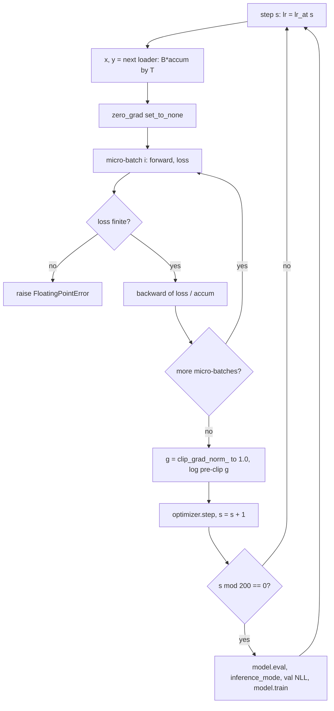

# 33 — Pretraining the GPT on CPU

> **Prerequisites:** modules 15–17 and 32.
> **You will learn:** the complete pretraining loop for the capstone GPT, every line justified; AdamW with decay/no-decay groups, warmup plus cosine decay, global-norm clipping and gradient accumulation; what to log (loss, lr, grad norm, tokens/s) and how to read the curves for under- and over-fitting; a full-state checkpoint and an exact-resume contract you can test; how the committed checkpoint `gpt_sherlock.pt` was produced, hashed and documented.

Module 32 left us with an 875,264-parameter GPT whose loss on real text is ln 512 ≈ 6.24 nats per token: it knows nothing. This module trains it for 800 optimizer steps on the ten training stories of *The Adventures of Sherlock Holmes* (217,572 tokens), on a laptop CPU, in under a minute. Everything lives in [`code/llm/train.py`](./code/llm/train.py) (the library) and [`code/33_pretrain.py`](./code/33_pretrain.py) (the command-line lab).

The loop is short. The hard part is the contract around it: a reproducible schedule, an auditable gradient, a checkpoint that resumes bit for bit, and a committed weight file whose manifest modules 34–38 can trust without retraining.

---

## 33.1 The recipe in one table

| Setting | Value | Why |
|---|---|---|
| Steps | 800 (full run), 150 (`--smoke`, used by CI) | under a minute on a laptop; CI runs only the smoke config |
| Batch | 32 sequences × 128 tokens = 4,096 tokens/step | ~60 ms per step on 4 CPU threads |
| Optimizer | AdamW, betas (0.9, 0.95), eps 1e-8, weight decay 0.1 on 2-D weights only, `fused=False`, `foreach=True` | β₂ = 0.95 forgets stale second moments faster than 0.999 |
| LR | peak 3e-3, linear warmup 40 steps (`steps // 20`), cosine decay to 3e-4 (10 %) | the floor keeps the last steps useful |
| Clip | global grad norm 1.0 | a safety rail against rare huge updates |
| Grad accumulation | `--accum 1` default (supported; test checks accum 2 × B/2 equals accum 1 × B within tolerance) | reproduces a larger batch in less memory |
| Precision | fp32 default; `--bf16-autocast` optional (CPU autocast) | fp32 is exact and, on this CPU, faster |
| Seed / threads | seed 1337; `torch.set_num_threads(min(4, os.cpu_count()))` | threads change reduction order |
| Eval | every 200 steps on val with `SequentialEvalDataset(stride=128)` | each of story XI's 23,847 targets scored once |
| Checkpoint | `{model, optimizer, step, rng_cpu, loader_state, config, tokenizer_sha256, torch_version}`; exact-resume contract | minimum state for an identical resume |

Biases and LayerNorm parameters get no weight decay: decay pulls toward zero, and a LayerNorm gain of zero kills its channel. Decay is for matrices, not offsets and scales. `GPT.configure_optimizer` (module 32) builds the two parameter groups ([module 15](./15-optimizers-and-schedules.md)) by `dim() >= 2` and counts the tied `wte`/`lm_head` weight once. PyTorch's `AdamW` defaults to `weight_decay=0.01` ([optim docs](https://docs.pytorch.org/docs/2.8/optim.html)); our 0.1 is deliberate, as in nanoGPT. Decoupled decay is Loshchilov and Hutter's ([arXiv:1711.05101](https://arxiv.org/abs/1711.05101)).

**Token budget.** 800 × 4,096 = 3,276,800 tokens, 15.1 passes over 217,572 training tokens. Chinchilla's compute-optimal rule is ≈ 20 tokens per parameter ([Hoffmann et al.](https://arxiv.org/abs/2203.15556)), so 875,264 parameters "want" about 17.5M *unique* tokens. We have one-eightieth of that, so we are data-limited, not compute-limited: more steps buy memorisation, not generalisation, which is the train/val gap in 33.5. (Kaplan et al. ([arXiv:2001.08361](https://arxiv.org/abs/2001.08361)) fit loss as a power law in parameters and unique data; neither fit covers 15 repeats of one small corpus.)

## 33.2 The loop, annotated

This is the core of `train(cfg)` with logging and resume plumbing stripped. Read it as a list of decisions:

```python
model = GPT(cfg.model)
optimizer = model.configure_optimizer(cfg.weight_decay, cfg.lr, (cfg.beta1, cfg.beta2), cfg.eps)
loader = make_train_loader(train_tokens, T, cfg.batch_size * cfg.accum, cfg.seed)
model.train()
while step < cfg.steps:
    lr = lr_at(step, cfg)
    for group in optimizer.param_groups:        # set by hand: nothing extra to checkpoint
        group["lr"] = lr
    x, y = next(loader)                         # (B * accum, T): the whole global batch
    optimizer.zero_grad(set_to_none=True)
    for xm, ym in zip(x.chunk(cfg.accum), y.chunk(cfg.accum)):
        with torch.autocast("cpu", dtype=torch.bfloat16, enabled=cfg.bf16_autocast):
            _, loss = model(xm, ym)             # mean CE over B*T targets of this micro-batch
        if not torch.isfinite(loss):
            raise FloatingPointError(f"non-finite loss at step {step}")
        (loss / cfg.accum).backward()           # .grad += ; dividing makes the sum a mean
    grad_norm = float(torch.nn.utils.clip_grad_norm_(model.parameters(), cfg.grad_clip))
    optimizer.step()
    step += 1
    if step % cfg.eval_every == 0 or step == cfg.steps:
        val = evaluate_split(model, val_tokens, T)   # eval mode + inference_mode inside
```

The decisions, in order:

1. **One loader draw per optimizer step, then `chunk`.** Module 31's loader is indexed by step (batch `k` is a pure function of `(seed, k)`). Drawing the whole `(B·accum, T)` batch and splitting it means `--accum 2 --batch-size 16` sees exactly the sequences `--batch-size 32` sees, and the loader state stays one integer.
2. **`zero_grad(set_to_none=True)` before the micro-batch loop.** `None` grads skip a memset and make misuse crash instead of silently accumulating ([module 16](./16-training-loop-checkpointing.md)).
3. **The NaN guard sits on the loss.** It fires before `backward` writes non-finite gradients into AdamW's moment buffers, where they would persist ([module 18](./18-debugging-and-testing.md)).
4. **`clip_grad_norm_` returns the pre-clip norm**, the most useful scalar to log after the loss.
5. **Evaluation flips modes and restores them.** `evaluate_split` uses `model.eval()` and `torch.inference_mode()`, then restores the previous mode in a `finally`. With `dropout=0.0` the mode changes nothing numerically, but a loop that forgets it breaks the day dropout is turned on.



Log per step: loss, lr, pre-clip grad norm and wall time (tokens/s = tokens per step / seconds). At each eval point `train()` records `{step, train_loss, val_loss, lr, grad_norm}`, where `train_loss` is the running mean of batch losses since the previous eval. That mean lags the model, so the manifest's final *train* loss is a separate full-split evaluation in eval mode, measured exactly like val.

## 33.3 Learning-rate schedule

$$
\text{lr}(s) =
\begin{cases}
\text{peak}\cdot\dfrac{s+1}{W} & s < W\\[6pt]
\text{floor} + \tfrac12(\text{peak}-\text{floor})\left(1+\cos\!\left(\pi\,\dfrac{s-W}{S-W}\right)\right) & W \le s < S
\end{cases}
$$

with peak 3e-3, floor 3e-4, W = 40, S = 800, and `s` the 0-indexed step about to be taken. With build-nanogpt's `(s + 1)/W`, step 0 has a non-zero lr and step `W − 1` hits the peak exactly. The cosine half is SGDR's annealing curve without restarts ([arXiv:1608.03983](https://arxiv.org/abs/1608.03983)).

| step `s` | 0 | 19 | 39 | 40 | 200 | 400 | 600 | 799 |
|---|---|---|---|---|---|---|---|---|
| `lr_at(s)` | 7.50e-5 | 1.50e-3 | 3.00e-3 | 3.00e-3 | 2.715e-3 | 1.762e-3 | 7.357e-4 | 3.0001e-4 |

**Why warmup matters for Adam.** Adam's update is $\Delta\theta = -\text{lr}\cdot \hat m / (\sqrt{\hat v} + \epsilon)$. At step 1 the bias-corrected moments are exactly $\hat m = g$ and $\hat v = g^2$, so every coordinate moves by `lr · sign(g)`: a full-lr step in every coordinate, whatever the gradient's magnitude, from a variance estimate of one sample. For the next few dozen steps $\hat v$ stays noisy, and coordinates whose early gradients happened to be small get outsized steps. Warmup keeps the lr small while $\hat v$ is being estimated. SGD's step is proportional to the gradient, so a small early gradient already means a small step (see [`../../notes/deep-learning/optimization-and-training.md`](../../notes/deep-learning/optimization-and-training.md)).

**Why set the lr by hand?** The math equals `LambdaLR` (fence 1), but a scheduler is one more object to checkpoint and restore in the right order. `group["lr"] = lr_at(step)` makes the lr a pure function of `step`, which is already in the checkpoint. The equivalent scheduler:

```python
sched = torch.optim.lr_scheduler.LambdaLR(optimizer, lambda s: lr_at(s, cfg) / cfg.lr)
# per step: optimizer.step(); sched.step()     # the scheduler steps AFTER the optimizer
```

**Peak lr shrinks with width.** build-nanogpt trains GPT-2 124M (d_model 768) at peak 6e-4; our 3e-3 suits d_model 128. A wider layer sums more terms per output, so the same per-parameter step moves activations further.

## 33.4 Gradient accumulation and clipping, precisely

`F.cross_entropy` returns a mean over its batch's `B·T` targets. Two micro-batches of 16 with means $\bar\ell_1, \bar\ell_2$ have global mean $(\bar\ell_1 + \bar\ell_2)/2$; since `backward` adds into `.grad`, `(loss / accum).backward()` on each yields exactly that mean's gradient. Without the division the gradient is `accum` times too large: nearly invisible under Adam, which normalises scale away, but not under SGD or clipping, where the pre-clip norm doubles. The argument needs equal numbers of scored targets per micro-batch; with padding or `ignore_index`, divide by the global count of real targets instead.

Locally, on the full model, first-step gradients of `--batch-size 32` and `--batch-size 16 --accum 2` differed by at most 6.7e-8 (summation order); both pre-clip norms were 2.38608.

Clipping must come **after the last micro-batch and before `optimizer.step()`**; earlier scales a partial gradient, later does nothing. `clip_grad_norm_` computes the global L2 norm of all gradients "as if concatenated into a single vector" and multiplies every gradient by `max_norm / (norm + 1e-6)` clamped to at most 1 ([docs](https://docs.pytorch.org/docs/2.8/generated/torch.nn.utils.clip_grad_norm_.html); [source](https://github.com/pytorch/pytorch/blob/v2.8.0/torch/nn/utils/clip_grad.py), which clamps instead of branching to avoid a device sync). It returns the norm before clipping. We clip from step 0 (Raschka's appendix D starts after warmup); our first step's norm was 2.39, so clipping fired immediately.

**bf16 autocast on CPU.** `--bf16-autocast` wraps the forward in `torch.autocast("cpu", dtype=torch.bfloat16)`; the backward reuses the autocast decisions. bf16 has fp32's exponent range, so no `GradScaler` is needed ([module 17](./17-mixed-precision.md); [amp docs](https://docs.pytorch.org/docs/2.8/amp.html)). Do not assume it is faster: in a local micro-benchmark on an Apple M2 Pro (4 threads, one `(32, 128)` batch), an fp32 step took about 61 ms (21 ms forward, 35 ms backward, 5 ms clip plus AdamW) and a bf16-autocast step about 2.15 s, 35 times slower. CPUs with native bf16 matrix units can invert that ratio; measure on your hardware.

## 33.5 Reading the curves

One local PyTorch 2.8 CPU run (Apple M2 Pro, 4 threads, seed 1337) of the full 800 steps produced the committed checkpoint; a second independent run produced a byte-identical `.pt` (same sha256).

| step | lr of the step just taken | pre-clip grad norm | train (running mean of batch losses) | val (story XI, non-overlapping) |
|---|---|---|---|---|
| 0 | n/a (init) | n/a | n/a | 6.252 |
| 200 | 2.72e-3 | 0.56 | 4.137 | 3.670 |
| 400 | 1.77e-3 | 0.95 | 3.363 | 3.263 |
| 600 | 7.40e-4 | 1.15 | 2.914 | 3.044 |
| 800 | 3.00e-4 | 1.19 | 2.651 | **2.963** |

After training, a full-split evaluation in eval mode gave **train 2.575** and **val 2.963** nats per token (perplexity e^2.963 ≈ 19.4). The training loop ran at 60,744 tokens/s and took 55.0 s including the five evaluations; the whole process took 57.2 s.

The script's text curve (`#` length proportional to `val − 2`):

```text
    0 | ######################################## 6.252
  200 | ################                         3.670 [train 4.14]
  400 | ############                             3.263 [train 3.36]
  600 | ##########                               3.044 [train 2.91]
  800 | #########                                2.963 [train 2.65]
```

How to read it:

- **Early on, train is above val.** At step 200 the running train mean (4.14) sits above val (3.67) because it averages the whole 200-step window, step 1 included. That is a logging artifact; compare like with like.
- **The gap opens late.** Eval-mode train 2.575 against val 2.963 is a 0.39-nat gap: after 15 passes the model memorises phrasings from stories I–X that story XI does not share. An underfit run instead shows train and val high, close together, and still falling steeply.
- **Val is still improving at step 800**, by 0.08 nats over the last 200 steps against 0.22 over the 200 before; the schedule ended, the model did not converge. In this data-limited regime more unique data, a smaller model or more regularisation (dropout, decay) help val; training longer mostly lowers the train number.
- **The grad norm rises as the loss falls**, from 0.56 to 1.19, so clipping is active late in training. A norm that jumps 10× in one step is different: a bad batch or the start of a divergence.

**Baselines.** Uniform guessing scores ln 512 = 6.238. Fitted on stories I–X, an add-one unigram scores 5.222 on val and a plain add-0.1 bigram 3.688. Module 34 builds the baselines properly; its bigram backs off to the unigram per context and scores 3.669, and that 3.67 is the bar the tests use. The GPT matches the bigram at step 200 (3.670) and ends 0.7 nats below either version, which is the part of the loss that comes from context longer than one token.

## 33.6 Checkpoints that actually resume

A checkpoint is the state that makes the next step identical to the uninterrupted run's:

| Key | Contents | What breaks without it |
|---|---|---|
| `model` | `state_dict()` (tied weight stored once on disk) | everything |
| `optimizer` | AdamW `state_dict()`: per-parameter `step`, `exp_avg`, `exp_avg_sq`, plus the groups | the first resumed steps behave like step 1 (sign-like updates from fresh moments) |
| `step` | completed optimizer steps | the lr schedule restarts at warmup |
| `rng_cpu` | `torch.get_rng_state()` | dropout masks differ, so parameters drift |
| `loader_state` | `{"step", "seed"}` from module 31 | the run sees different batches |
| `config` | `asdict(TrainConfig)` including the model config | you cannot rebuild the model or schedule |
| `tokenizer_sha256`, `torch_version` | provenance | silent mismatch between ids and embeddings |

`save_checkpoint` writes `path + ".tmp"` and `os.replace`s it into place, so a crash mid-write never leaves a truncated file at the real path (`os.replace` is atomic on POSIX within one filesystem). It loads with `torch.load(path, weights_only=True)`, the default since 2.6, whose unpickler rebuilds only tensors, primitives and plain containers and imports nothing ([serialization notes](https://docs.pytorch.org/docs/2.8/notes/serialization.html)). One trap bit this module's first draft: `torch.__version__` is a `torch.torch_version.TorchVersion` object, not a `str`, and storing it made the load fail with "Unsupported global: GLOBAL torch.torch_version.TorchVersion". The fix is `str(torch.__version__)`; anything beyond tensors, numbers, strings, bools, `None` and plain containers is a liability (the [PyTorch notes](../../notes/libraries/pytorch.md) summarise `state_dict` saving; this module goes further).

**The exact-resume contract.** Train N steps straight; separately train N/2, save, build *fresh* model, optimizer and loader objects as a new process would, load, and train N/2 more. On one machine, thread count and build the parameters match bitwise: the lab's `resume_check` (reduced model, `dropout=0.1`, 12 steps against 6 + 6) gives a max absolute difference of 0.0. The test allows `atol=1e-6` for harmless reordering in future builds, and checks the contract has teeth: with `torch.set_rng_state` patched to a no-op the difference is 4.8e-3, because steps 7–12 draw different dropout masks.

Not resumed here, but needed in production (module 16): scheduler and `GradScaler` state (we have neither), CUDA RNG per device, per-rank RNG and loader positions (module 37), DataLoader worker state, and sharded optimizer state via `torch.distributed.checkpoint`.

## 33.7 The committed checkpoint

Modules 34–38 need fixed weights: 34 asserts behaviour of *this* model, 35 compares cached and uncached generation token for token, 38 measures int8 quality loss against these fp32 weights. CI cannot afford the full run on every push (an estimated 90–110 s on a 4-vCPU runner; not measured here), and a different CPU would produce slightly different weights anyway. So the 3.4 MiB file is committed once, with a manifest that makes it verifiable.

`gpt_sherlock.pt` is `model.state_dict()` only: fp32, 3,519,703 bytes, with `wte.weight` and `lm_head.weight` sharing one storage so it is written once. `gpt_sherlock.json` records:

| Field | Committed value |
|---|---|
| `format_version` | 1 |
| `config` | `GPTConfig` fields (V 512, block 128, L 4, H 4, d_model 128, dropout 0.0, bias true) |
| `train_config` | every `TrainConfig` field |
| `params` / `steps` / `seed` / `tokens_seen` | 875,264 / 800 / 1337 / 3,276,800 |
| `tokenizer_file`, `tokenizer_sha256` | `bpe_sherlock_512.json`, `5e38bec0…c815` |
| `corpus_sha256` | `3552d466…3b3` |
| `checkpoint_file`, `checkpoint_sha256`, `checkpoint_bytes` | `gpt_sherlock.pt`, `b6c29127…97ab`, 3,519,703 |
| `final_train_loss`, `final_val_loss` | 2.5753, 2.9634 |
| `history` | the five eval points above |
| `tokens_per_second`, `wall_seconds` | 60,744, 55.0 |
| `torch_version`, `python_version`, `machine`, `created` | "2.8.0", "3.11.12", "macOS 26.1 arm64, Apple M2 Pro, 4 threads", 2026-10-10 |

`load_pretrained(device="cpu")` returns `(model, tokenizer, manifest)`. It first hashes the `.pt` and the tokenizer JSON against the manifest, so a re-trained tokenizer with the same file name cannot pair with these embeddings. It then builds `GPT(GPTConfig(**manifest["config"]))`, loads with `weights_only=True` and `strict=True` (a renamed key is an error, not a silently random layer) into the freshly built model, which keeps the head tied (`assign=True` would break it, module 32), and returns it in eval mode.

**Security.** `weights_only=True` blocks pickle's arbitrary-code execution, but it is not a sandbox; load only files you trust. Here trust comes from the sha256 in a reviewed manifest in the same repository (module 16).

## 33.8 What changes at scale

**Data parallelism.** DDP (module 26) runs this loop on every rank and all-reduces gradients during `backward`; FSDP2 (module 27) also shards parameters and optimizer state. Module 37 checks both against the single-process step on this model. With accumulation under DDP, skip the all-reduce on all but the last micro-batch (`no_sync`, or build-nanogpt's `require_backward_grad_sync`), or pay `accum` times the communication.

**Compilation.** `torch.compile` (module 23) fuses elementwise tails of attention and the MLP. Not executed here: Inductor does not build on this course's reference Mac.

**Precision on GPU.** The usual recipe is bf16 autocast, fp32 master weights, fused AdamW (`fused=True`), and TF32 for leftover fp32 matmuls (`torch.backends.cuda.matmul.allow_tf32` or `torch.set_float32_matmul_precision("high")`). Described from the docs; not executed in this course's CI.

**Batch size.** build-nanogpt reaches 524,288 tokens per step with `grad_accum_steps = total_batch_size // (B * T * world)`, the decomposition of 33.4. Larger batches lower gradient noise and usually allow a higher lr, up to the critical batch size.

The transformers course covers what else changes for real runs (data mixtures, loss spikes, μP-style lr transfer) in [`../transformers/13-training-considerations.md`](../transformers/13-training-considerations.md); [module 37](./37-capstone-scaling-the-recipe.md) does the memory, FLOP and MFU accounting for GPT-2 124M.

## Reconciling the sources

nanoGPT's [`train.py`](https://github.com/karpathy/nanoGPT/blob/3adf61e154c3fe3fca428ad6bc3818b27a3b8291/train.py) is the closest ancestor: same betas, weight decay 0.1, clip 1.0 and `min_lr ≈ lr/10` (lines 58–68). Its `get_lr` (lines 231–242) warms up with `(it + 1)/(warmup_iters + 1)`, which never quite reaches the peak; we use [build-nanogpt](https://github.com/karpathy/build-nanogpt/blob/6104ab1b53920f6e2159749676073ff7d815c1fa/train_gpt2.py)'s `(it + 1)/warmup_steps` (lines 349–364, with the GPT-2 124M values 6e-4 peak, 715 warmup steps, `min_lr = 0.1 · max_lr`). build-nanogpt also has our accumulation and logging pattern: `loss = loss / grad_accum_steps` (line 498), then `norm = clip_grad_norm_(...)` (line 503), printed on line 516. nanoGPT's `estimate_loss` (line 216) averages `eval_iters` *random* batches: cheap, noisy, some tokens scored twice and others never. We score every val target once, because the result is a committed number tests compare within 0.05. Raschka's [appendix D](https://github.com/rasbt/LLMs-from-scratch/blob/cdbd33e6d57a71e20ea31434841095fac50cecd8/appendix-D/01_main-chapter-code/appendix-D.ipynb) warms up from an `initial_lr`, uses the same cosine, and clips only once warmup ends (a comment notes the book's original `>` skipped one clipping step).

## Worked training verification

**Fence 1: the hand-written schedule equals `LambdaLR`.** Same lr at all 100 steps (warmup 5) when the scheduler steps after the optimizer, peak at `warmup − 1`, last step within 1e-3·peak of the floor. It does not prove the schedule is a *good* one.

```python pytorch-check
import math
import torch

def lr_at(step, peak, floor, warmup, total):
    if step < warmup:
        return peak * (step + 1) / warmup
    progress = (step - warmup) / (total - warmup)
    return floor + 0.5 * (peak - floor) * (1.0 + math.cos(math.pi * progress))

peak, floor, warmup, total = 3e-3, 3e-4, 5, 100
manual = [lr_at(s, peak, floor, warmup, total) for s in range(total)]

w = torch.nn.Parameter(torch.zeros(1))
opt = torch.optim.SGD([w], lr=peak)                      # base lr = peak
sched = torch.optim.lr_scheduler.LambdaLR(
    opt, lambda s: lr_at(s, peak, floor, warmup, total) / peak)
seen = []
for s in range(total):
    seen.append(opt.param_groups[0]["lr"])               # lr used by step s
    opt.step()                                           # optimizer first, then scheduler
    sched.step()

torch.testing.assert_close(torch.tensor(seen), torch.tensor(manual), rtol=1e-12, atol=0)
assert manual[warmup - 1] == peak
assert abs(manual[-1] - floor) < 1e-3 * peak
print(f"LambdaLR == lr_at for {total} steps; last lr {manual[-1]:.3e} (floor {floor:.0e})")
```

**Fence 2: accumulation equals the big batch.** Two micro-batches of 8 with `loss / 2` match one batch of 16 within 1e-6; forgetting the division doubles the gradient. This proves the loss-scale argument for equal-sized micro-batches; it says nothing about BatchNorm, whose statistics depend on the micro-batch.

```python pytorch-check
import torch
import torch.nn.functional as F

torch.manual_seed(0)
model = torch.nn.Linear(10, 5)
x, y = torch.randn(16, 10), torch.randint(0, 5, (16,))

model.zero_grad(set_to_none=True)
F.cross_entropy(model(x), y).backward()                  # one batch of 16
big = [p.grad.clone() for p in model.parameters()]

model.zero_grad(set_to_none=True)
accum = 2
for xm, ym in zip(x.chunk(accum), y.chunk(accum)):       # two micro-batches of 8
    (F.cross_entropy(model(xm), ym) / accum).backward()  # .grad accumulates (+=)
small = [p.grad.clone() for p in model.parameters()]
for a, b in zip(big, small):
    torch.testing.assert_close(a, b, atol=1e-6, rtol=0)

model.zero_grad(set_to_none=True)
for xm, ym in zip(x.chunk(accum), y.chunk(accum)):
    F.cross_entropy(model(xm), ym).backward()            # forgot "/ accum"
assert torch.allclose(model.weight.grad, accum * big[0], atol=1e-6)
print("2 x 8 with loss/2 == 1 x 16; without the division the gradient doubles")
```

**Fence 3: `clip_grad_norm_` returns the pre-clip norm.** The return value equals a hand-computed global L2 norm before clipping, and the clipped gradients have norm at most `max_norm`. Logging it tells you how hard clipping worked, not the post-clip state.

```python pytorch-check
import torch

torch.manual_seed(0)
model = torch.nn.Sequential(torch.nn.Linear(8, 16), torch.nn.Tanh(), torch.nn.Linear(16, 4))
loss = (model(torch.randn(32, 8)) * 50).pow(2).mean()    # deliberately large gradients
loss.backward()

manual = torch.sqrt(sum(p.grad.pow(2).sum() for p in model.parameters()))
max_norm = 1.0
returned = torch.nn.utils.clip_grad_norm_(model.parameters(), max_norm)
after = torch.sqrt(sum(p.grad.pow(2).sum() for p in model.parameters()))

torch.testing.assert_close(returned, manual, rtol=1e-5, atol=0)   # the PRE-clip norm
assert returned > max_norm and after <= max_norm + 1e-6
print(f"returned {returned.item():.2f} (pre-clip); global norm after clip {after.item():.4f}")
```

**Fence 4: exact resume on a toy.** An MLP with dropout and AdamW: 6 steps straight against 3 + save (model, optimizer, RNG) + fresh objects + `torch.load(weights_only=True)` + 3. Parameters are bitwise equal, and the resume without the RNG restore is not. This proves the checkpoint is complete for this loop on one machine, not cross-machine reproducibility.

```python pytorch-check
import tempfile
from pathlib import Path
import torch

def make():
    torch.manual_seed(0)
    m = torch.nn.Sequential(torch.nn.Linear(4, 32), torch.nn.ReLU(), torch.nn.Dropout(0.5),
                            torch.nn.Linear(32, 1))
    return m, torch.optim.AdamW(m.parameters(), lr=1e-2, weight_decay=0.1)

def batch(step):                                          # data = pure function of step
    g = torch.Generator().manual_seed(1000 + step)
    return torch.randn(8, 4, generator=g), torch.randn(8, 1, generator=g)

def run(m, opt, steps):
    for s in steps:
        x, y = batch(s)
        opt.zero_grad(set_to_none=True)
        torch.nn.functional.mse_loss(m(x), y).backward()  # dropout draws from the global RNG
        opt.step()

def resumed(restore_rng):
    m_a, o_a = make()
    torch.manual_seed(7)
    run(m_a, o_a, range(3))
    with tempfile.TemporaryDirectory() as tmp:
        path = Path(tmp) / "ckpt.pt"
        torch.save({"model": m_a.state_dict(), "optimizer": o_a.state_dict(), "step": 3,
                    "rng_cpu": torch.get_rng_state()}, path)
        m_b, o_b = make()                                 # fresh objects, as in a new process
        torch.manual_seed(12345)                          # whatever the new process did
        ck = torch.load(path, weights_only=True)
    m_b.load_state_dict(ck["model"])
    o_b.load_state_dict(ck["optimizer"])
    if restore_rng:
        torch.set_rng_state(ck["rng_cpu"])
    run(m_b, o_b, range(ck["step"], 6))
    return m_b

rng_before = torch.get_rng_state()
try:
    m_ref, o_ref = make()
    torch.manual_seed(7)
    run(m_ref, o_ref, range(6))                           # 6 steps straight
    good, bad = resumed(True), resumed(False)
    for (n, a), b in zip(m_ref.state_dict().items(), good.state_dict().values()):
        torch.testing.assert_close(a, b, atol=0, rtol=0, msg=n)
    assert not torch.equal(m_ref[0].weight, bad[0].weight)
    print("6 straight == 3 + save/load (model, AdamW, RNG) + 3, bitwise; without RNG it drifts")
finally:
    torch.set_rng_state(rng_before)
```

## Lab: pretrain the GPT and prove the run can resume

**Tested with Python 3.11 and PyTorch 2.8.0 on CPU.**

[`code/33_pretrain.py`](./code/33_pretrain.py) wraps [`code/llm/train.py`](./code/llm/train.py). It evaluates on story XI at step 0 and every `--eval-every` steps, prints the text curve to stderr, and returns JSON with `steps`, `history`, `final_val_loss`, `final_train_loss` (skipped under `--smoke`), `tokens_seen`, `tokens_per_second`, `wall_seconds`, `resume_max_abs_diff` (with `--check-resume`), `params` and per-step `lrs`. `--smoke` is 150 steps, warmup 7, eval every 75, full model size. `--output-dir` keeps a full `ckpt.pt` that `--resume` continues from. Scope: one CPU process, a tiny model in a data-limited regime, one seed; nothing here measures seed-to-seed variance.

```bash
python content/courses/pytorch/code/33_pretrain.py --smoke
python content/courses/pytorch/code/33_pretrain.py --steps 800 --output-dir /tmp/gpt-run
python site/test_pytorch_33_pretrain.py
```

**Producing the artifact** (run once by the course author; not run in CI):

```bash
python content/courses/pytorch/code/33_pretrain.py --steps 800 --save-artifact --json-out /tmp/pretrain.json
```

`--save-artifact` refuses `--smoke`, `--resume`, and any run with val ≥ 3.3; it writes the `state_dict` atomically, hashes it, and writes the 33.7 manifest. Its numbers are in 33.5.

Locally the smoke run went from val 6.252 to 4.567 (step 75) and 4.371 (step 150). The test asserts contracts, not those numbers: (a) the smoke run's final val is below 4.72 (unigram 5.22 − 0.5) and at least 1.0 below its step-0 value, everything is finite, and every logged lr equals `lr_at`; (b) the 12 versus 6 + 6 resume on the reduced model matches within 1e-6 including AdamW's `exp_avg_sq`, the loader state is `{"step": 12, "seed": 1337}`, and skipping the RNG restore *is* detected; (c) `--accum 2 --batch-size 16` gives first-step gradients equal to `--batch-size 32` within 1e-5; (d) the committed artifact loads through `load_pretrained()`, both sha256 values match, the model has 875,264 parameters with the head still tied, the file loads with `weights_only=True`, its val loss reproduces the manifest within 0.05 and is below 3.67, and a manifest with a wrong hash is rejected; (e) the manifest's `torch_version` starts with "2.8". Locally the test file took 12.0 s wall, about 0.8 s of it `import torch` and about 10 s the smoke run.

## Key takeaways

- AdamW (0.9, 0.95), decay 0.1 on matrices only, warmup to 3e-3, cosine to a 10 % floor, clip 1.0; 800 × 4,096 tokens is about 15 passes over the training split, a data-limited regime.
- An lr that is a pure function of `step` equals `LambdaLR` and leaves one less object to checkpoint.
- Accumulation is exact when each equal-sized micro-batch loss is divided by `accum`; clip once, after the last micro-batch, and log the pre-clip norm `clip_grad_norm_` returns.
- The committed run reached val 2.963 (train 2.575) nats per token in 55.0 s at 60,744 tokens/s on 4 M2 Pro threads, 0.7 nats below an add-0.1 bigram; two runs produced byte-identical weights.
- A checkpoint holds model, optimizer, step, RNG, loader position, config and provenance; save atomically, load with `weights_only=True`, store only plain Python types (`str(torch.__version__)`).
- Exact resume is a test: straight and split runs must match, and a negative control (no RNG restore) must fail.

## Self-check

1. Your val loss plateaus at 3.4 while train keeps falling to 2.2. Name two changes that would help and one that would only make the train number look better.
2. You resume from a checkpoint and the loss curve is smooth but the parameters after 10 more steps differ from the uninterrupted run. List the state you probably forgot, in order of likelihood.
3. Why does warmup matter more for Adam than for SGD, and what happens to the effective step size in the first few iterations without it?

---

**Next → [34 — Evaluating the Model: Perplexity, Bits per Byte, and Baselines](./34-capstone-evaluation.md)**
