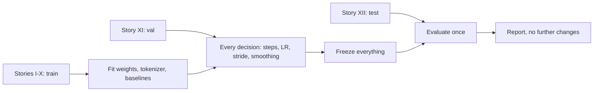

# 34 — Evaluating the Model: Perplexity, Bits per Byte, and Baselines

> **Prerequisites:** module 33.
> **You will learn:** how held-out negative log-likelihood, perplexity and bits per byte relate, and which one compares across tokenizers; why sliding-window evaluation gives lower loss than non-overlapping windows, and which number to report; n-gram baselines (uniform, unigram, bigram) and why a model that fails to beat a bigram is broken; uncertainty: per-window losses, standard error, and why one held-out story is a small sample; test-set discipline and behavioural checks that are deterministic across machines.

[Module 33](./33-capstone-pretraining.md) ended with one number: val loss 2.9634 nats per token on story XI. Change the window stride and it moves; change the tokenizer and it is no longer comparable; without a baseline nobody knows whether it is good, and without an error bar nobody knows whether a 0.02 improvement is real. This module turns it into an evaluation report you could defend in a review.

Everything lives in [`code/llm/evaluate.py`](./code/llm/evaluate.py) (imported by modules 36 and 38 to measure forgetting and quantization loss) and [`code/34_evaluate.py`](./code/34_evaluate.py) (the lab). Both load the committed checkpoint through `load_pretrained()` and never train. Every number below is from one local PyTorch 2.8 CPU run on an Apple M2 Pro laptop, 4 threads.

---

## 34.1 What a language-model loss measures

For a token stream $x_0, \dots, x_{n-1}$ the model scores the $n-1$ targets $x_1, \dots, x_{n-1}$. The first token is context only. The held-out loss is the mean negative log-likelihood

$$\text{NLL} = -\frac{1}{n-1}\sum_{t=1}^{n-1} \ln p_\theta(x_t \mid x_{<t}),$$

which is the cross-entropy between the held-out text and the model, in nats per token. Perplexity $e^{\text{NLL}}$ is the size of a uniform distribution that would be exactly as surprised: perplexity 19 means as uncertain as a fair 19-sided die. Definitions are in [information theory](../../notes/math/information-theory.md) and [NLP evaluation](../../notes/nlp/nlp-evaluation.md); the work here is computing them correctly.

| Model on story XI | NLL (nats/token) | Perplexity |
|---|---|---|
| Uniform over $V = 512$ | $\ln 512 = 6.2383$ | 512 |
| Capstone GPT, stride 64 | 2.9461 | 19.03 |

"Correctly" has three parts.

1. **Weight by tokens, not windows.** `F.cross_entropy(..., ignore_index=-100, reduction="mean")` divides by the number of non-ignored targets ([docs](https://docs.pytorch.org/docs/2.8/generated/torch.nn.functional.cross_entropy.html)). Averaging per-batch means is not token-weighted once batches hold different numbers of valid targets (padding, a short last batch, masked overlap); fence 1 shows the difference ([module 13](./13-initialization-and-losses.md) covers reductions).
2. **Accumulate in float64.** `cross_entropy` is already stable (log-softmax with max subtraction, [module 05](./05-tensor-math-linear-algebra-numerics.md)); summing 23,847 float32 losses is where digits go, so window sums are float64 and combined with `math.fsum`.
3. **No autograd, eval mode.** The loop runs under [`torch.inference_mode()`](https://docs.pytorch.org/docs/2.8/generated/torch.autograd.grad_mode.inference_mode.html) ([module 07](./07-autograd-graph-and-backward.md)) and restores the caller's train/eval mode in `finally`.

The core of `evaluate_nll`:

```python
ds = SequentialEvalDataset(tokens, block_size, stride=stride)        # module 31
with torch.inference_mode():
    for i in range(0, len(ds), batch_size):
        x, y, m = (torch.stack(t) for t in zip(*[ds[j] for j in range(i, min(i + batch_size, len(ds)))]))
        logits = model(x)[0].float()                                  # (B, T, V)
        y = y.masked_fill(~m, -100)                                   # overlap = context only
        tok = F.cross_entropy(logits.transpose(1, 2), y, ignore_index=-100, reduction="none")  # (B, T)
        window_sums += tok.double().sum(1).tolist()
        window_counts += m.sum(1).tolist()
nll = math.fsum(window_sums) / sum(window_counts)                     # == len(tokens) - 1 targets
```

It also returns per-window `window_losses` and `window_counts` for the error bars in 34.5.

## 34.2 Tokens are not comparable units: bits per byte

"Per token" depends on the tokenizer: bigger pieces mean fewer, harder predictions, so NLL per token rises even when the model is just as good. Normalise instead by what every tokenizer agrees on, the UTF-8 bytes ([Gao et al., The Pile](https://arxiv.org/abs/2101.00027), who define $\text{BPB} = (L_T/L_B)\,\ell/\ln 2$):

$$\text{bpb} = \frac{\sum_t -\ln p_\theta(x_t \mid x_{<t})}{\ln 2 \cdot n_\text{bytes}} = \frac{\text{NLL}}{\ln 2 \cdot (\text{bytes/token})}.$$

`n_bytes` is defined precisely as the bytes of the *scored* targets $x_1, \dots, x_{n-1}$ (`scored_bytes(tokenizer, tokens)`): the first token's bytes are excluded because nothing predicted them, and `<|endoftext|>` counts zero bytes because it is not text. On story XI: 52,163 bytes over 23,847 targets, 2.1874 bytes per token.

| Model on story XI | nats/token | bytes/token | bits/byte |
|---|---|---|---|
| Uniform | 6.2383 | 2.1874 | 4.114 |
| Add-one unigram | 5.2218 | 2.1874 | 3.444 |
| Bigram (34.4) | 3.6688 | 2.1874 | 2.420 |
| Capstone GPT, stride 64 | 2.9461 | 2.1874 | **1.943** |

Bpb puts our BPE-512 model next to a character-level model or one with GPT-2's 50,257-token vocabulary, provided all score the same bytes. *Bits per character* normalises by Unicode code points instead; it equals bpb only for ASCII, and this corpus uses curly quotes and em dashes (3 UTF-8 bytes each), so say which. Perplexity has no tokenizer-free version: convert to bpb before comparing across tokenizers.

## 34.3 Window strategy changes the number

The model sees at most 128 tokens. Non-overlapping windows (stride 128) score position 0 of every window from a single token of context, position 127 from 128. A sliding window with stride $s < 128$ advances by $s$ and scores only its last $s$ targets; the first $128 - s$ positions are masked context, so every target after the first window sees at least $128 - s + 1$ tokens. [Module 31](./31-capstone-data-pipeline.md) built this mask into `SequentialEvalDataset`; at any stride each of the 23,847 targets is scored exactly once.

| Stride | Windows | NLL (nats/token) | Perplexity | bpb | Forward time |
|---|---|---|---|---|---|
| 128 (non-overlapping) | 187 | 2.9634 | 19.36 | 1.954 | 0.13 s |
| 64 (headline) | 372 | 2.9461 | 19.03 | 1.943 | 0.26 s |
| 32 | 743 | 2.9418 | 18.95 | 1.940 | 0.51 s |

Cost grows as block/stride (every window is a full forward pass), and the gain shrinks fast. Loss by position in the non-overlapping windows shows why:

| Position in window | 0 | 1–7 | 8–31 | 32–63 | 64–127 |
|---|---|---|---|---|---|
| Mean NLL | 4.00 | 3.07 | 2.96 | 2.99 | 2.93 |

Position 0 predicts from one token, the bigram's situation, and costs 4.00 nats, worse than the bigram's 3.67, plausibly because only 1 in 128 training positions has so little context while the bigram is fitted on nothing else. After about 8 tokens the loss is flat, so stride 64 removes all the low-context positions and stride 32 buys only another 0.004 for twice the compute. We report **stride 64** and always state it. The Hugging Face [perplexity guide](https://github.com/huggingface/transformers/blob/v4.57.1/docs/source/en/perplexity.md) does the same and reports GPT-2 large on WikiText-2 at 19.44 without overlap and 16.44 at stride 512 (doc-reported, not run here).

Neither number is "the" perplexity: stride 128 measures chunks fed in fresh, small strides the model with as much context as it can hold. Never compare across strides.

## 34.4 Baselines you must beat

A loss means little without the losses of models that know less. Three baselines, fitted on stories I–X, score the same targets as the model:

| Baseline | Definition | NLL on story XI | Perplexity |
|---|---|---|---|
| Uniform | $p(b) = 1/V$ | 6.2383 | 512 |
| Unigram, add-one | $p(b) = (c_b + 1)/(N + V)$ | 5.2218 | 185.3 |
| Bigram, add-0.1, unigram prior | see below | 3.6688 | 39.2 |
| Capstone GPT, stride 64 | 128-token context | 2.9461 | 19.0 |

The bigram is a $512 \times 512$ count matrix from one [`torch.bincount`](https://docs.pytorch.org/docs/2.8/generated/torch.bincount.html) on the flattened pair index $a \cdot V + b$ ([module 04](./04-indexing-broadcasting-shapes.md)): Karpathy's [makemore part 1](https://github.com/karpathy/nn-zero-to-hero/blob/73c3fcc741f0ec104ca850b1fb0df90e7e8d4cde/lectures/makemore/makemore_part1_bigrams.ipynb) with a counting loop replaced by one kernel:

```python
C = torch.bincount(train[:-1] * V + train[1:], minlength=V * V).double().view(V, V)
p_uni = (torch.bincount(train, minlength=V).double() + 1) / (len(train) + V)
P = (C + k * V * p_uni) / (C.sum(1, keepdim=True) + k * V)        # (V, V), rows sum to 1
nll = -P[val[:-1], val[1:]].log().mean()
```

Plain add-$k$ spreads $k$ pseudo-counts *uniformly* over 512 successors; here the same $kV$ pseudo-counts follow the unigram. Rearranged, that is interpolation with a per-context weight:

$$p(b \mid a) = \lambda_a \frac{C(a,b)}{C(a)} + (1-\lambda_a)\, p_\text{uni}(b), \qquad \lambda_a = \frac{C(a)}{C(a) + kV}.$$

Frequent contexts trust their counts; rare ones fall back to the unigram. With $k = 0.1$ it scores 3.6688 against 3.6882 for plain add-0.1, while a fixed mixture $\lambda \cdot \text{add-}k + (1-\lambda)\,p_\text{uni}$ never beat plain add-$k$ in a sweep ($\lambda = 0.9$: 3.719), because add-$k$ is already smoothed. So `bigram_nll(..., lam=None)` uses the per-context form; `lam=0` reproduces the unigram and `lam=1` is plain add-$k$.

The bigram captures most of what one token of context buys (5.22 → 3.67). The transformer's longer context takes another 0.72 nats per token, a factor $e^{0.72} \approx 2.06$ in perplexity: that is what 875,264 parameters bought over a counting table. It is also a bug bar. The model matched the bigram at step 200 in module 33 (3.670); one still at 3.7 after 800 steps has learned only adjacent-token statistics, which in practice means context is not reaching the prediction (a wrong mask or a reshape that mixes heads), a positional-embedding bug, or a learning rate stuck near zero. The lab test asserts `model < bigram − 0.3 < unigram − 1.0 < uniform`.

## 34.5 How sure are we? Per-window losses and standard error

One story of 23,847 tokens gives an estimate, not a fact. Treating the 372 stride-64 windows as independent gives the standard error of a token-weighted mean (`standard_error`, ratio-estimator form):

$$\text{SE} = \frac{\sqrt{\tfrac{W}{W-1}\sum_i c_i^2 (\ell_i - \bar\ell)^2}}{\sum_i c_i},$$

where $\ell_i$ is window $i$'s mean NLL over its $c_i$ scored targets. Here SE = 0.0163, so the normal interval is 2.946 ± 0.032.

That is optimistic. Adjacent windows score adjacent text (one conversation, one recurring name), and the lag-1 autocorrelation of window losses is 0.12, so there are fewer effective samples than windows. The honest alternative is a **moving-block bootstrap**: resample *runs* of contiguous windows so short-range dependence survives inside each run. `block_bootstrap` draws block starts with `torch.randint` from a dedicated, explicitly seeded `torch.Generator` ([module 06](./06-randomness-and-reproducibility.md)), so the interval is reproducible and the global RNG untouched, and summarises the replicates with [`torch.quantile`](https://docs.pytorch.org/docs/2.8/generated/torch.quantile.html).

| Method (stride 64, 200 replicates, seed 34) | SE | 95 % interval |
|---|---|---|
| Independent windows, normal approximation | 0.0163 | [2.914, 2.978] |
| Bootstrap, block 1 (i.i.d. resampling) | 0.0162 | [2.910, 2.975] |
| Bootstrap, block 7 (default, $W^{1/3}$) | 0.0195 | [2.912, 2.983] |
| Bootstrap, block 20 | 0.0208 | [2.904, 2.986] |
| Bootstrap, block 50 | 0.0270 | [2.886, 2.988] |

Block 1 reproduces the naive SE, as it should; longer blocks capture more correlation and widen the interval, until (block 50, about 3,200 tokens) too few distinct blocks remain and the interval itself gets noisy. The cube-root default is a convention. Read the table as "SE about 0.02, not 0.016": with one story, an *unpaired* difference below about 0.05 nats is noise. Two models scored on the same windows compare more tightly by bootstrapping the per-window *difference*, which cancels shared text difficulty.

## 34.6 The test set, once

Every number so far, including module 33's 2.9634, used story XI. Each decision made by looking at a split (stride, smoothing, checkpoint, learning rate) fits a little of that split's noise, so after enough decisions its loss is optimistically biased; the only unbiased number left comes from text that influenced nothing. With every choice made on val, we ran `34_evaluate.py --split test` exactly once:



| Split | NLL, stride 128 | NLL, stride 64 | Perplexity (64) | bytes/token | bpb (64) | 95 % block bootstrap (64) | Bigram |
|---|---|---|---|---|---|---|---|
| Val, story XI | 2.9634 | 2.9461 | 19.03 | 2.1874 | 1.943 | [2.912, 2.983] | 3.669 |
| Test, story XII | 2.9959 | 2.9794 | 19.68 | 2.1556 | 1.994 | [2.935, 3.016] | 3.690 |

Test is 0.033 nats worse, inside both intervals, and the bigram is also 0.02 worse on XII, so part of the gap is harder text, not overfitting to val. The bpb gap (0.051) exceeds the nats gap because the tokenizer compresses story XII less well (2.156 vs 2.187 bytes per token), which per-token NLL hides.

Had the number been bad, we could not fix it and re-report. Trying 12 learning rates against a test split makes it a second validation set, and the best of 12 noisy estimates is biased low; the salvage is to treat that split as burnt, re-select on val, and evaluate once on fresh text (here, another book). The CI test touches story XII only to run the code path on a 512-token slice.

## 34.7 Behavioural checks that do not lie across machines

Aggregate loss can hide a broken model; exact-output tests can fail a healthy one. The lab test's checks are robust across CPUs ([module 18](./18-debugging-and-testing.md) on testing invariants):

- **Causality.** Changing tokens 40–63 leaves logits at positions 0–39 unchanged (atol 1e-5) and changes later ones, on the loaded checkpoint, not a toy.
- **Same-process greedy determinism.** Two greedy continuations in one process are identical. Across machines they need not be: thread count and CPU change reduction order, logits move by float32 rounding, and a near-tie can flip the argmax and every later token.
- **Seeded sampling.** `torch.multinomial` with `generator=torch.Generator().manual_seed(7)` twice gives identical draws, seed 8 does not (fence 4); the generator carries the state, so other code cannot shift the stream.
- **"Sherlock" → " Holmes", gated by margin.** `greedy_margin` returns the top token and its logit lead over the runner-up; the test asserts `" Holmes"` only when the margin exceeds 1.0, else `skipTest` with the margin. Here the margin is 5.02 logits.

The next-token table from the committed checkpoint (`--prompts`):

| Prompt | Top 1 | Top 2 | Top 3 |
|---|---|---|---|
| `Sherlock` | `" Holmes"` 0.913 | `" I"` 0.006 | `" was"` 0.006 |
| `Mr. Sherlock` | `" Holmes"` 0.882 | `" was"` 0.009 | `" I"` 0.009 |
| `My dear` | `" f"` 0.223 | `" "` 0.052 | `" B"` 0.040 |
| `It was a` | `" s"` 0.060 | `"g"` 0.046 | `"d"` 0.045 |
| `said` | `" that"` 0.116 | `" of"` 0.060 | `" the"` 0.058 |

Names are near-certain. After "My dear" the model expects `" f"`, presumably the start of " fellow": with 255 merges many words are two or three tokens, so the table shows fragments. After "It was a" the distribution is flat, which is the honest answer.

**Memorisation probe.** Fifteen passes over the training tokens (module 33) invite verbatim recall. We greedy-continue the first 24 tokens of story I (train) and of story XI (val) for 30 tokens and find the longest substring of each continuation that occurs verbatim in the training text. Story I's continuation (`. “‘It is a very _d_. ‘It is a very _d_d_.`) shares 12 characters and does not reproduce the real next sentence; story XI's shares 13. Equal values for seen and unseen prompts put ~12 characters at the level of common phrases, not recall. A model that memorised would show long matches on train prompts only.

## 34.8 What these numbers do not tell you

Perplexity measures how well the model predicts *this* author's next token. It does not measure coherence over a paragraph (module 35 lets you look), task ability (module 36 measures exact match), calibration, or human preference. The usual next step is a multiple-choice suite such as [HellaSwag](https://arxiv.org/abs/1905.07830) through [lm-evaluation-harness](https://github.com/EleutherAI/lm-evaluation-harness), which scores each candidate ending by log-likelihood; both need network downloads and are out of scope here. General principles (leakage, intervals) are in [model evaluation](../../notes/ml/model-evaluation.md); perplexity among LM metrics in [language models](../../notes/nlp/language-models.md).

## Reconciling the sources

All three references are valid estimators of different quantities. Raschka's [ch05 notebook](https://github.com/rasbt/LLMs-from-scratch/blob/cdbd33e6d57a71e20ea31434841095fac50cecd8/ch05/01_main-chapter-code/ch05.ipynb) `calc_loss_loader` averages per-batch mean losses and takes `torch.exp(loss)` as perplexity, which equals the token mean only when batches hold equal numbers of targets. nanoGPT's [`estimate_loss`](https://github.com/karpathy/nanoGPT/blob/3adf61e154c3fe3fca428ad6bc3818b27a3b8291/train.py) (line 216) averages `eval_iters` random batches: fast, fine for curves, noisy, with some tokens scored twice and others never. The Hugging Face guide slides strided windows, masks overlap with `-100` and weights by valid targets, which is our scheme. State the scheme with every number.

## Worked evaluation verification

### Fence 1: the mean of window means is not the token mean

Two windows of four positions, with `ignore_index=-100` leaving 3 valid targets in the first and 1 in the second. The fence proves `reduction="sum"` / valid count equals a hand computation and `reduction="mean"`, and that the mean of window means differs. It does not prove `evaluate_nll` uses the right form; the lab test recombines its window losses on the real model.

```python pytorch-check
import torch
import torch.nn.functional as F

g = torch.Generator().manual_seed(0)
V = 7
logits = torch.randn(2, 4, V, generator=g, dtype=torch.float64)
y = torch.tensor([[1, 2, 3, -100],
                  [-100, -100, -100, 5]])
flat_logits, flat_y = logits.reshape(-1, V), y.reshape(-1)

total = F.cross_entropy(flat_logits, flat_y, ignore_index=-100, reduction="sum")
n_valid = (flat_y != -100).sum()
token_mean = total / n_valid
builtin_mean = F.cross_entropy(flat_logits, flat_y, ignore_index=-100, reduction="mean")

per_tok = F.cross_entropy(logits.transpose(1, 2), y, ignore_index=-100, reduction="none")  # (B, T)
counts = (y != -100).sum(1)
window_means = per_tok.sum(1) / counts
mean_of_means = window_means.mean()

valid = flat_y != -100
manual = -torch.log_softmax(flat_logits[valid], -1).gather(1, flat_y[valid, None]).mean()
torch.testing.assert_close(token_mean, manual)
torch.testing.assert_close(builtin_mean, token_mean)
torch.testing.assert_close((window_means * counts).sum() / counts.sum(), token_mean)
assert int(n_valid) == 4 and abs(float(mean_of_means - token_mean)) > 1e-3
print(f"token mean {token_mean:.4f}  mean of window means {mean_of_means:.4f}")
```

### Fence 2: perplexity and bits-per-byte identities

Uniform logits give $\ln V$ and perplexity $V$; the bpb conversion reproduces 3.0 / (ln 2 · 2.19) = 1.9763. This proves arithmetic, not the byte count.

```python pytorch-check
import math
import torch
import torch.nn.functional as F

V = 512
logits = torch.zeros(3, V)                       # uniform model
targets = torch.tensor([0, 17, 511])
nll = F.cross_entropy(logits, targets).item()
assert abs(nll - math.log(V)) < 1e-5
assert abs(math.exp(nll) - V) < 1e-2             # perplexity of a uniform model = V

nll_tok, bytes_per_tok = 3.0, 2.19
bpb = nll_tok / (math.log(2) * bytes_per_tok)
assert abs(bpb - 1.9763) < 1e-4
n = 1000                                         # same number from totals
assert abs((nll_tok * n) / (math.log(2) * bytes_per_tok * n) - bpb) < 1e-12
print(f"uniform nll {nll:.4f} = ln {V}; ppl {math.exp(nll):.1f}; bpb {bpb:.4f}")
```

### Fence 3: a bigram count matrix from one bincount

The `a*V+b` bincount equals a `Counter` over pairs, and both smoothed forms have rows summing to 1. It does not show the baseline is good; the lab test pins its value.

```python pytorch-check
from collections import Counter
import torch

g = torch.Generator().manual_seed(3)
V = 6
ids = torch.randint(0, V, (200,), generator=g)
C = torch.bincount(ids[:-1] * V + ids[1:], minlength=V * V).view(V, V)

ref = torch.zeros(V, V, dtype=torch.long)
for (a, b), c in Counter(zip(ids[:-1].tolist(), ids[1:].tolist())).items():
    ref[a, b] = c
assert torch.equal(C, ref) and int(C.sum()) == len(ids) - 1

k = 0.1
Cd = C.double()
add_k = (Cd + k) / (Cd.sum(1, keepdim=True) + k * V)
p_uni = (torch.bincount(ids, minlength=V).double() + 1) / (len(ids) + V)
uni_prior = (Cd + k * V * p_uni) / (Cd.sum(1, keepdim=True) + k * V)
for P in (add_k, uni_prior):
    torch.testing.assert_close(P.sum(1), torch.ones(V, dtype=torch.float64))
print("bincount bigram == Counter bigram; smoothed rows sum to 1")
```

### Fence 4: seeded sampling is a property of the Generator

Two [`torch.Generator`](https://docs.pytorch.org/docs/2.8/generated/torch.Generator.html)s seeded 7 give identical [`torch.multinomial`](https://docs.pytorch.org/docs/2.8/generated/torch.multinomial.html) draws, seed 8 differs, the global RNG is untouched. This holds within one build; the [randomness notes](https://docs.pytorch.org/docs/2.8/notes/randomness.html) promise nothing across versions or devices, so tests never hard-code sampled ids.

```python pytorch-check
import torch

probs = torch.tensor([0.5, 0.2, 0.2, 0.1])
global_state = torch.get_rng_state()

def draw(seed):
    g = torch.Generator().manual_seed(seed)
    return torch.multinomial(probs, 64, replacement=True, generator=g)

a, b, c = draw(7), draw(7), draw(8)
assert torch.equal(a, b)
assert not torch.equal(a, c)
assert torch.equal(torch.get_rng_state(), global_state)   # global RNG untouched
print("seed 7 twice identical; seed 8 differs; global RNG untouched")
```

## Lab: evaluate the committed model

**Tested with Python 3.11 and PyTorch 2.8.0 on CPU.**

[`code/34_evaluate.py`](./code/34_evaluate.py) evaluates one split at each `--strides` value (default `128,64`, headline 64), fits the baselines on train, and returns JSON with `results` per stride, `baselines`, `se`, `bootstrap_ci` (`--bootstrap N`, `--seed`), `holmes_margin` and, with `--prompts`, the next-token table and memorisation probe. `--split test` prints a "final report only" banner; `--limit-tokens` evaluates a prefix. Val with strides 128, 64, 32 plus prompts took 1.3 s in-process. Scope: one story per split, correlated windows, one checkpoint; perplexity is not quality.

```bash
python content/courses/pytorch/code/34_evaluate.py --prompts
python site/test_pytorch_34_evaluate.py
```

The test asserts contracts, not this machine's numbers: each target scored once at strides 128 and 64; stride 64 ≤ stride 128 + 0.01; stride 128 within 0.05 of the manifest; `model < bigram − 0.3 < unigram − 1.0 < uniform`; baselines within 0.1 of 5.22 and 3.67; bpb consistent with `scored_bytes`, itself checked against the raw story (val is one story and byte-level BPE is lossless, so it must equal the UTF-8 length minus the first token's bytes); determinism and mode restoration; a seed-deterministic bootstrap that leaves the global RNG alone; causality and sampling determinism on the loaded model; the margin-gated `" Holmes"`; and the test-split path on a 512-token slice. Locally the file took 1.7 s wall (warm caches; 3.1 s on a cold first run), about 0.8 s of it `import torch`.

## Key takeaways

- Held-out NLL is a token-weighted mean over every target exactly once, accumulated in float64; perplexity is its exponential.
- Per-token numbers depend on the tokenizer; bits per byte compares across tokenizers (ours: 1.943 on story XI).
- The window scheme moves the number (2.963 at stride 128, 2.946 at 64, 2.942 at 32): state the stride.
- Baselines frame the result: uniform 6.238, unigram 5.222, bigram 3.669, GPT 2.946. Not beating the bigram widely signals a bug.
- One story gives SE ≈ 0.02 once correlation is respected, not the naive 0.016; unpaired differences under 0.05 nats are noise.
- The test split was used once: 2.979 nats, 1.994 bpb, 0.033 above val and inside both intervals.
- Behavioural tests must be platform-robust: causality, same-process determinism, generator-seeded sampling, exact tokens only behind a margin gate.

## Self-check

1. Model A (BPE-512) has perplexity 20; model B (characters) has perplexity 3.5 on the same text. Which is better? Show the conversion.
2. Why is the standard error from per-window losses optimistic, and what would you do to get an honest interval?
3. A teammate reports the test-set number after trying 12 learning rates against it. What exactly is wrong, and how do you salvage an unbiased estimate?

---

**Next → [35 — Generation and the KV Cache](./35-capstone-generation-kv-cache.md)**
