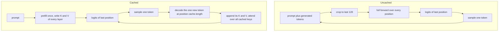

# 35 — Generation and the KV Cache

> **Prerequisites:** modules 32–34.
> **You will learn:** the autoregressive loop and why naive generation is quadratic in recomputation; greedy, temperature, top-k and top-p (nucleus) sampling implemented and validated, with explicit `torch.Generator`s; the KV cache: what is stored, its memory formula, how positions and masks shift, and how to prove it changes nothing numerically; what happens at the context limit with learned positions, stop tokens, and streaming decode of byte-level tokens; batched generation with left padding and per-row masks.

The committed checkpoint reaches 2.96 nats per token on story XI ([module 34](./34-capstone-evaluation.md) put that in context). To write, it runs a loop: forward, turn the last position's logits into one token, append, repeat. Each part of the loop is a decision that changes the output or the cost: which token, from which random stream, what to keep between steps, what to do at position 128 and with prompts of different lengths.

All of it lives in [`code/llm/generate.py`](./code/llm/generate.py), which modules 36 and 38 import, plus the lab [`code/35_generate.py`](./code/35_generate.py). The claim to earn is that the cache is an optimisation and nothing else, checked at every one of 64 greedy steps.

---

## 35.1 The autoregressive loop

The model maps `idx` of shape `(B, T)` to logits `(B, T, V)`. Training uses all `T` rows, because teacher forcing scores every position in parallel ([Transformers 08](../transformers/08-encoder-decoder-masking.md) explains why training and inference differ). Generation needs only the last row. The uncached loop is nanoGPT's:

```python
for _ in range(max_new_tokens):
    idx_cond = idx[:, -block_size:]                 # learned positions stop at 128
    logits, _ = model(idx_cond)                     # (B, T, V), recomputes every position
    nxt = sample_next(logits[:, -1, :], ...)        # (B, 1)
    idx = torch.cat([idx, nxt], dim=1)
```

With a prompt of `P` tokens and `N` new ones, step `t` runs the network over `P + t` positions, a total of

$$\sum_{t=0}^{N-1} (P + t) = NP + \tfrac{N(N-1)}{2} = O\big((P+N)^2\big)$$

token-forwards, with attention adding another factor of the length. Almost all of it is repeated: position 3's keys at step 90 are the numbers they were at step 1. The cached loop runs the prompt once (*prefill*), then feeds one token per step (*decode*): `P + N − 1` token-forwards.

| Benchmark shape (35.8) | Uncached | Cached | Ratio |
|---|---|---|---|
| Token-forwards for P = 16, N = 100 | 6,550 | 115 | 57× |
| Query-key score entries, per head and layer, before masking | $\sum_{t=0}^{99} (16+t)^2$ = 512,350 | $16^2 + \sum_{t=1}^{99}(16+t)$ = 6,790 | 75× |



The inference course walks the same loop at GPU scale in [the decode loop and KV cache](/courses/inference/00-foundations/00-02-decode-loop-and-kv-cache.html).

## 35.2 Turning logits into a token

`sample_next(logits, temperature=1.0, top_k=None, top_p=None, generator=None)` maps `(B, V)` logits to `(B, 1)` int64 ids in a fixed order:

1. **Temperature.** `0` returns `argmax`. Otherwise divide by $\tau$: $\mathrm{softmax}(z/\tau)$ tends to one-hot as $\tau \to 0$ and to uniform as $\tau \to \infty$. Negative or NaN raises `ValueError`.
2. **Top-k.** `torch.topk(logits, k).values[..., -1:]` is the k-th largest logit ([module 04](./04-indexing-broadcasting-shapes.md)); everything below it becomes $-\infty$. `k > V` is clamped, `k < 1` raises.
3. **Top-p (nucleus).** Sort descending, softmax, take the exclusive prefix sum `cumsum − probs`, drop a token once that mass has reached `p`, force-keep the top token, and `scatter` the mask back to vocabulary order: the smallest prefix with mass ≥ `p` ([Holtzman et al. 2019](https://arxiv.org/abs/1904.09751)). `p` must lie in `(0, 1]`.
4. **Draw.** [`torch.multinomial`](https://docs.pytorch.org/docs/2.8/generated/torch.multinomial.html)`(probs, 1, generator=generator)`.

The worked example uses probabilities $[0.5, 0.3, 0.1, 0.06, 0.04]$, given as their logs:

| id | prob | mass before | kept, top-k = 2 | kept, top-p = 0.5 | kept, top-p = 0.9 |
|---|---|---|---|---|---|
| 0 | 0.50 | 0.00 | yes | yes | yes |
| 1 | 0.30 | 0.50 | yes | no (0.50 ≥ 0.5) | yes |
| 2 | 0.10 | 0.80 | no | no | yes |
| 3 | 0.06 | 0.90 | no | no | no (0.90 ≥ 0.9) |
| 4 | 0.04 | 0.96 | no | no | no |

Both top-p columns sit exactly on a boundary. Locally the float32 mass before token 3 was 0.8999999762, which is `float32(0.9)` to the last bit, so `>=` dropped it; one ulp lower and it would have stayed. Tests stay off boundaries: fence 1 uses 0.45 and 0.85.

Hugging Face's `TopPLogitsWarper` ([v4.57.1](https://github.com/huggingface/transformers/blob/v4.57.1/src/transformers/generation/logits_process.py)) sorts ascending, removes tokens whose cumulative mass is `<= 1 − top_p` and force-keeps `min_tokens_to_keep` (default 1): the same set away from boundaries. Its constructor raises only for `top_p < 0 or top_p > 1`, so `top_p=0` silently means greedy; ours rejects it as a caller bug. Other strategies (beam, typical, min-p) are surveyed in [text generation and decoding](../../notes/nlp/text-generation-and-decoding.md); sort-free GPU kernels in [sampling on GPU](/courses/inference/06-decoding-algorithms/06-01-sampling-on-gpu.html).

## 35.3 Randomness you can reproduce

Without a `generator`, `torch.multinomial` draws from the global RNG that dropout, shuffling and every library share, so a seeded generation is reproducible only if nothing else drew in between. `generate` takes a `torch.Generator` ([module 06](./06-randomness-and-reproducibility.md)), and the test asserts that sampling leaves `torch.get_rng_state()` unchanged.

Within one process the same seed reproduces the same 32 tokens exactly. Across machines it can break, for a precise reason. In PyTorch 2.8, `multinomial` with one sample (or without replacement) uses an exponential race. It draws $q_i \sim \mathrm{Exp}(1)$ for every vocabulary entry and returns $\arg\max_i p_i / q_i$ ([`Distributions.cpp` at v2.8.0](https://github.com/pytorch/pytorch/blob/v2.8.0/aten/src/ATen/native/Distributions.cpp)), the Gumbel-max trick from module 06 in exponentiated form. Same seed, same $q$. If another machine's matmul kernels move one $p_i$ by $10^{-7}$, the token changes only when two ratios $p_i/q_i$ are within $10^{-7}$ of each other. That is rare at any single step. Over thousands of steps it happens, and from then on the two sequences condition on different text and never agree again.

So cross-platform checks use tolerances or margins (35.5). And because the race consumes `V` draws per row, a batch of three prompts sampled with one generator does *not* reproduce three single-prompt runs; batched consistency is tested greedily.

## 35.4 Deriving the KV cache

Fix layer `ℓ` and position `j < t`. Its key is $k_j^{(\ell)} = W_k\,\mathrm{LN}(h_j^{(\ell)}) + b_k$, and $h_j^{(\ell)}$ depends only on tokens $0..j$ (causal mask, frozen weights). Appending token `t` changes none of that, so every past key and value is constant once computed. The new work at step `t` is one row per layer: $q_t, k_t, v_t$, the scores $q_t K_{0..t}^\top$, the weighted sum of $V_{0..t}$, and a one-position MLP.

[Module 32](./32-capstone-gpt-model.md) built `KVCache(cfg, batch_size, max_len)`: `k`, `v` of shape `(L, B, H, max_len, d_head)` and an integer `length`. In a cached forward:

- every layer writes the chunk's keys and values at `[length : length + T_new]` and attends over `[: length + T_new]`;
- positions start at `cache.length` (`wpe(arange(start, start + T_new))`), not at 0;
- the mask is `causal_mask(T_new, length + T_new, offset=length)`, bottom-right aligned (SDPA's `is_causal=True` aligns top-left, wrong here);
- `length` advances once, after the last layer.

The decode loop in `generate` is then two calls:

```python
cache = KVCache(model.config, B, block_size)
logits, _ = model(idx, cache=cache)                  # prefill: (B, P, V), cache.length = P
for step in range(max_new_tokens):
    nxt = sample_next(logits[:, -1], temperature, top_k, top_p, generator)  # (B, 1)
    logits, _ = model(nxt, cache=cache)              # decode: (B, 1, V), length += 1
```

The library adds the stop rules of 35.6 and runs under `torch.inference_mode()` ([module 07](./07-autograd-graph-and-backward.md)), which skips autograd bookkeeping; its cache buffers are inference tensors and can never enter a gradient graph.

**Memory.** The cache holds a key and a value per layer, head, position and channel: $2 \cdot L \cdot B \cdot H \cdot T \cdot d_\text{head} \cdot \text{bytes}$ ([module 22](./22-memory-accounting-and-checkpointing.md) has the general method).

| Model | L | H (KV) | d_head | T | dtype | Bytes per sequence |
|---|---|---|---|---|---|---|
| Capstone GPT | 4 | 4 | 32 | 128 | float32 | 2·4·4·128·32·4 = 524,288 (512 KiB) |
| GPT-2 small | 12 | 12 | 64 | 1,024 | bfloat16 | 2·12·12·1024·64·2 = 37,748,736 (36 MiB) |

The first row is what `KVCache(cfg, 1, 128).nbytes` reported locally, 15 % of our 3.5 MB of fp32 weights. GPT-2 small's cache overtakes its 249 MB of bf16 weights at batch 7: at serving scale the cache sets the batch size, which is why GQA shrinks `H` here to the KV-head count ([Transformers 14](../transformers/14-inference-optimizations.md), [KV-cache sizing](/courses/inference/02-memory-and-kv-cache/02-01-kv-cache-sizing.html)).

**Static versus growing.** Raschka's teaching cache grows with `torch.cat([cache_k, k_new])`: every step copies everything so far, $O(T^2)$ bytes in total (the quadratic-`cat` trap of [module 04](./04-indexing-broadcasting-shapes.md)), and the shape changes every step. Ours allocates `max_len` once and writes slices: fixed memory, no allocator churn, and a buffer shape that `torch.compile` guards and CUDA graphs can rely on ([module 23](./23-torch-compile-in-practice.md)). The price is reserving 128 positions for a 20-token answer, which paged caches recover.

## 35.5 Proving the cache is exact

A cache that is off by one position, drops the last key or advances `length` per layer still writes fluent text, so "the output looks fine" proves nothing. `verify_cache(model, idx, steps)` decodes greedily with the cache and, at every step, runs the uncached forward over *the same prefix*, comparing last-position logits and argmaxes. Teacher-forcing the uncached side keeps the logit report meaningful after a disagreement; when every per-step argmax agrees, the two free-running greedy decodes are identical, which is what `tokens_equal` means.

The bar is `atol = 1e-4`, not equality. The uncached step calls SDPA on queries `(1, 4, T, 32)` with `is_causal=True`; the cached step on `(1, 4, 1, 32)` against `T` keys with an explicit mask. Different shapes take different kernels and reduction orders, and float32 addition is not associative ([module 05](./05-tensor-math-linear-algebra-numerics.md)). Identical *tokens* are still expected, because rounding moves logits by about $10^{-5}$ and greedy decisions are separated by far more. One local run, prompt "Sherlock Holmes" (5 tokens):

| Steps | Max abs logit diff, cached vs uncached |
|---|---|
| 1–16 | 9.5e-6 |
| 17–32 | 8.6e-6 |
| 33–48 | 9.5e-6 |
| 49–64 | 1.4e-5 |

All 64 tokens were identical. The smallest top-1 minus top-2 margin was 0.019, about 1,300 times the largest discrepancy, and that ratio is the real safety factor. Where a margin falls below the noise a token may legitimately flip, so the test accepts a mismatch only if the margin at the first divergence is below `1e-4`, and prints it. A divergence with a large margin is a bug and fails; nothing passes silently. The check does not cover sampling or batches; 35.7's test does.

## 35.6 The context limit, stop tokens and streaming text

**Learned positions end at 128.** `wpe` has 128 rows; the model raises at position 128. When `cache.length == block_size` there is nowhere to feed the last sampled token, so `generate` stops with `stop_reason = "context_limit"` (or raises `ContextLimitError` with `on_context_limit="raise"`). That token is still returned, since it came from the forward at position 127. A 120-token prompt asked for 20 new tokens returned 129 tokens.

The uncached loop crops to the last 128 tokens and keeps going. After the crop every token is renumbered (old position 5 becomes 0), and because absolute positions are added into $h^{(0)}$ they are baked into every stored key and value, so a cache cannot slide: sliding window = recompute. RoPE models such as [Transformers 16](../transformers/16-end-to-end-forward-pass.md)'s decoder differ ([Transformers 05](../transformers/05-positional-encodings.md)): $q_i^\top k_j$ depends only on $i - j$, so old entries can be evicted without touching the rest. That is still an approximation, because the surviving keys were computed while the evicted tokens were visible.

**Stop tokens.** With `eos_id` set (the lab uses `<|endoftext|>`, id 511), a row that samples it is finished and emits `eos_id` from then on; the loop ends when every row has finished. Finished rows still occupy batch slots, which continuous batching avoids by evicting them.

**Streaming bytes.** Module 30's tokens are byte strings and may end mid-character. The em dash `—` (`E2 80 94`) becomes tokens `b"\xe2\x80"` and `b"\x94"`, and printing `decode([id])` per token shows two U+FFFD characters. `stream_decode` holds partial sequences back:

```python
decoder = codecs.getincrementaldecoder("utf-8")(errors="replace")
for token_id in ids:
    text = decoder.decode(tokenizer.token_bytes(int(token_id)))   # "" while a character is incomplete
    if text:
        yield text
tail = decoder.decode(b"", final=True)                            # flush; replaces truly invalid bytes
```

The test asserts that the concatenated stream equals `tokenizer.decode(ids)` on a string with curly quotes and a dash and on 48 sampled tokens, with no U+FFFD for valid UTF-8; both paths use `errors="replace"`, so invalid sampled bytes also agree.

## 35.7 Batched generation with left padding

Prompts of 2, 10 and 13 tokens ("Holmes", "It was a dark night and", "My dear Watson, said he, I") share one `(3, 13)` tensor. Pad on the **left**, so every row's last real token sits in column 12, `logits[:, -1]` serves all rows, and new tokens append to a common column.

| Row | Columns 0–12 (P = pad, id 511) | Mask | Position ids |
|---|---|---|---|
| 0 | P×11, `H`, `olmes` | 0×11, 1, 1 | 0×11, 0, 1 |
| 1 | P×3, 10 prompt tokens | 0×3, 1×10 | 0×3, 0..9 |
| 2 | 13 prompt tokens | 1×13 | 0..12 |

Module 32 added a keyword for each of the two things that must change:

- **`key_mask=`** `(B, T_k)`, True for real tokens, ANDed with the causal mask so no real query sees a pad. A pad query would then see nothing (softmax of all $-\infty$ is NaN), so each query always sees its own key; pad positions yield finite values nobody reads.
- **`position_ids=`** `(B, T)` = `(mask.cumsum(-1) - 1).clamp(min=0)`. Row 0's real tokens get positions 0 and 1, as if unpadded; `arange(T)` would give 11 and 12.

During decode the new token's position is `mask.sum(-1)`, then +1 per step, and the key mask is a preallocated `(B, 128)` buffer whose generated columns are all True. Row 0's next-token logits against the unpadded prompt, measured:

| Variant | Max abs logit diff |
|---|---|
| key mask + mask-derived positions | 7.6e-6 |
| key mask, `arange` positions | 1.38 |
| no key mask (pads visible) | 3.99 |

The 1.38-nat error left this argmax unchanged, the kind of bug that plausible-looking text hides. The test generates 24 greedy tokens for the three prompts batched and singly, cached and uncached, and requires equal tokens, excusing a mismatch only at a single-prompt margin below `1e-4`. Locally all rows matched.

## 35.8 Speed: cached versus uncached

The lab times both loops with `torch.utils.benchmark.Timer` ([docs](https://docs.pytorch.org/docs/2.8/benchmark_utils.html), [module 21](./21-profiling-and-benchmarking.md)): 100 greedy tokens from a 16-token prompt, one warm-up, median of 5. Local runs on an Apple M2 Pro, 4 threads unless noted:

| Run | Cached | Uncached | Speedup |
|---|---|---|---|
| 1 | 50.9 ms (0.51 ms/token) | 196.9 ms | 3.9× |
| 2 | 58.1 ms | 253.1 ms | 4.4× |
| 3 | 46.9 ms | 209.3 ms | 4.5× |
| 1 thread | 37.6 ms | 126.4 ms | 3.4× |

The 57× cut in token-forwards becomes about 4× in wall time, because a decode step here is mostly overhead. A dispatch-mode count ([module 20](./20-execution-model-dispatch-devices.md)) found 172 ATen calls per decode step, about 40 per block, each wrapping a 128-wide matmul or smaller that finishes in microseconds. One thread beat four: at these shapes thread coordination costs more than it saves. Neither number transfers to another CPU, so CI never asserts the ratio. At real sizes on a GPU, decode is memory-bound, re-reading every weight and the whole cache per token, so batching, cache quantisation and paging are the levers ([Pope et al. 2022](https://arxiv.org/abs/2211.05102)).

## Reconciling the sources

nanoGPT's [`generate`](https://github.com/karpathy/nanoGPT/blob/3adf61e154c3fe3fca428ad6bc3818b27a3b8291/model.py) is the uncached loop of 35.1 exactly: crop to `block_size`, divide by temperature, optional top-k, `multinomial` on the global RNG, `cat`. It has no cache, no top-p and no generator, and `temperature=0` divides by zero. Raschka's [KV-cache bonus material](https://github.com/rasbt/LLMs-from-scratch/blob/cdbd33e6d57a71e20ea31434841095fac50cecd8/ch04/03_kv-cache/README.md) adds a cache that grows by `torch.cat`, reports about 5× tokens/s on a 124M model and 200 tokens, and recommends preallocation and sliding windows as follow-ups. Our cache is the preallocated version. HF `generate` offers both a growing dynamic cache and a static one for compilation; our top-p keeps at least one token, matching its `min_tokens_to_keep=1`, with stricter validation.

## Worked generation verification

**Fence 1: the top-p kept set.** On $[0.5, 0.3, 0.1, 0.06, 0.04]$ the nucleus is `{0}` at $p = 0.45$, `{0, 1, 2}` at 0.85 and everything at 1, and kept probabilities renormalise to 1. It avoids the boundaries 0.5 and 0.9 (35.2). It does not prove nucleus sampling writes better text.

```python pytorch-check
import torch

def top_p_filter(logits, p):
    sorted_logits, order = torch.sort(logits, dim=-1, descending=True)
    probs = sorted_logits.softmax(-1)
    drop_sorted = (probs.cumsum(-1) - probs) >= p          # prefix mass before this token
    drop_sorted[..., 0] = False                            # always keep the top token
    drop = torch.zeros_like(drop_sorted).scatter(-1, order, drop_sorted)
    return logits.masked_fill(drop, float("-inf"))

probs = torch.tensor([[0.5, 0.3, 0.1, 0.06, 0.04]])
logits = probs.log()
expected = {0.45: [0], 0.85: [0, 1, 2], 1.0: [0, 1, 2, 3, 4]}
for p, keep in expected.items():
    out = top_p_filter(logits, p)
    assert torch.isfinite(out).nonzero()[:, 1].tolist() == keep, (p, out)
    renorm = out.softmax(-1)
    torch.testing.assert_close(renorm.sum(-1), torch.ones(1), atol=1e-6, rtol=0)
    torch.testing.assert_close(renorm[0, keep], probs[0, keep] / probs[0, keep].sum(), atol=1e-6, rtol=0)
shuffled = logits[:, [3, 0, 4, 2, 1]]                      # order must not matter
assert torch.isfinite(top_p_filter(shuffled, 0.85)).nonzero()[:, 1].tolist() == [1, 3, 4]
print("top-p kept sets:", {p: k for p, k in expected.items()})
```

**Fence 2: temperature limits.** $\tau = 10^{-3}$ is near one-hot, $\tau = 10^3$ near uniform, and $\tau = 0$ is argmax, which the near-zero limit agrees with. It says nothing about which temperature to use.

```python pytorch-check
import torch

g = torch.Generator().manual_seed(35)
logits = torch.randn(3, 512, generator=g) * 3
top = logits.argmax(-1, keepdim=True)
logits.scatter_add_(-1, top, torch.ones(3, 1))           # a clear winner: margin >= 1

cold = (logits / 1e-3).softmax(-1)
hot = (logits / 1e3).softmax(-1)
assert bool((cold.max(-1).values > 0.999).all())
assert bool(((hot.max(-1).values - hot.min(-1).values) < 1e-2).all())

def sample_next(logits, temperature, generator):
    if temperature == 0:
        return logits.argmax(-1, keepdim=True)
    return torch.multinomial((logits / temperature).softmax(-1), 1, generator=generator)

greedy = sample_next(logits, 0.0, g)
assert torch.equal(greedy, logits.argmax(-1, keepdim=True))
assert torch.equal(sample_next(logits, 1e-3, g), greedy)
print("cold max prob", round(cold.max(-1).values.min().item(), 4), "hot spread", f"{(hot.max(-1).values - hot.min(-1).values).max().item():.1e}")
```

**Fence 3: a toy KV cache equals recomputation.** One causal attention head with random $W_q, W_k, W_v$ ($d = 8$). The uncached path computes all 6 outputs at once; the cached path prefills 2 tokens, then feeds one token at a time, appending its key and value to a preallocated buffer and masking with the offset rule $j \le \text{start} + i$. It proves the indexing and mask arithmetic; it does not cover multiple layers, positions or batching (the lab test does, on the real model).

```python pytorch-check
import math
import torch

torch.manual_seed(35)
d, T = 8, 6
Wq, Wk, Wv = (torch.randn(d, d) / math.sqrt(d) for _ in range(3))
x = torch.randn(T, d)

def attend(q, k, v, start):
    q_pos = torch.arange(start, start + q.size(0))[:, None]
    allowed = torch.arange(k.size(0))[None, :] <= q_pos                 # offset causal mask
    scores = (q @ k.T / math.sqrt(d)).masked_fill(~allowed, float("-inf"))
    return scores.softmax(-1) @ v

full = attend(x @ Wq, x @ Wk, x @ Wv, start=0)                          # (T, d), one shot

K, V = torch.zeros(T, d), torch.zeros(T, d)                             # preallocated cache
outs, length = [], 0
for chunk in (x[:2], x[2:3], x[3:4], x[4:5], x[5:6]):                   # prefill 2, then 1 by 1
    n = chunk.size(0)
    K[length:length + n], V[length:length + n] = chunk @ Wk, chunk @ Wv
    outs.append(attend(chunk @ Wq, K[:length + n], V[:length + n], start=length))
    length += n
torch.testing.assert_close(torch.cat(outs), full, atol=1e-5, rtol=0)
print("cached == recomputed for", T, "tokens; max diff", f"{(torch.cat(outs) - full).abs().max().item():.1e}")
```

**Fence 4: left-padding positions.** Position ids derived from the attention mask start at 0 on each row's first real token, so a padded row sees the positions its unpadded prompt would. It proves the formula, not that the model masks padded keys (32's test and this module's batch test do).

```python pytorch-check
import torch

mask = torch.tensor([[0, 0, 1, 1, 1],
                     [1, 1, 1, 1, 1],
                     [0, 0, 0, 0, 1]])
pos = (mask.cumsum(-1) - 1).clamp(min=0)
expected = torch.tensor([[0, 0, 0, 1, 2],
                         [0, 1, 2, 3, 4],
                         [0, 0, 0, 0, 0]])
assert torch.equal(pos, expected)
real = mask.bool()
for row in range(mask.size(0)):                         # real tokens get 0..n-1, as if unpadded
    assert pos[row][real[row]].tolist() == list(range(int(real[row].sum())))
next_pos = mask.sum(-1, keepdim=True)                   # position of the first generated token
assert next_pos.squeeze(-1).tolist() == [3, 5, 1]
print("positions:", pos.tolist())
```

## Lab: generate text and verify the cache

**Tested with Python 3.11 and PyTorch 2.8.0 on CPU.**

[`code/35_generate.py`](./code/35_generate.py) loads the checkpoint through `load_pretrained()` (both sha256 values checked) and samples a continuation of `--prompt` (default "Sherlock Holmes", 64 tokens, temperature 0.8, top-k 40, top-p 0.95, seed 1337, EOT stops). `--no-cache` uses the recompute loop, `--stream` streams to stderr, `--verify` runs 35.5, `--benchmark` runs 35.8, and `--batch-prompts "A|B|C"` checks a left-padded greedy batch against single runs. It returns `prompt`, `completion`, `stop_reason`, `verify` (`max_abs_logit_diff`, `tokens_equal`, `steps`, margins, per-16-step maxima), `benchmark` and `batch_consistent` (null when not requested). Scope: CPU, batches of at most 3; no speculative decoding, beam search or paged cache.

```bash
python content/courses/pytorch/code/35_generate.py --verify
python content/courses/pytorch/code/35_generate.py --prompt "Holmes" --temperature 0.8 --top-p 0.95
python site/test_pytorch_35_generate.py
```

One local default run began `, with a lawn, hoped / which was likely o’clock. “I can glanced down the morning-headed`: Doyle's punctuation, quotes and line lengths from a 0.9M-parameter model, and little sense. Another machine may differ (35.3).

`site/test_pytorch_35_generate.py` asserts: 64 cached/uncached greedy steps within `1e-4` with margin-gated token equality; the uncached path accepts any callable `f(idx) -> (logits, _)` given `block_size=` (module 38's contract); seeded sampling repeats, different seeds differ, and the global RNG is untouched; `ValueError` for `top_p` 0 or 1.5, `top_k` 0 and negative or NaN temperature, with `temperature=0` and `top_k=1` equal to argmax; the context limit stops at 129 tokens (or raises) while the uncached loop slides to 140; `eos_id` ends a row, which then emits only `eos_id`; left-padded batches equal per-prompt runs, cached and uncached; `stream_decode` matches `decode` without U+FFFD where per-token decoding has one; and the lab's `main` returns the documented keys. Locally the test file took 1.6 s wall warm (0.85 s inside the tests) and 3.4 s on a cold first run.

## Key takeaways

- Uncached generation costs $NP + N(N-1)/2$ token-forwards (6,550 vs 115 for the benchmark shape); on this tiny model the cache bought about 4×, measured locally on CPU, because decode is dispatch overhead.
- `sample_next`: temperature, top-k, top-p, then `multinomial(..., generator=g)`; temperature 0 is argmax; top-p always keeps the top token; invalid arguments raise.
- Seeded sampling is exact within a process; across machines, last-bit differences flip a token only near a tie, and the runs never re-converge.
- The cache stores $2LBHTd_\text{head}$ elements (512 KiB here, 36 MiB per 1,024-token GPT-2 sequence in bf16): write at `[length : length + T_new]`, offset positions and mask by `length`, advance once.
- Prove it per step on the same prefix with a tolerance (1.4e-5 measured, 1e-4 asserted) and a margin-gated token check.
- Learned positions make 128 a hard stop for the cache; uncached cropping renumbers every position.
- Left padding needs a key mask and positions from `mask.cumsum(-1) - 1`; byte-level streaming needs an incremental UTF-8 decoder.

## Self-check

1. Derive the KV-cache size for one 4,096-token sequence of a 32-layer model with 8 KV heads of width 128 in bf16. What changes with GQA vs MHA?
2. Your cached and uncached greedy outputs diverge at step 41. Give two benign and two buggy explanations and the check that separates them.
3. With left padding, why must position ids be computed from the attention mask rather than `arange(T)`? What would the model see otherwise?

---

**Next → [36 — Fine-Tuning with LoRA from Scratch](./36-capstone-lora-finetuning.md)**
