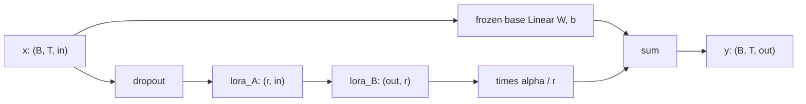

# 36 — Fine-Tuning with LoRA from Scratch

> **Prerequisites:** modules 10, 15 and 35.
> **You will learn:** supervised fine-tuning (SFT) data: templates, EOT, and masking the prompt out of the loss; full fine-tuning vs LoRA: trainable parameters, optimizer-state memory, quality and forgetting; LoRA from scratch as an `nn.Module` wrapper: initialization, scaling, merge/unmerge, adapter-only checkpoints; how to freeze precisely and verify what the optimizer actually updates; a classification-head variant (replace the LM head) and where QLoRA/DoRA fit.

The build so far: the committed module-33 GPT (val 2.963 nats per token at stride 128), measured against baselines in module 34 and sampled through a verified KV cache in module 35. It continues Victorian prose; it does not answer questions. Here we teach it a format (`Q: ...`, `A: ...`, stop) from 60 templated examples, twice: updating all 875,264 parameters, and through a 45,056-parameter low-rank adapter written from scratch in [`code/llm/lora.py`](./code/llm/lora.py). Data and evaluation live in [`code/llm/sft.py`](./code/llm/sft.py), the experiment in [`code/36_lora_finetune.py`](./code/36_lora_finetune.py).

The engineering is the point: a loss that ignores the prompt, surgery that leaves the base bit-identical, a 183 KiB adapter that reloads to identical logits, and a forgetting measurement less flattering to LoRA than the folklore.

---

## 36.1 From a text predictor to a question answerer

Supervised fine-tuning changes *behaviour*: which continuation the model prefers given a prompt shape. It is a poor way to add knowledge; a few hundred steps on a handful of facts mostly teach the model to emit those strings. InstructGPT ([Ouyang et al.](https://arxiv.org/abs/2203.02155)) used SFT on demonstrations as the first of three stages, in exactly this role.

`sft.FACTS` holds 30 deterministic facts: the 12 story numbers with their titles, and 18 characters described by role (Holmes's friend and chronicler → Dr. Watson, the Scotland Yard inspector → Lestrade, …). Each is rendered through three templates:

| Template | Story question | Character question | Use |
|---|---|---|---|
| A | `Q: Which story is number {n}?\nA:` | `Q: Who is {role}?\nA:` | train |
| B | `Q: What is the title of story {n}?\nA:` | `Q: Name {role}.\nA:` | train |
| C | `Q: Story {n} is called what?\nA:` | `Q: Tell me who {role} is.\nA:` | held out |

The answer is a space, the string, then `<|endoftext|>` (id 511), so the model also learns *when to stop*. Three rendered examples, counted with the module-30 tokenizer:

| Rendered example | Prompt tokens | Answer + EOT tokens | Positions |
|---|---|---|---|
| `Q: Which story is number IX?\nA:` ` The Adventure of the Engineer’s Thumb` | 19 | 24 | 42 |
| `Q: Name the Scotland Yard inspector.\nA:` ` Lestrade` | 23 | 6 | 28 |
| `Q: Story IV is called what?\nA:` ` The Boscombe Valley Mystery` | 17 | 19 | 35 |

Examples span 27–46 positions (cap 48); the 60 training examples carry 796 answer targets in 2,114 positions ("Scotland" alone is five tokens).

Honest scope: a 0.9M-parameter model memorising 30 facts tests the *mechanics* (masking, surgery, checkpoints, memory, forgetting), not instruction following, and a template paraphrase is weak evidence of generalisation.

## 36.2 Masking the prompt out of the loss

Teacher forcing ([transformers 08](../transformers/08-encoder-decoder-masking.md)) feeds `x = ids[:-1]` and scores `y = ids[1:]`. For SFT we keep that shift and then overwrite every target that is still part of the prompt with `-100`, the default `ignore_index` of `F.cross_entropy` ([docs](https://docs.pytorch.org/docs/2.8/generated/torch.nn.functional.cross_entropy.html)). With a prompt of `n_p` tokens, targets `0 … n_p − 2` are masked and position `n_p − 1` (the `:` after `A`) predicts the first answer token. For `Q: Who is the Scotland Yard inspector?\nA:` ` Lestrade`:

| pos | input token | target | counted? |
|---|---|---|---|
| 0–22 | `Q`, `:`, ` W`, `h`, `o`, ` is`, ` the`, ` S`, `c`, `ot`, … `?`, `\n`, `A` | prompt token | no (−100) |
| 23 | `:` | ` L` | yes |
| 24 | ` L` | `est` | yes |
| 25 | `est` | `r` | yes |
| 26 | `r` | `ad` | yes |
| 27 | `ad` | `e` | yes |
| 28 | `e` | EOT (511) | yes |

`sft.encode_example` builds `x = ids[:-1]`, `y = ids[1:]` and sets `y[:n_p - 1] = -100`; prompt and answer are encoded separately so no BPE merge straddles the boundary. `collate(batch, pad_id)` right-pads inputs with the EOT id and labels with −100; causal attention never lets a real position see the pads after it. (Generation left-pads instead, [module 35](./35-capstone-generation-kv-cache.md).)

With `reduction="mean"`, `cross_entropy` divides by the number of *non-ignored* targets: a token-weighted mean over answer tokens, as in module 34. Hugging Face's `DataCollatorForLanguageModeling` (`mlm=False`) sets labels to −100 *by value* wherever the input equals `pad_token_id` ([v4.57.1 source](https://github.com/huggingface/transformers/blob/v4.57.1/src/transformers/data/data_collator.py)); with the common `pad_token = eos_token` that masks every EOS, and the model never learns to stop ([HF notes](../../notes/libraries/huggingface.md)). We mask by *position*. Raschka's chapter 7 also keeps the first EOT as a target and leaves prompt masking as an exercise ([ch07](https://github.com/rasbt/LLMs-from-scratch/blob/cdbd33e6d57a71e20ea31434841095fac50cecd8/ch07/01_main-chapter-code/ch07.ipynb)).

Why mask? Without it, 62 % of our targets are question tokens the model will never be asked to produce, and the gradient spends capacity on them. `--no-prompt-mask` labels every next token; over five seeds of the default LoRA run, held-out exact match averaged 0.56 unmasked versus 0.69 masked, train-template exact match 0.87 versus 0.95 (one local PyTorch 2.8 CPU run per seed, Apple M2 Pro). With a seed-to-seed range of about 0.3 on 30 questions, that is suggestive, not conclusive. The two loss curves are not comparable: they average different targets.

## 36.3 Full fine-tuning baseline

The baseline updates every parameter, tied embedding included: AdamW (constant lr 1e-3, no decay, clip 1.0), 150 steps of 16 examples, about 40 passes over the data. AdamW keeps two fp32 moments per parameter ([module 15](./15-optimizers-and-schedules.md)); we sum the `optimizer.state` tensors after training:

| Item | Formula | Bytes |
|---|---|---|
| Weights (fp32) | 4 · 875,264 | 3,501,056 |
| Gradients (fp32) | 4 · 875,264 | 3,501,056 |
| AdamW `exp_avg` + `exp_avg_sq` | 2 · 4 · 875,264 | 7,002,112 |
| AdamW `step` scalars | 52 tensors · 4 | 208 |
| Measured `optimizer.state` | | 7,002,320 (6.68 MiB) |

Forgetting is the change in val NLL on story XI ([module 34](./34-capstone-evaluation.md)'s `evaluate_nll`, non-overlapping 128-token windows; base 2.963 nats per token). Results are in 36.6.

## 36.4 LoRA: the low-rank update

Fine-tuning a pretrained `nn.Linear` with weight $W \in \mathbb{R}^{out \times in}$ learns an update $\Delta W$. [Hu et al.](https://arxiv.org/abs/2106.09685) constrain it to rank $r$:

$$W' = W + \frac{\alpha}{r} B A, \qquad A \in \mathbb{R}^{r \times in},\; B \in \mathbb{R}^{out \times r},\; r \ll \min(in, out).$$

$W$ is frozen; only $A$ and $B$ train. $B$ starts at zero, so $\Delta W = 0$ and the adapted model *is* the base model at step 0, exactly. For one input $x$ with output gradient $g$, $\partial L/\partial A = \tfrac{\alpha}{r} B^\top g\, x^\top$ and $\partial L/\partial B = \tfrac{\alpha}{r}\, g\,(Ax)^\top$: each factor's gradient goes through the other. If both started at zero, neither could ever move. With random $A$ and $B = 0$, step 1 moves only $B$ and $A$ starts moving on step 2 (check 2).

Why should low rank suffice? [Aghajanyan et al.](https://arxiv.org/abs/2012.13255) tuned RoBERTa through a random 200-dimensional subspace and reached 90 % of full fine-tuning on MRPC: fine-tuning updates have low *intrinsic dimension*, and pretraining lowers it. LoRA bets on a structured version of that claim, low rank per matrix.

The scale $\alpha/r$ is meant to keep a tuned lr roughly valid when $r$ changes. Each adapted Linear adds $r(in + out)$ parameters:

| Target (per block) | Shape in → out | $r(in+out)$ | r = 2 | r = 4 | r = 8 | r = 16 |
|---|---|---|---|---|---|---|
| `attn.c_attn` | 128 → 384 | 512r | 1,024 | 2,048 | 4,096 | 8,192 |
| `attn.c_proj` | 128 → 128 | 256r | 512 | 1,024 | 2,048 | 4,096 |
| `mlp.c_proj` | 512 → 128 | 640r | 1,280 | 2,560 | 5,120 | 10,240 |
| × 4 blocks | | 5,632r | 11,264 | 22,528 | **45,056** | 90,112 |
| % of 875,264 | | | 1.29 % | 2.57 % | 5.15 % | 10.30 % |

`apply_lora(model, ("c_attn", "c_proj"))` matches the *last* name component, so both `c_proj`s (attention output, MLP down-projection) are caught and `c_fc`, `lm_head` and the embeddings are not. The test checks 12 replaced modules and `count_trainable(model) == 45,056`.



The extra compute is $B\cdot T\cdot r(in+out)$ multiply-adds, about 8 % of `c_attn`'s base matmul at $r = 8$ (4,096 versus 49,152 per token). Backward still propagates input gradients through every frozen layer (block 0's adapters need them); LoRA skips the frozen weight-gradient matmuls and shrinks optimizer state, but saves no activation memory ([module 22](./22-memory-accounting-and-checkpointing.md)).

## 36.5 Implementing `LoRALinear`

`LoRALinear(base, r=8, alpha=16, dropout=0.0)` in [`llm/lora.py`](./code/llm/lora.py) wraps an existing `nn.Linear` rather than copying it; check 1 below contains a 25-line version. Five details carry the design. **Layout:** $A$ is `(r, in)` and $B$ `(out, r)`, the `nn.Linear.weight` convention, so `F.linear` applies them and `B @ A` has `base.weight`'s shape. **Order:** the forward never forms `B @ A`; `x → A → B` costs $r(in+out)$ per token, not $in \cdot out$. **Exactness:** with $B = 0$ the adapter adds an exact zero (check 1 and the lab assert `atol=0`). **Merge:** `merge()` adds `delta_weight()` into `base.weight` under `torch.no_grad()` and sets `merged`, after which `forward` skips the adapter; `unmerge()` subtracts it; both are idempotent. **Keys:** the base becomes a child named `base`, so `blocks.0.attn.c_attn.weight` becomes `blocks.0.attn.c_attn.base.weight` and a wrapped checkpoint no longer loads into a plain GPT; `unwrap_lora(model)` merges and restores the plain Linear and the original keys.

Surgery follows [module 10](./10-nn-module-internals.md): collect names first, then `setattr` on the parent, never mutate while iterating `named_modules()`.

```python
def apply_lora(model, target_names=("c_attn", "c_proj"), r=8, alpha=16, dropout=0.0):
    targets = set(target_names)
    names = [n for n, m in model.named_modules()
             if isinstance(m, nn.Linear) and n.rpartition(".")[2] in targets]
    for name in names:
        parent_name, _, child = name.rpartition(".")
        parent = model.get_submodule(parent_name) if parent_name else model
        setattr(parent, child, LoRALinear(getattr(parent, child), r=r, alpha=alpha, dropout=dropout))
    return names

def mark_only_lora_trainable(model):
    for name, p in model.named_parameters():
        p.requires_grad_(name.rpartition(".")[2] in ("lora_A", "lora_B"))
```

Freezing precisely means checking. `mark_only_lora_trainable` also freezes LayerNorms, biases and the tied `wte`/`lm_head`. Build the optimizer from `[p for p in model.parameters() if p.requires_grad]`: an optimizer handed frozen parameters skips them only while their `.grad` stays `None`, and any code that sets one silently updates the "frozen" base. The lab asserts that every base tensor is bit-identical after training; nothing weaker proves it.

The alternative is a parametrization, which recomputes `weight` from the original tensor on every read ([`register_parametrization`](https://docs.pytorch.org/docs/2.8/generated/torch.nn.utils.parametrize.register_parametrization.html)):

```python
import torch.nn.utils.parametrize as P

class LoRAParam(nn.Module):                 # holds lora_A, lora_B, scale as in LoRALinear
    def forward(self, W):
        return W + self.lora_B @ self.lora_A * self.scale

P.register_parametrization(lin, "weight", LoRAParam(...))
# keys: bias, parametrizations.weight.original, parametrizations.weight.0.lora_A, ...lora_B
P.remove_parametrizations(lin, "weight", leave_parametrized=True)   # merge + unwrap -> bias, weight
```

No surgery, and a built-in merge, but every forward materialises the full `(out, in)` matrix `W + BA`. We use the wrapper, as PEFT and Raschka do.

## 36.6 Training with LoRA and comparing

Same data, 150 steps, batch order (private `torch.Generator`, seed 1337) and constant-lr AdamW without decay; only the trainable set and lr differ (LoRA usually wants a higher lr). One local PyTorch 2.8 CPU run (Apple M2 Pro, 4 threads, seed 1337) produced:

| Method | Trainable params | Optimizer state | Template-C EM | Train-template EM | Val NLL (Δ vs 2.963) | Train wall time |
|---|---|---|---|---|---|---|
| Base model | 0 | 0 | 0.000 | 0.000 | 2.963 | — |
| LoRA r = 8, α = 16, lr 3e-3 | 45,056 | 360,544 B (352 KiB) | 0.467 (14/30) | 0.967 (58/60) | 4.598 (+1.634) | 2.24 s |
| Full, lr 1e-3 | 875,264 | 7,002,320 B (6.68 MiB) | 0.433 (13/30) | 0.967 (58/60) | 6.228 (+3.265) | 2.92 s |

Optimizer state shrinks 19.4×, the trainable-parameter ratio. Wall time barely moves (both pay the full forward and input-gradient backward; timings on this shared laptop varied ±30 % between runs). At these default lrs LoRA learns the task as well and forgets half as much, the expected pattern.

But the forgetting is enormous in both, and the pattern does not survive an lr sweep. With the same seed and 150 steps:

| Run | Template-C EM | Train EM | Val NLL Δ |
|---|---|---|---|
| LoRA lr 3e-4 | 0.067 | 0.067 | +0.363 |
| LoRA lr 1e-3 | 0.400 | 0.817 | +1.092 |
| LoRA lr 2e-3 | 0.600 | 0.900 | +1.528 |
| LoRA r = 16, α = 32, lr 1e-3 | 0.700 | 0.900 | +1.240 |
| Full lr 5e-5 | 0.333 | 0.733 | +0.415 |
| Full lr 1e-4 | 0.533 | 1.000 | +0.648 |
| Full lr 3e-4 | 0.600 | 1.000 | +1.185 |

Full fine-tuning at lr 1e-4 reaches perfect train EM with *less* forgetting (+0.648) than any LoRA run that learns the task. Forgetting tracks how far the weights move, and LoRA at lr 3e-3 moves them far: in one layer the largest entry of $\Delta W$ ends at 1.25× the largest entry of $W$. Low rank constrains the update's *direction*, not its size. [Biderman et al.](https://arxiv.org/abs/2405.09673) find LoRA learns less and forgets less at billion-parameter scale; here, lr dominates. Greedy text after `Sherlock Holmes` shows the damage: base `.\n\n“It is a few more thank to the matter.`, LoRA `in the terer too the Beyl<|endoftext|>IIIIs IIs Ad`. The usual cures (lower lr, fewer steps, replaying pretraining text as InstructGPT's PPO-ptx does) were not tried.

Variance matters too. Over seeds 1337, 1, 2, 3, 4 (batch order and $A$'s init), LoRA's template-C EM was 0.467, 0.700, 0.800, 0.733, 0.767 and full fine-tuning's 0.433, 0.533, 0.733, 0.467, 0.533; val NLL ranged 4.38–4.66 for LoRA and 5.93–6.29 for full. At seed 1337, 8 of 12 story and 8 of 18 character questions fail, mostly with a memorised answer of the wrong *type* (`Tell me who the Scotland Yard inspector is.` → ` The Five Orange Pips`): the model keyed on template surface, not on the slot.

## 36.7 Merging, saving and serving adapters

Merged, an adapted Linear is an ordinary Linear (inference costs what the base costs; `unwrap_lora` hands module 38 a plain model). Unmerged, one base can serve a different adapter per request.

Merging is exact algebra, not exact arithmetic. In float64 merged and unmerged logits agreed to 3.6e-14; in float32, after training, they differed by up to 4.1e-5 on logits as large as 24.7, because $(W + \Delta W)x$ rounds differently from $Wx + \Delta W x$. A bare `atol=1e-5` ("merged equals unmerged within 1e-5") would fail by a factor of four, through no bug. The contract is therefore `rtol=1e-5, atol=1e-5`: `assert_close` then allows $10^{-5} + 10^{-5}\cdot|	ext{logit}|$, about 2.6e-4 at a logit of 24.7, which scales with the magnitude that sets the rounding error. The float64 check keeps the bar tight where rounding is negligible. Unmerging is not bit-exact either (logits moved by 3.2e-5), so keep the original weights if you need them bit for bit.

The adapter checkpoint is just the filtered state dict:

```python
torch.save(lora_state_dict(model), out_dir / "adapter.pt")       # 24 tensors, 45,056 floats

fresh, _, _ = load_pretrained()
apply_lora(fresh, ("c_attn", "c_proj"), r=8, alpha=16)           # same structure first
result = load_lora_state_dict(fresh, torch.load(path, weights_only=True))
```

| Checkpoint | Contents | Bytes |
|---|---|---|
| Full model `state_dict` (module 32) | 875,264 fp32 | 3,518,663 |
| Adapter only | 45,056 fp32 (176 KiB raw) | 187,675 (183 KiB) |

`load_lora_state_dict` calls `load_state_dict(sd, strict=False)`, then raises on any *unexpected* key or *missing* `lora_A`/`lora_B` key; the expected result is 53 missing (every base tensor) and 0 unexpected. A bare `strict=False` would load a file with half its tensors. The reload reproduced the trained logits exactly (max difference 0.0). The tensors do not record `alpha` or targets; PEFT keeps them in `adapter_config.json`.

## 36.8 Variants and the real-world stack

**Classification head.** Raschka's chapter 6 ([ch06](https://github.com/rasbt/LLMs-from-scratch/blob/cdbd33e6d57a71e20ea31434841095fac50cecd8/ch06/01_main-chapter-code/ch06.ipynb)) replaces GPT-2's `(d_model → V)` head with `Linear(d_model, n_classes)` and trains on the last position; [appendix E](https://github.com/rasbt/LLMs-from-scratch/blob/cdbd33e6d57a71e20ea31434841095fac50cecd8/appendix-E/01_main-chapter-code/appendix-E.ipynb) adds LoRA. In a causal trunk only the last *real* token has seen the whole input, so we `gather` it by per-row length (check 4) and train the new head plus the adapters. A random new head means the model no longer starts at the base function.

**QLoRA** ([Dettmers et al.](https://arxiv.org/abs/2305.14314)) stores the frozen base in 4-bit NormalFloat (NF4) with double-quantised scales, dequantises on the fly ([module 29](./29-quantization-and-compression.md)), computes and trains the adapters in bf16, and uses paged optimizers to survive memory spikes; it also found that adapting every linear layer was needed to match 16-bit full fine-tuning. **DoRA** ([Liu et al.](https://arxiv.org/abs/2402.09353)) splits each weight into magnitude and direction, applies LoRA to the direction and trains the magnitude. **rsLoRA** ([Kalajdzievski](https://arxiv.org/abs/2312.03732)) scales by $\alpha/\sqrt{r}$ so large ranks are not starved. **LoRA on embeddings** inits the other way round in PEFT (A zeros, B normal). Production code uses PEFT ([HF notes](../../notes/libraries/huggingface.md)); `LoraConfig` defaults at v0.17.1 are `r=8`, `lora_alpha=8`, `lora_dropout=0.0`. Sweep lr first. Preference tuning (DPO, RLHF) follows SFT and is out of scope: see [LLM prompting and alignment](../../notes/nlp/llm-prompting-and-alignment.md) and [transfer learning and fine-tuning](../../notes/deep-learning/transfer-learning-and-finetuning.md).

## Reconciling the sources

**Which matrices.** The LoRA paper adapts only $W_q$ and $W_v$ in its main GPT-3 experiments; Raschka's appendix E replaces every `Linear` (rank 16, α 16); PEFT looks the default `target_modules` up per architecture. Our fused `c_attn` cannot express "q and v only" without splitting, so we adapt `c_attn` and both `c_proj`. **Scaling.** PEFT uses `lora_alpha / r`, or `lora_alpha / sqrt(r)` with `use_rslora=True` ([layer.py at v0.17.1](https://github.com/huggingface/peft/blob/v0.17.1/src/peft/tuners/lora/layer.py)); Raschka multiplies by `alpha / rank`; we use $\alpha/r$. **Initialisation.** The paper draws $A$ from a Gaussian; PEFT's default and Raschka use `kaiming_uniform_(a=sqrt(5))`, `nn.Linear`'s own init. All set $B = 0$, which is what makes $\Delta W = 0$ at init. **Layout.** Raschka stores $A$ as `(in, r)` and computes `x @ A @ B`; our `nn.Linear` layout makes `B @ A` directly mergeable.

## Worked LoRA verification

### Check 1: zero update at init, merge and unmerge

A minimal `LoRALinear` on `nn.Linear(16, 8)`. Proves: bit-identical output at init; merged equals unmerged within 1e-6 once $B \ne 0$; `unmerge` restores $W$ within 1e-6. The GPT-scale tolerance is the lab test's job.

```python pytorch-check
import math
import torch
import torch.nn as nn
import torch.nn.functional as F


class LoRALinear(nn.Module):
    def __init__(self, base, r=4, alpha=8):
        super().__init__()
        self.base, self.scale, self.merged = base, alpha / r, False
        base.requires_grad_(False)
        self.lora_A = nn.Parameter(torch.empty(r, base.in_features))
        self.lora_B = nn.Parameter(torch.zeros(base.out_features, r))
        nn.init.kaiming_uniform_(self.lora_A, a=math.sqrt(5))

    def delta_weight(self):
        return self.lora_B @ self.lora_A * self.scale          # (out, in)

    def forward(self, x):
        y = self.base(x)
        if self.merged:
            return y
        return y + F.linear(F.linear(x, self.lora_A), self.lora_B) * self.scale

    @torch.no_grad()
    def merge(self):
        self.base.weight += self.delta_weight(); self.merged = True

    @torch.no_grad()
    def unmerge(self):
        self.base.weight -= self.delta_weight(); self.merged = False


torch.manual_seed(0)
base = nn.Linear(16, 8)
w0 = base.weight.detach().clone()
layer = LoRALinear(base, r=4, alpha=8)
x = torch.randn(5, 16)
with torch.no_grad():
    assert torch.equal(layer(x), base(x))                    # B = 0: bit-identical
    nn.init.normal_(layer.lora_B, std=0.1)                   # pretend we trained
    unmerged = layer(x)
    assert not torch.allclose(unmerged, base(x))
    layer.merge()
    torch.testing.assert_close(layer(x), unmerged, rtol=0, atol=1e-6)
    layer.unmerge()
torch.testing.assert_close(base.weight, w0, rtol=0, atol=1e-6)
print(f"exact at init, merge ok, unmerge max |W - W0| = {(base.weight - w0).abs().max().item():.1e}")
```

### Check 2: only the adapters train, and B moves first

Two adapted MLP layers, two AdamW steps. Proves: base weights bit-identical with no `.grad`; $r(in+out)$ trainable per layer; $A$'s gradient exactly zero on step 1. Not that anything useful is learned.

```python pytorch-check
import math
import torch
import torch.nn as nn
import torch.nn.functional as F


class LoRALinear(nn.Module):
    def __init__(self, base, r, alpha):
        super().__init__()
        self.base, self.scale = base, alpha / r
        self.lora_A = nn.Parameter(torch.empty(r, base.in_features))
        self.lora_B = nn.Parameter(torch.zeros(base.out_features, r))
        nn.init.kaiming_uniform_(self.lora_A, a=math.sqrt(5))

    def forward(self, x):
        return self.base(x) + F.linear(F.linear(x, self.lora_A), self.lora_B) * self.scale


torch.manual_seed(0)
r = 2
model = nn.Sequential(nn.Linear(12, 32), nn.GELU(), nn.Linear(32, 3))
for i in (0, 2):
    setattr(model, str(i), LoRALinear(model[i], r=r, alpha=4))   # surgery on the parent
for name, p in model.named_parameters():
    p.requires_grad_(name.endswith(("lora_A", "lora_B")))
params = [p for p in model.parameters() if p.requires_grad]
assert sum(p.numel() for p in params) == r * (12 + 32) + r * (32 + 3)
frozen = {n: p.detach().clone() for n, p in model.named_parameters() if not p.requires_grad}
A0, B0 = model[0].lora_A.detach().clone(), model[0].lora_B.detach().clone()
opt = torch.optim.AdamW(params, lr=1e-2, weight_decay=0.0)
x, y = torch.randn(64, 12), torch.randint(0, 3, (64,))

F.cross_entropy(model(x), y).backward()
assert torch.count_nonzero(model[0].lora_A.grad) == 0       # dL/dA goes through B = 0
opt.step(); opt.zero_grad()
assert torch.equal(model[0].lora_A, A0) and not torch.equal(model[0].lora_B, B0)
F.cross_entropy(model(x), y).backward()
opt.step()
assert not torch.equal(model[0].lora_A, A0)                 # step 2: A moves
for n, p in model.named_parameters():
    if n in frozen:
        assert torch.equal(p, frozen[n]) and p.grad is None
print(f"{sum(p.numel() for p in params)} trainable; base bit-identical; A still on step 1")
```

### Check 3: the prompt is masked out of the loss

Proves: `cross_entropy(ignore_index=-100)` equals the manual mean over answer targets and ignores every prompt-position logit. Not that masking improves quality (36.2 has the weak evidence).

```python pytorch-check
import torch
import torch.nn.functional as F

torch.manual_seed(0)
V, n_prompt, n_answer = 50, 7, 4                            # answer includes the EOT target
ids = torch.randint(0, V, (n_prompt + n_answer,))
x, y = ids[:-1], ids[1:].clone()
y[: n_prompt - 1] = -100                                    # targets still inside the prompt
logits = torch.randn(x.numel(), V)

loss = F.cross_entropy(logits, y, ignore_index=-100)
logp = logits.log_softmax(-1)
manual = -torch.stack([logp[t, y[t]] for t in range(n_prompt - 1, x.numel())]).mean()
torch.testing.assert_close(loss, manual, rtol=1e-6, atol=1e-6)
assert int((y != -100).sum()) == n_answer
bumped = logits.clone()
bumped[: n_prompt - 1] += 10 * torch.randn(n_prompt - 1, V)
assert F.cross_entropy(bumped, y, ignore_index=-100).item() == loss.item()
print(f"masked loss {loss.item():.4f} over {n_answer} targets; unmasked {F.cross_entropy(logits, ids[1:]).item():.4f} over 10")
```

### Check 4: a classification head reads the last real token

A tiny random causal trunk with a `Linear(d, n_classes)` head on the last real token. Proves: shape `(B, n_classes)`, invariant to overwriting positions past each sequence's end, unlike the naive `[:, -1]`. Trains nothing.

```python pytorch-check
import torch
import torch.nn as nn
import torch.nn.functional as F

torch.manual_seed(0)
V, d, n_classes, PAD = 30, 16, 2, 0
emb, qkv, head = nn.Embedding(V, d), nn.Linear(d, 3 * d), nn.Linear(d, n_classes)


def trunk(idx):                                             # (B, T) -> (B, T, d), causal
    h = emb(idx)
    q, k, v = qkv(h).chunk(3, dim=-1)
    return h + F.scaled_dot_product_attention(q, k, v, is_causal=True)


def classify(idx, lengths):
    last = (lengths - 1).view(-1, 1, 1).expand(-1, 1, d)    # (B, 1, d)
    return head(trunk(idx).gather(1, last).squeeze(1))      # (B, n_classes)


lengths = torch.tensor([5, 3, 6])
idx = torch.full((3, 6), PAD)
noisy = torch.randint(1, V, (3, 6))
for i, n in enumerate(lengths.tolist()):
    idx[i, :n] = noisy[i, :n]                               # same tokens, right-padded
with torch.no_grad():
    out = classify(idx, lengths)
    assert out.shape == (3, n_classes)
    torch.testing.assert_close(classify(noisy, lengths), out, rtol=0, atol=0)
    assert not torch.allclose(head(trunk(idx)[:2, -1]), head(trunk(noisy)[:2, -1]))
print("last-real-token logits", tuple(out.shape), "ignore padding; [:, -1] does not")
```

## Lab: fine-tune the pretrained GPT two ways

**Tested with Python 3.11 and PyTorch 2.8.0 on CPU.**

[`code/36_lora_finetune.py`](./code/36_lora_finetune.py) loads the committed checkpoint with `load_pretrained()`, measures base exact match (greedy via module 35's `generate`, one left-padded batch, stop at EOT) and val NLL (module 34's `evaluate_nll`), fine-tunes with LoRA and/or fully, re-measures, saves `adapter.pt`, reloads it into a fresh base and compares merged with unmerged logits. Flags: `--method lora|full|both`, `--steps`, `--rank`, `--alpha`, `--lr`, `--seed`, `--output-dir`, `--json-out`, plus `--full-steps`, `--full-lr` and `--no-prompt-mask`; the JSON holds `base`, `lora` and `full` blocks. Scope: 30 facts, one seed per run, a paraphrase as the only generalisation test.

```bash
python content/courses/pytorch/code/36_lora_finetune.py --method both
python site/test_pytorch_36_lora.py
```

The test runs LoRA for 150 steps and full fine-tuning for 60 (seed 1337) and asserts: exactly 12 replaced modules and 45,056 trainable parameters with the head still tied; output equal to the base with `atol=0` before training; bit-identical base tensors after; template-C EM ≥ base + 0.3 and train-template EM ≥ 0.8; LoRA's val-NLL increase ≤ full fine-tuning's + 0.02 (true at these default lrs, not in general, see 36.6); merged versus unmerged logits within `rtol=1e-5, atol=1e-5`, exact to 1e-10 in float64; adapter reload within 1e-6 with 53 missing and 0 unexpected keys; adapter file under 300 KiB; mismatched adapters raise; no prompt token carries a label. Locally it took 5.6 s wall, about 0.8 s of it `import torch`.

## Key takeaways

- SFT teaches format and stopping: mask the prompt with −100, keep EOT as a target.
- LoRA adds $\frac{\alpha}{r}BA$ to a frozen $W$; $B = 0$ makes step 0 exactly the base model, and $A$ only starts moving on step 2.
- r = 8 on `c_attn` and both `c_proj`: 45,056 trainable parameters (5.15 %), AdamW state 352 KiB instead of 6.68 MiB, adapter file 183 KiB.
- Wrapping renames keys to `*.base.weight`; load adapters with `strict=False`, then check missing and unexpected keys yourself.
- Merge is exact algebra, not exact fp32 arithmetic: compare with `rtol`.
- Forgetting follows how far the weights move: at default lrs LoRA forgot half as much as full fine-tuning, but full fine-tuning at a 10× smaller lr forgot less than any LoRA run that learned the task.

## Self-check

1. Why must B (not A) be zero at initialization, and what would go wrong if both were zero?
2. For a 7B model with d_model 4,096, how many trainable parameters does r=16 LoRA on W_q and W_v across 32 layers add, and how much optimizer state does it save vs full AdamW fine-tuning in fp32 states?
3. You forgot to mask the prompt tokens. How does the loss curve change and what happens to exact-match on held-out questions?

---

**Next → [37 — Scaling the Recipe: compile, DDP, FSDP, and Profiling](./37-capstone-scaling-the-recipe.md)**
