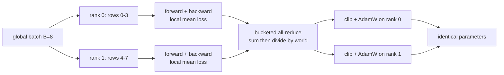

# 37 — Scaling the Recipe: compile, DDP, FSDP, and Profiling

> **Prerequisites:** modules 21–27 and 36.
> **You will learn:** how to profile one capstone training step and reconcile measured FLOPs with 6·P·tokens; how to apply `torch.compile`, activation checkpointing, DDP and FSDP2 to the capstone model without editing it, and how to prove each preserves the math; what changes in memory and communication as you move from one CPU process to sharded multi-GPU training; the full memory/FLOP/MFU budget for reproducing GPT-2 124M, computed rather than run.

The capstone GPT trains in under a minute on a laptop; GPT-2 124M on 10B tokens needs about 8.5·10¹⁸ FLOPs. Between the two sit the tools of modules 21–27. This module applies each one to the real capstone model *from the outside*: every wrapper lives in [`code/llm/scale.py`](./code/llm/scale.py), and `model.py` and `train.py` are untouched.

The rule: **a scaling transformation is correct only if you can show it computes the same thing.** Every section pairs a transformation with a check against the plain single-process step. Speed is never claimed: on a CPU with gloo standing in for NCCL, the honest results are correctness and byte counts.

---

## 37.1 Where the time goes in one step

Profile before changing anything ([module 21](./21-profiling-and-benchmarking.md)). `scale.profile_step` runs the [module 33](./33-capstone-pretraining.md) recipe step (forward, backward, clip, foreach AdamW) with each phase under a `record_function` label, and a `schedule(wait=0, warmup=2, active=3)` that discards two warm-up steps ([profiler docs](https://docs.pytorch.org/docs/2.8/profiler.html)). One local PyTorch 2.8 CPU run (Apple M2 Pro, 4 threads, the committed checkpoint, B = 32, T = 128) printed this, trimmed to eight rows:

```text
Name                                          Self CPU %   Self CPU   # of Calls
aten::mm                                         20.46%    36.593ms        105
aten::_scaled_dot_product_flash_attention_for_cpu_ba...  14.14%   25.296ms   12
aten::gelu_backward                              11.81%    21.131ms         12
aten::addmm                                       8.84%    15.821ms         48
aten::_scaled_dot_product_flash_attention_for_cpu 8.84%    15.808ms         12
aten::gelu                                        8.82%    15.780ms         12
aten::sum                                         2.36%     4.225ms         51
aten::copy_                                       2.11%     3.767ms        576
Self CPU time total: 178.872ms   (3 profiled steps)
```

Read the call counts first. 48 `addmm` over 3 steps is 16 per step: four biased `Linear`s × four blocks, forward. 105 `mm` is 35 per step: the bias-free tied head's forward plus two backward matmuls for each of the 17 linears. Counts that match the architecture prove the profile measured what you think.

Then the surprises. Exact-erf GELU and its backward take 21 % of self time against 29 % for all `mm` + `addmm`; the CPU flash-attention kernels take 23 %. Phases came to 20.8 ms forward, 34.0 ms backward, 4.7 ms optimizer; the unprofiled median step was 60.4 ms. At this size a step is not "all matmul"; elementwise chains like GELU and its backward are what a fusing compiler targets ([module 24](./24-compiler-internals-fx-inductor.md)).

## 37.2 FLOPs: measured vs the 6·P rule

Count FLOPs with `FlopCounterMode` and predict them independently. Per token, a weight matrix with $P_w$ entries costs $2P_w$ FLOPs forward and twice that backward (input gradient and weight gradient), so the dense part is $6\,P_{\text{matmul}}$ per token. Attention adds two activation-activation matmuls per layer, $QK^\top$ and $AV$, each $2\,T\,d_{\text{model}}$ FLOPs per token forward, so $12\,L\,T\,d_{\text{model}}$ per token for forward plus backward.

| Component | Formula (per step, tokens = B·T = 4,096) | Value | Measured |
|---|---|---|---|
| $P_{\text{matmul}}$ | $L(3d^2 + d^2 + 4d^2 + 4d^2) + V d$ | 851,968 | — |
| Dense (incl. tied head) | $6 \cdot P_{\text{matmul}} \cdot$ tokens | 20,937,965,568 | — |
| of which head | $6 \cdot V d \cdot$ tokens | 1,610,612,736 | — |
| Attention | $12 \cdot L \cdot T \cdot d \cdot$ tokens | 3,221,225,472 | — |
| Total | dense + attention | 24,159,191,040 | 24,159,191,040 (`attn_impl="manual"`) |
| Total, SDPA path | — | — | 20,937,965,568 |

The ratio is exactly 1.0, for two reasons. First, $P_{\text{matmul}} = 851{,}968$, not $P = 875{,}264$: the 23,296 difference is `wpe` plus every bias and LayerNorm vector, which are lookups and elementwise ops. `wte` is free as an *input* (a gather), but as the tied *head* it is a $(d \times V)$ matmul, $2dV$ FLOPs per token forward, 6.7 % of this step. Second, the count uses `attn_impl="manual"`. In 2.8 [`flop_counter.py`](https://github.com/pytorch/pytorch/blob/v2.8.0/torch/utils/flop_counter.py) has no formula for `_scaled_dot_product_flash_attention_for_cpu`, so the SDPA count equals the dense part *exactly*: 13 % of the FLOPs vanish without a warning.

The formula counts the full $T \times T$ score matrix; a causal kernel that skips the masked half does about half that work.

**Achieved throughput, as an illustration.** The lab's run did 24.16 GFLOP in a 66.1 ms step, 366 GFLOP/s, while a 1024×1024 fp32 matmul in the same process ran at 2,751 GFLOP/s: about 13 % of a *measured* ceiling, unverified as a hardware peak and noisy by ±30 % between local runs. PaLM's MFU ([Chowdhery et al.](https://arxiv.org/abs/2204.02311), appendix B) divides model FLOPs (no recompute) by published peak FLOP/s, which a laptop CPU does not have ([roofline and arithmetic intensity](/courses/inference/00-foundations/00-04-roofline-and-arithmetic-intensity.html)).

## 37.3 Compiling the training step

`scale.compile_parity` resets Dynamo, runs `torch._dynamo.explain` on the training forward, then compares `torch.compile(model, backend="aot_eager")` with eager on loss and every gradient. `aot_eager` runs Dynamo capture and AOTAutograd's joint graph but executes ATen ops eagerly: everything except code generation, so it is CI-safe ([torch.compiler docs](https://docs.pytorch.org/docs/2.8/torch.compiler.html), [module 23](./23-torch-compile-in-practice.md)). On the committed model: **1 graph, 0 graph breaks, loss and gradient difference 0.0**. The uncached forward has no data-dependent Python branching, as module 32 promised.

`backend="inductor"` generates fused kernels but needs a C++ toolchain on CPU (Triton on GPU); it failed on the reference Mac with missing headers, so it is not executed here. Assert parity, never speed.

The cached generation path is different. `KVCache.length` is a Python `int` read inside `forward`, and Dynamo specialises on it. With `TORCH_LOGS=recompiles` the second decode step prints:

```text
Recompiling function forward in .../code/llm/model.py:214
    triggered by the following guard failure(s):
    - 0/0: cache.length == 0
```

`scale.cached_recompiles` counts compiles over five single-token decode steps with a counting backend. By default it saw **2**: the first specialised `length = 0`, and the guard failure made automatic dynamic shapes recompile once with `length` as a `SymInt`. With `automatic_dynamic_shapes = False` it saw **5**, one per length, which a cache growing to `block_size` would push past the recompile limit of 8. Production decoders make position a tensor: a static cache plus `mark_dynamic`, or a CUDA-graph-friendly design with fixed shapes ([inference course: torch.compile](/courses/inference/08-compilation-and-runtime/08-02-torch-compile.html)). Likewise a compiled `opt.step()` recompiles per float LR under `dynamic=False` but compiles once with a tensor LR (module 23).

## 37.4 Activation checkpointing without touching the model

`enable_activation_checkpointing(model)` replaces each `model.blocks[i]` with `CheckpointedBlock(block)`, whose training forward is `checkpoint(self.block, x, mask=..., attn_impl=..., use_reentrant=False)`; no-grad and cached calls run the block directly. Two properties make it a drop-in:

- **Keys do not move.** Wrapping would rename `blocks.0.ln_1.weight` to `blocks.0.block.ln_1.weight`. A `register_state_dict_post_hook` strips the prefix and a `register_load_state_dict_pre_hook` restores it, so the committed `gpt_sherlock.pt` loads strictly into a wrapped model with identical logits (tested).
- **Non-reentrant is the default to use.** The [checkpoint docs](https://docs.pytorch.org/docs/2.8/checkpoint.html) recommend `use_reentrant=False`. It supports keyword arguments, works when no input requires grad, records the graph so `torch.autograd.grad` works, and stops recomputing early (below).

`saved_activation_bytes` records each saved tensor's untyped storage once, by pointer, in a `saved_tensors_hooks` pack hook, skipping parameters ([module 22](./22-memory-accounting-and-checkpointing.md)). Non-reentrant checkpoint saves block inputs through an internal `autograd.Function` *outside* its own hook, so the outer hook sees exactly what survives the forward. Full capstone model, B = 32, T = 128, fp32, one local run:

| | Saved bytes | Counted FLOPs per step | Max grad diff |
|---|---|---|---|
| Plain | 147,424,260 (140.6 MiB) | 24,159,191,040 | — |
| Checkpointed per block | 21,070,852 (20.1 MiB) | 29,527,900,160 (×1.222) | 0.0 |
| Checkpointed, early stop off | same | 31,675,383,808 (×1.311) | — |

Per block, plain training saves 33,685,504 bytes: 16.06 fp32 values per token per `d_model`. Korthikanti et al. ([arXiv:2205.05198](https://arxiv.org/abs/2205.05198)) derive $sbh(34 + 5as/h)$ bytes per layer for 16-bit activations; drop their two 1-byte dropout masks (dropout is 0) and the $5as/h$ score term (flash attention keeps only a log-sum-exp) and $32\,sbh$ bytes is 16 values per token per $h$. The measurement matches to the LayerNorm statistics. Checkpointed, a block keeps 2,097,152 bytes, its input $B \cdot T \cdot d \cdot 4$; the rest is the head (`ln_f` and the $(B \cdot T, V)$ log-softmax output, about 12 MiB). Hence 0.14 here but 0.29 on `--small`, where $V = 512$ dwarfs $d = 64$.

The FLOP column is the price. Rerunning each block's forward costs +⅓ of the block FLOPs: ×1.311 with `set_checkpoint_early_stop(False)`. By default non-reentrant recompute *stops* once the last tensor backward needs exists; the MLP `c_proj` output is never saved, so that matmul is skipped: 2,147,483,648 FLOPs, exactly the gap to ×1.222. Chen et al. ([arXiv:1604.06174](https://arxiv.org/abs/1604.06174)) frame this as trading $O(\sqrt{n})$ memory for one extra forward. Selective checkpointing keeps the cheap-to-store, expensive-to-recompute tensors (matmul outputs) and recomputes the cheap ones (GELU, softmax).

## 37.5 Data parallel on two CPU processes

DDP replicates the model and splits the batch. `scale.ddp_worker` runs under `torch.multiprocessing.spawn(nprocs=2)` with gloo and a `file://` rendezvous in a temporary directory. Rank $r$ takes rows $[rB/2, (r+1)B/2)$ of one fixed global batch, which is what `DistributedSampler` does for a dataset ([module 26](./26-distributed-collectives-and-ddp.md)).



The math is one line: each rank's loss is a mean over its $B/2 \cdot T$ tokens, the full-batch mean is the average of the shard means, so the averaged gradient equals the full-batch gradient **when shards are equal-sized**. DDP's reducer packs gradients into ~25 MiB buckets in reverse registration order and all-reduces each bucket as it fills, which on NCCL overlaps with the rest of backward ([DDP notes](https://docs.pytorch.org/docs/2.8/notes/ddp.html), [Li et al.](https://arxiv.org/abs/2006.15704)). Gloo on CPU shows the semantics, not the overlap.

One local run (fresh seeded model, full config, global B = 32): gradients within **3.9e-8** of the single-process full-batch step; parameters after clip + AdamW bit-identical across ranks (`torch.equal` on an all-gathered flat vector) and within **2.7e-6** of the reference. Accumulating two micro-batches per rank, the first under `ddp.no_sync()` (no all-reduce), matched the reference gradient to **5.4e-8**; build-nanogpt does the same by toggling `model.require_backward_grad_sync`.

Why compare gradients, not just parameters? The reference is recipe step 0 (lr 7.5·10⁻⁵), and AdamW's first update is $\text{lr} \cdot g/(|g| + \epsilon)$, nearly the sign of $g$. The 2.7e-6 comes from elements with $|g| \approx 10^{-8} \approx \epsilon$, where reduction-order noise moves the update; elsewhere gradient *size* barely matters, so a gradient twice too large leaves the parameters almost unchanged. 37.6 hits exactly that bug.

## 37.6 Sharding with FSDP2

DDP replicates parameters, gradients and AdamW state; FSDP2 shards all three ([ZeRO-3](https://arxiv.org/abs/1910.02054), [Zhao et al.](https://arxiv.org/abs/2304.11277)). `scale.shard_gpt` applies `fully_shard` to each block, then the root, so each block is one all-gather/reduce-scatter unit and the root owns the rest ([fully_shard docs](https://docs.pytorch.org/docs/2.8/distributed.fsdp.fully_shard.html), [module 27](./27-fsdp2-dtensor-parallelism.md)). Every parameter becomes a `DTensor` with placement `(Shard(dim=0),)` ([DTensor docs](https://docs.pytorch.org/docs/2.8/distributed.tensor.html)); the optimizer is built *after* sharding, so its moments are sharded too.

| Full capstone config, 2 ranks | Bytes |
|---|---|
| Parameters, unsharded model | 3,501,056 |
| Parameters held by rank 0 / rank 1 | 1,750,528 / 1,750,528 |
| Unique parameters (`named_parameters`) | 52 |

**Tied weights.** `model.lm_head.weight is model.wte.weight` still holds after sharding: one DTensor, counted once in the 52, owned by the root group. Inspecting FSDP's private parameter group shows four root parameters (`wte`, `wpe`, `ln_f` weight and bias), with the `Linear` head recorded as a module sharing `wte.weight`; both uses accumulate into one sharded gradient. torchtitan makes this explicit: with tied weights it calls `fully_shard` on embedding, final norm and head *together*, avoiding two all-gathers of one tensor ([fsdp.py](https://github.com/pytorch/torchtitan/blob/49c4cff1f9286692094682dcb8300724ba89ed13/torchtitan/distributed/fsdp.py)).

**The gloo AVG bug, kept visible.** FSDP2 reduce-scatters gradients with `ReduceOp.AVG`, and in torch 2.8 gloo's `reduce_scatter_tensor` ignores the op and sums (module 27 traced it). `shard_gpt` calls `set_force_sum_reduction_for_comms(True)` on every FSDP module so FSDP divides by the world size itself; the worker also runs the default path and reports the head-gradient norm ratio:

| Path | Grad ratio vs reference | Max param diff after one step |
|---|---|---|
| Forced SUM (the lab's setting) | 1.0000 | 2.7e-6 |
| Default AVG on gloo | **2.0000** | 2.7e-6 |

Both leave the *parameters* equally close: Adam normalised the doubled gradient away. Only the gradient check catches it, and only the forced-SUM run's gradients match the reference (**3.9e-8** after `full_tensor()`). NCCL supports AVG natively (not executed here).

Not run here: `MixedPrecisionPolicy(param_dtype=torch.bfloat16, reduce_dtype=torch.float32)`, the bf16 policy at scale, which keeps the fp32 sharded master and casts only the gathered copy ([module 17](./17-mixed-precision.md); module 27 ran it on gloo); and Distributed Checkpoint, the checkpoint format at scale: `get_state_dict(model, optim)` then `dcp.save`, each rank writing its shards, resharding on load to any world size ([DCP docs](https://docs.pytorch.org/docs/2.8/distributed.checkpoint.html)).

## 37.7 The GPT-2 124M budget, computed

Everything here is **arithmetic, not executed in this course**, produced by `scale.gpt2_budget(mfu=0.4, tokens=10e9, n_gpus=8, peak_tflops=312.0)` for GPT-2 small as build-nanogpt trains it: $V = 50{,}257$ padded to 50,304 (a multiple of 64 for tensor-core tiles), $T = 1{,}024$, $L = 12$, $H = 12$, $d = 768$, tied head ([../transformers/13-training-considerations.md](../transformers/13-training-considerations.md) covers the recipe side).

| Quantity | Formula / convention | Value |
|---|---|---|
| Parameters $P$ | $Vd + Td + L(12d^2 + 13d) + 2d$ | 124,475,904 (124,439,808 at V = 50,257) |
| $P_{\text{matmul}}$ | $12Ld^2 + Vd$ | 123,568,128 |
| Training state | 16 B/param: bf16 weights 2 + bf16 grads 2 + fp32 master 4 + Adam $m, v$ 8 (ZeRO's $2+2+12$) | 1,991,614,464 B = 1.85 GiB |
| Activations, no recompute | $34d + 5HT$ B/token/layer (Korthikanti, 16-bit, scores stored) | 87,552 B; 1.00 GiB per 1,024-token sequence |
| Activations, flash / selective | $34d$ (score terms gone) | 26,112 B; 0.30 GiB per sequence |
| Activations, full recompute | $2d$ (bf16 block input) | 1,536 B; 18 MiB per sequence |
| FLOPs per token | $6P_{\text{matmul}} + 12LTd$ | 854,654,976 ($6P$ alone: 746,855,424) |
| Total for 10B tokens | × $10^{10}$ | 8.55·10¹⁸ |
| Cluster throughput | 8 × 312 TFLOP/s × MFU 0.4 | 998.4 TFLOP/s → 1.17M tokens/s |
| Time | total / throughput | 2.38 h |

The 16 B/param total is the same for bf16 weights plus fp32 master (ZeRO) and for fp32 weights under autocast (build-nanogpt: 4 + 4 + 8). Activations dominate: build-nanogpt's micro-batch of 64 sequences needs about 18–19 GiB of block activations even with flash attention, and its logits alone are 64 · 1,024 · 50,304 ≈ 3.3·10⁹ elements, 6.1 GiB at 2 bytes, before the loss upcasts to fp32. Attention adds 15 % to the 6P FLOP count at T = 1,024 (Kaplan's 6N, [arXiv:2001.08361](https://arxiv.org/abs/2001.08361), omits it; PaLM's appendix includes it). The A100's 312 TFLOP/s is NVIDIA's dense bf16 tensor-core figure, vendor-reported ([A100 datasheet](https://www.nvidia.com/content/dam/en-zz/Solutions/Data-Center/a100/pdf/nvidia-a100-datasheet-us-nvidia-1758950-r4-web.pdf)). The 0.4 MFU is an assumption, not a measurement.

## 37.8 What torchtitan does differently

torchtitan ([README at 49c4cff](https://github.com/pytorch/torchtitan/blob/49c4cff1f9286692094682dcb8300724ba89ed13/README.md)) is PyTorch's reference for doing all of this at once. Each item is reviewed from that commit, not run.

**Composition through DeviceMesh.** FSDP2, tensor, pipeline and context parallelism each act on one dimension of a multi-dimensional `DeviceMesh`; the model is written once and parallelised by `parallelize_module` / `fully_shard` calls ([module 27](./27-fsdp2-dtensor-parallelism.md), [collectives and topology](/courses/inference/05-parallelism/05-04-collectives-and-topology.html)). It also owns gradient scaling: `disable_fsdp_gradient_division` sets FSDP's divide factor to 1 and the loop normalises by the global token count.

**Low precision.** At this commit the README lists MXFP8 and NVFP4 training, the step beyond bf16 that 37.7 does not model.

**Async tensor parallel.** Per the README's linked post, it splits TP's all-gather/reduce-scatter and the consuming matmuls into chunks so they overlap; it pays only when communication is on the critical path.

**Selective activation checkpointing.** "Per-op selective and full", wrapped per transformer block (`distributed/activation_checkpoint.py`): our `CheckpointedBlock` plus a policy that saves matmul outputs and recomputes cheap ops.

**DCP with async checkpointing.** Shards are staged to CPU and written in the background while training continues (`dcp.async_save`, module 27).

**Compile regions.** `torch.compile` is applied to registered functions with `fullgraph=True` (`distributed/local_compile.py`) rather than the whole model, which bounds compile time and composes with per-block FSDP and checkpoint wrappers.

## Reconciling the sources

build-nanogpt's [`train_gpt2.py`](https://github.com/karpathy/build-nanogpt/blob/6104ab1b53920f6e2159749676073ff7d815c1fa/train_gpt2.py) at the pinned commit uses NCCL DDP, bf16 autocast, `set_float32_matmul_precision('high')` (TF32), fused AdamW on CUDA, SDPA with `is_causal=True`, and a 524,288-token batch for 19,073 steps (≈ 10B tokens). Its `use_compile` flag is **False** at that commit ("torch.compile interferes with HellaSwag eval and Generation"), so "build-nanogpt uses compile" is not true of the final script. nanoGPT's `train.py` supports DDP only; torchtitan is FSDP2-first. On FLOPs, Kaplan's $C \approx 6N$ uses non-embedding parameters and ignores attention; nanoGPT's and PaLM's MFU estimates add $12LTd$ (written $12LHQT$). This module uses $P_{\text{matmul}}$ + attention throughout, because that is what the counter measures; the test's 1 % tolerance against $6P$ + attention covers the 0.6 % difference.

## Worked scaling verification

**Checkpointing preserves gradients and saves memory.** Four residual MLP layers ($d = 64$), with and without `checkpoint(use_reentrant=False)` per layer. It proves equal gradients (1e-6) and fewer saved bytes; it does not prove a lower *peak*, since recompute re-allocates a layer's interior during backward.

```python pytorch-check
import torch
import torch.nn as nn
from torch.utils.checkpoint import checkpoint

torch.manual_seed(0)
layers = nn.ModuleList(nn.Sequential(nn.Linear(64, 256), nn.GELU(), nn.Linear(256, 64))
                       for _ in range(4))
x = torch.randn(32, 64, requires_grad=True)
param_ptrs = {p.untyped_storage().data_ptr() for p in layers.parameters()}

def run(use_ckpt):
    seen = {}
    def pack(t):  # count unique non-parameter storages autograd keeps for backward
        s = t.untyped_storage()
        if s.data_ptr() not in param_ptrs:
            seen[s.data_ptr()] = s.nbytes()
        return t
    with torch.autograd.graph.saved_tensors_hooks(pack, lambda t: t):
        h = x
        for layer in layers:
            h = h + (checkpoint(layer, h, use_reentrant=False) if use_ckpt else layer(h))
        loss = h.square().mean()
    grads = torch.autograd.grad(loss, [x, *layers.parameters()])
    return sum(seen.values()), grads

bytes_plain, g_plain = run(False)
bytes_ckpt, g_ckpt = run(True)
for a, b in zip(g_plain, g_ckpt):
    torch.testing.assert_close(a, b, rtol=0, atol=1e-6)
assert bytes_ckpt < bytes_plain
print(f"saved bytes plain={bytes_plain} ckpt={bytes_ckpt} ratio={bytes_ckpt / bytes_plain:.3f}")
```


**FLOP counter vs formula.** One `nn.Linear(64, 32)` forward and backward, input requiring grad: exactly three matmuls, bias free. It pins "6 = 2 forward + 4 backward"; it says nothing about ops without a registered formula, which count as zero.

```python pytorch-check
import torch
import torch.nn as nn
from torch.utils.flop_counter import FlopCounterMode

torch.manual_seed(0)
lin = nn.Linear(64, 32)
x = torch.randn(8, 64, requires_grad=True)
with FlopCounterMode(display=False) as counter:
    lin(x).sum().backward()
counted = counter.get_total_flops()
per_matmul = 2 * 8 * 64 * 32            # multiply + add per (8,64)@(64,32) output element
assert counted == 3 * per_matmul, counted  # forward, grad wrt x, grad wrt W; bias adds uncounted
by_op = {str(k): v for k, v in counter.get_flop_counts()["Global"].items()}
print(f"counted={counted} = 3 x {per_matmul}; by op: {by_op}")
```


**aot_eager compile parity.** A tiny pre-LN attention + MLP block, compiled with `aot_eager`, matches eager loss and gradients with zero graph breaks. It proves capture and AOTAutograd preserve this block's math, not that Inductor's kernels would.

```python pytorch-check
import torch
import torch.nn as nn
import torch.nn.functional as F

class TinyBlock(nn.Module):
    def __init__(self, d=32, h=4):
        super().__init__()
        self.h, self.ln, self.qkv = h, nn.LayerNorm(d), nn.Linear(d, 3 * d)
        self.proj, self.fc = nn.Linear(d, d), nn.Linear(d, 4 * d)
        self.out = nn.Linear(4 * d, d)

    def forward(self, x):                        # x: (B, T, d)
        B, T, d = x.shape
        q, k, v = self.qkv(self.ln(x)).split(d, dim=2)
        q, k, v = (t.view(B, T, self.h, d // self.h).transpose(1, 2) for t in (q, k, v))
        y = F.scaled_dot_product_attention(q, k, v, is_causal=True)
        x = x + self.proj(y.transpose(1, 2).reshape(B, T, d))
        return x + self.out(F.gelu(self.fc(x)))

torch._dynamo.reset()
try:
    torch.manual_seed(0)
    block = TinyBlock()
    x = torch.randn(2, 16, 32)

    def loss_and_grads(fn):
        block.zero_grad(set_to_none=True)
        loss = fn(x).square().mean()
        loss.backward()
        return loss.detach(), [p.grad.clone() for p in block.parameters()]

    eager_loss, eager_grads = loss_and_grads(block)
    breaks = torch._dynamo.explain(block)(x).graph_break_count
    torch._dynamo.reset()
    comp_loss, comp_grads = loss_and_grads(torch.compile(block, backend="aot_eager"))
    torch.testing.assert_close(comp_loss, eager_loss, rtol=0, atol=1e-5)
    for a, b in zip(comp_grads, eager_grads):
        torch.testing.assert_close(a, b, rtol=0, atol=1e-5)
    assert breaks == 0, breaks
finally:
    torch._dynamo.reset()
print(f"aot_eager loss diff={(comp_loss - eager_loss).abs().item():.1e}, graph breaks={breaks}")
```


**DDP math in one process.** A one-rank gloo group (`HashStore`) shows the collective API; the two-rank arithmetic is simulated: two half-batch gradients, summed and divided by the world size, equal the full-batch gradient. It proves the averaging identity for equal shards, not buckets or a second process; the lab does that.

```python pytorch-check
import torch
import torch.distributed as dist
import torch.nn as nn
import torch.nn.functional as F

dist.init_process_group("gloo", store=dist.HashStore(), rank=0, world_size=1)
try:
    torch.manual_seed(0)
    model = nn.Sequential(nn.Linear(16, 32), nn.GELU(), nn.Linear(32, 4))
    x, y = torch.randn(8, 16), torch.randint(0, 4, (8,))

    def grads(xb, yb):
        model.zero_grad(set_to_none=True)
        F.cross_entropy(model(xb), yb).backward()  # mean over this shard's rows
        return [p.grad.clone() for p in model.parameters()]

    full = grads(x, y)                                   # one process, global batch of 8
    shards = [grads(x[:4], y[:4]), grads(x[4:], y[4:])]  # what two ranks would compute
    world = 2
    for g_full, g0, g1 in zip(full, *shards):
        summed = g0 + g1                        # what all_reduce(SUM) would produce
        torch.testing.assert_close(summed / world, g_full, rtol=0, atol=1e-6)
    t = torch.ones(3)
    dist.all_reduce(t, op=dist.ReduceOp.SUM)    # the real collective; a no-op sum over world 1
    assert torch.equal(t, torch.ones(3)) and dist.get_world_size() == 1
finally:
    dist.destroy_process_group()
print("mean of per-rank mean-loss grads == full-batch grad (equal shard sizes)")
```


## Lab: scale the capstone without changing its math

**Tested with Python 3.11 and PyTorch 2.8.0 on CPU.**

[`code/37_scale_recipe.py`](./code/37_scale_recipe.py) drives [`code/llm/scale.py`](./code/llm/scale.py) with subcommands `profile`, `flops`, `compile`, `checkpoint`, `ddp`, `fsdp`, `budget` and `all`, each printing a JSON section. Without `--small` it profiles and compiles the committed checkpoint (never saved back); `checkpoint`, `ddp` and `fsdp` use fresh seeded models, since they compare two computations of the same math. `--small` is `GPTConfig(n_layer=2, d_model=64, n_head=4, block_size=64)`. `ddp` and `fsdp` spawn `--world-size` (default 2) gloo processes with `file://` rendezvous in a temporary directory. Scope: CPU gloo stands in for NCCL; nothing here measures overlap, bandwidth or speedups; FSDP on CPU demonstrates sharding semantics, not memory relief.

```bash
python content/courses/pytorch/code/37_scale_recipe.py all --small
python content/courses/pytorch/code/37_scale_recipe.py budget
python site/test_pytorch_37_scale.py
```

One local run of `all --small` (M2 Pro, 4 threads) took 6.6 s: FLOP ratio 1.0; compile differences 0.0, 0 breaks, 2 vs 5 cached-decode compiles; checkpointing bytes ratio 0.286, FLOP ratio 1.185, gradient difference 0.0; DDP gradient difference 1.7e-8 (`no_sync` 2.2e-8), ranks equal; FSDP 273,920 of 547,840 bytes per rank, gradient difference 1.7e-8, AVG-path ratio 2.0000. The test asserts contracts, not those numbers: (a) checkpointed gradients within 1e-6, saved bytes below 0.6× plain, unchanged keys, recompute FLOPs between 1× and 4/3×, and the committed checkpoint loading strictly into a wrapped model with identical logits; (b) FLOP ratio in [0.8, 1.25] and the SDPA count no larger than the manual one; (c) `aot_eager` loss and gradients within 1e-5 with 0 breaks; (d) the profile sees a matmul and all three phases; (e) via two concurrent `subprocess` runs of the script, DDP and FSDP gradients and parameters within 1e-5 of the reference, ranks equal, tying preserved, shard bytes ≤ 0.6× full, forced-SUM ratio 1.0 and AVG-path ratio 2.0 (or 1.0 once gloo is fixed); (f) `gpt2_budget()` within 1 % of 124.4M parameters and of $(6P + 12LTd) \cdot$ tokens. It restores threads, RNG and Dynamo state and never runs Inductor. Locally the test took 5.8–7.0 s wall over four runs, about 0.6 s of it `import torch`.

## Key takeaways

- Profile call counts are a checksum on the architecture: 16 `addmm` + 35 `mm` per step is exactly 17 linears forward and backward. At capstone size, GELU and the CPU flash-attention kernels together outweigh the matmuls.
- `FlopCounterMode` matched $6P_{\text{matmul}} \cdot \text{tokens} + 12LTd \cdot \text{tokens}$ exactly with manual attention, and missed all attention FLOPs on the SDPA path. Count $P_{\text{matmul}}$, not $P$: the tied head counts, embedding lookups do not.
- `aot_eager` compile is the CI-safe parity check (0 breaks, identical gradients). Python-int state such as `cache.length` becomes a guard; automatic dynamic shapes rescue it after one recompile, and static-shape designs avoid it.
- Per-block checkpointing from the outside cut saved activations from 140.6 MiB to 20.1 MiB for +22 % FLOPs (not +31 %, thanks to recompute early stop). Measured per-block bytes match Korthikanti's $32\,sbh$ to the LayerNorm statistics.
- DDP and FSDP2 on two gloo ranks reproduce the single-process gradients to ~1e-8. Compare gradients, not post-Adam parameters: the gloo AVG bug doubled every gradient, yet its parameters matched the reference as closely as the correct run's.
- GPT-2 124M: 124.5M params, 16 B/param of training state, ~0.85 GFLOP per token, ≈ 2.4 h on 8 A100s at an assumed 40 % MFU. All arithmetic, all labelled.

## Self-check

1. Activation checkpointing every block reduced memory but training got ≈ 30 % slower. Where does the extra time come from, and how does selective checkpointing change the trade-off?
2. Under DDP, why are gradients averaged rather than summed by default, and what must change in your loss or learning rate if each rank's local batch size differs?
3. For GPT-2 124M with AdamW in mixed precision, how many bytes per parameter does each GPU hold under DDP vs FSDP (full shard) on 8 GPUs, ignoring activations?

---

**Next → [38 — Export, Quantize, and Serve the LLM](./38-capstone-export-quantize-serve.md)**
