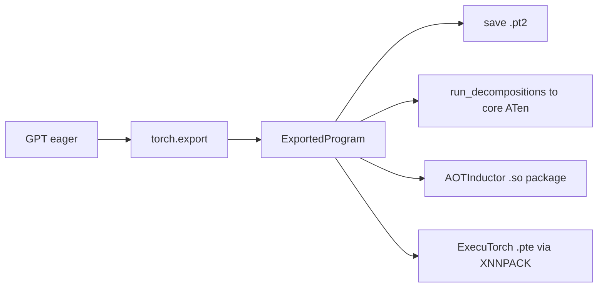

# 38 — Export, Quantize, and Serve the LLM

> **Prerequisites:** modules 28, 29 and 37.
> **You will learn:** how to export the capstone GPT with `torch.export` and a dynamic sequence length, save it as `.pt2`, reload it and prove it computes the same function; where export stops (Python-side KV-cache bookkeeping, data-dependent control flow) and the options for crossing that line; int8 weight-only quantization from scratch: per-channel scales, size, quality and agreement measurements; why `torch.ao.quantization` is deprecated in 2.8 and what torchao, AOTInductor and ExecuTorch do in production; a minimal, tested serving contract, and a retrospective map of every PyTorch feature the capstone used.

The checkpoint from [module 33](./33-capstone-pretraining.md) is a `state_dict`: 3,518,663 bytes that mean nothing without `llm/model.py`. Shipping the model needs an artifact that carries its own computation, a smaller file, and an interface that cannot be misused. This module builds all three and measures each against the fp32 model.

The tools are from [module 28](./28-export-and-deployment.md) and [module 29](./29-quantization-and-compression.md). What is new is a real model with a tied head, a context limit and a KV cache. The code is in [`code/llm/export.py`](./code/llm/export.py) and [`code/38_export_quantize.py`](./code/38_export_quantize.py). The final section looks back over the whole course.

---

## 38.1 What "deploying" this model means

| Target | Artifact | Contains | Needs at runtime | Here |
|---|---|---|---|---|
| Python eager | `gpt_sherlock.pt` | tensors | Python, PyTorch, `llm/model.py` | starting point |
| `torch.export` | `gpt.pt2` | ATen graph, weights, shape constraints | Python, PyTorch; not our source | built and verified |
| AOTInductor / ExecuTorch | `.pt2` package with `.so` / `.pte` | compiled kernels, weights | a C++ runtime | fragments only |



Every downstream path consumes the `ExportedProgram`, so it comes first. The [2.8 export docs](https://docs.pytorch.org/docs/2.8/export.html) call the API under active development and warn that saved files may not load in newer versions, so record the writing PyTorch version beside a `.pt2`.

## 38.2 Exporting the uncached forward

```python
idx = torch.randint(0, 512, (2, 16))          # example (B, T), inside both ranges
ep = torch.export.export(model.eval(), (idx,), dynamic_shapes={
    "idx": {0: Dim("B", min=1, max=64), 1: Dim("T", min=2, max=128)}})
```

**`min=2`.** Tracing specializes sizes 0 and 1, because size 1 broadcasts. A `T = 1` example fails with "You marked T as dynamic but your code specialized it to be a constant (1)". Module 28 set the `min=2` convention. Here `min=1` with a length-16 example also exported, since nothing broadcasts over `T`.

**`max=128`.** `wpe` has 128 rows, and `forward` raises `ValueError` past `block_size`. Export turns that check into a guard, so asking for `max=256` fails with "Suggested fixes: T = Dim('T', max=128)".

**Batch.** A first probe with a `(1, 16)` example and only `T` dynamic rejected batch 2: "Expected input at \*args[0].shape[0] to be equal to 1". Unlisted dimensions are static.

One local run (M2 Pro, 4 threads, PyTorch 2.8.0 CPU):

| Quantity | Value |
|---|---|
| Export time | 0.76–1.14 s over four runs |
| Graph nodes | 160: 54 placeholders, 105 `call_function`, 1 output |
| Main ops | 17 `linear`, 9 `layer_norm`, 4 SDPA, 4 `gelu`, 2 `embedding`, 9 `dropout` (p = 0) |
| After `run_decompositions()` | 394 nodes of core ATen (`addmm`, `bmm`, `native_layer_norm`, ...) |
| `range_constraints` | `{s95: VR[1, 64], s75: VR[2, 128]}` |
| `user_inputs` / `user_outputs` | `('idx',)` / `('linear_16', None)` |

**The tied weight is listed twice and stored once.** `graph_signature.parameters` names 53 tensors, including both `wte.weight` and `lm_head.weight`, against the model's 52. Placeholder `p_wte_weight` has no users, and `p_lm_head_weight` feeds both `aten.embedding` and the final `aten.linear`. The tie survives as shared storage (`ep.state_dict["wte.weight"] is ep.state_dict["lm_head.weight"]`), including after save and load. The `.pt2` stores the matrix once, and `ep.module()` has 52 parameters. Any pass that rewrites parameters by name, a quantizer for example, must handle that alias.

`ep.module()` returns `(logits, None)`, like `GPT.forward`. The dropout nodes are there because 2.8 exports a training-level IR; decomposition removes them.

## 38.3 Round trip and equivalence

| Check (one local run) | Result |
|---|---|
| Max \|eager − reloaded\| logits, T = 2, 17, 128 | 0.0, 0.0, 0.0 |
| T = 129 | `RuntimeError: Expected input at *args[0].shape[1] to be <= 128, but got 129` |
| T = 1, below `min=2` | **accepted**, logits equal eager |
| 32 greedy tokens from "Sherlock Holmes", reloaded vs eager | identical |
| `torch.export.load` time | 0.12–0.14 s |
| `gpt.pt2` vs `torch.save(state_dict)` | 3,738,493 vs 3,518,663 bytes (216 KB of the difference is the JSON graph) |

The difference is exactly zero because the program calls the same CPU kernels in the same order as eager. After decomposition or AOTInductor, fusion reorders sums, so check with `atol=1e-5` and identical greedy tokens.

The T = 1 row is real 2.8.0 behaviour. The module's input check enforces the upper bound but not the lower one, despite `VR[2, 128]` (module 28 saw the same lost 0/1 guard). The program was traced assuming T ≥ 2, so `ExportedLM` reads the range from `ep.range_constraints` and raises `ValueError` outside it.

`ExportedLM` also overrides `train()`, because `ep.module().eval()` raises `NotImplementedError` in 2.8 and module 34's `evaluate_nll` calls `.eval()`. It exposes `.config` so module 35's `generate(..., use_cache=False)` can crop to `block_size`. The generation check above ran through that code.

## 38.4 Why the KV-cache path does not export as-is

The cached forward from [module 35](./35-capstone-generation-kv-cache.md) is the one worth serving, and it does not export, for three reasons:

1. **Python state.** `cache.length` is an `int` that `forward` reads and writes. Export bakes it in as a constant, so the graph is correct only at the traced position.
2. **Data-dependent slicing.** `cache.k[layer, :, :, :end]` has a value-dependent length. With a tensor `length` it becomes an unbacked symbol needing `torch._check` hints.
3. **Mutation outside the module.** `KVCache` is not an `nn.Module`, so writes to its tensors are invisible side effects.

There are three ways out:

- **(a) Functional cache.** Export prefill and decode as two programs. The cache tensors and a position tensor go in, and the updated cache comes out.
- **(b) Buffer mutation.** Register the cache as buffers and write with `index_copy_`. Export functionalizes the write and lists it in `graph_signature.buffers_to_mutate`.
- **(c) `torch.cond`** keeps the prefill and decode branches in one program ([module 28](./28-export-and-deployment.md)).

The fragment below is the core of (a). While writing this module, a probe exported it in 0.57 s (177 nodes), fed "Sherlock Holmes" one token at a time, and matched the `KVCache` path within 2.9e-6.

```python
class DecodeStep(nn.Module):                     # one token in; cache in and out
    def __init__(self, gpt):
        super().__init__()
        self.gpt = gpt

    def forward(self, idx, pos, k_cache, v_cache):  # (B,1), (1,), (L,B,H,S,d_head) x2
        g, B, H, D = self.gpt, idx.size(0), self.gpt.config.n_head, self.gpt.config.d_head
        x = g.wte(idx) + g.wpe(pos)                                   # (B, 1, d_model)
        visible = (torch.arange(k_cache.size(3)) <= pos)[None, :]     # (1, S)
        ks, vs = [], []
        for i, blk in enumerate(g.blocks):
            q, k, v = blk.attn.c_attn(blk.ln_1(x)).split(g.config.d_model, dim=2)
            q, k, v = (t.view(B, 1, H, D).transpose(1, 2) for t in (q, k, v))
            ks.append(k_cache[i].index_copy(2, pos, k))               # functional write
            vs.append(v_cache[i].index_copy(2, pos, v))
            y = F.scaled_dot_product_attention(q, ks[-1], vs[-1], attn_mask=visible)
            x = x + blk.attn.c_proj(y.transpose(1, 2).reshape(B, 1, -1))
            x = x + blk.mlp(blk.ln_2(x))
        return g.lm_head(g.ln_f(x)), torch.stack(ks), torch.stack(vs)
```

Every step attends over all 128 slots and masks the unwritten ones: the price of static shapes. The payoff on a GPU is one CUDA graph replayed for every step ([CUDA graphs](/courses/inference/08-compilation-and-runtime/08-01-cuda-graphs.html)). We do not ship it because it duplicates attention outside the frozen `llm/model.py`.

## 38.5 Int8 weight-only quantization from scratch

For each output row $r$ of $W \in \mathbb{R}^{d_\text{out} \times d_\text{in}}$:

$$s_r = \frac{\max_j |W_{rj}|}{127}, \qquad q_{rj} = \mathrm{clamp}\big(\mathrm{round}(W_{rj}/s_r),\,-127,\,127\big), \qquad \hat W_{rj} = s_r\, q_{rj}.$$

The error is at most $s_r/2$, and the symmetric ±127 grid keeps zero exact. Model the error as uniform, with variance $s_r^2/12$. A Gaussian row of 128–512 weights has absmax ≈ $3.5\sigma$, so the relative error is about $(3.5\sigma/127)/(\sqrt{12}\sigma) \approx 0.8\%$, matching the measurement below. Scales are per channel because each row is its own dot product, and one tensor-wide scale would let an outlier row set every row's step (fence 3). See [module 29](./29-quantization-and-compression.md), the [design space](/courses/inference/04-quantization/04-01-the-design-space.html), and [Jacob et al.](https://arxiv.org/abs/1712.05877).

`Int8WeightOnlyLinear` holds `weight` (`torch.int8`, `(d_out, d_in)`), `scale` (fp32, `(d_out,)`) and `bias` buffers. Its forward, `F.linear(x, weight.float() * scale[:, None], bias)`, rebuilds the fp32 matrix every call: numerics and storage, not speed. Real kernels dequantize tiles in registers or multiply in int8 ([formats and kernels](/courses/inference/04-quantization/04-03-formats-and-kernels.html)).

**The tied head stays fp32.** `quantize_int8_weight_only` deep-copies the model and replaces the 16 block Linears. Replacing `lm_head` too would give it a private int8 copy: the matrix stored twice, and the lookup reading different numbers from the head.

| Component | fp32 bytes | int8 model bytes |
|---|---|---|
| 16 block Linear weights (786,432 values) | 3,145,728 | 786,432 |
| Their per-row scales | — | 18,432 |
| `wte` (tied head) + `wpe` | 327,680 | 327,680 |
| Biases, LayerNorm | 27,648 | 27,648 |
| **Tensor data** | **3,501,056** | **1,160,192** |
| **`torch.save(state_dict)`** | **3,518,663** | **1,182,551** (2.98× smaller) |

The Linears shrink 4×, but the fp32 embeddings are now 28 % of the file. In GPT-2 124M, `wte` alone is 50,257 × 768 = 38.6M parameters. That is why production schemes quantize the embedding too, or use 4 bits for the Linears.

Quality against the fp32 checkpoint on story XI (23,847 targets, stride 128, module 34's `evaluate_nll`):

| Metric | fp32 | int8 weight-only |
|---|---|---|
| Val NLL (nats/token) | 2.96337 (manifest 2.96337) | 2.96367 (+0.00029) |
| Teacher-forced greedy agreement, 64 tokens | — | 1.0 |
| Free-running 64-token greedy text | — | identical |
| Per-layer ‖W − Ŵ‖/‖W‖ | — | 0.62–0.87 % (mean 0.70 %) |
| Same with one scale per tensor | — | 0.92–1.50 % |

Teacher-forced agreement scores the int8 argmax on the fp32 greedy sequence. Free-running comparison is harsher, since one near-tie makes the continuations diverge. Both are perfect here because the layers are well conditioned: the largest row absmax is 1.4–2.2× the median row's. Outlier features near 6.7B parameters forced [LLM.int8()](https://arxiv.org/abs/2208.07339), and 4 bits needs error-compensating rounding such as [GPTQ](https://arxiv.org/abs/2210.17323). For why weight-only helps bandwidth-bound GPU decoding, see [Transformers 14](../transformers/14-inference-optimizations.md).

## 38.6 The library path in 2.8 and after

**`torch.ao.quantization`.** In 2.8.0, calling `quantize_dynamic` emits `DeprecationWarning: torch.ao.quantization is deprecated and will be removed in 2.10`, and the message points eager users to torchao's `quantize_`. The text is `DEPRECATION_WARNING` in [`utils.py`](https://github.com/pytorch/pytorch/blob/v2.8.0/torch/ao/quantization/utils.py) (line 794), applied by `@typing_extensions.deprecated` in [`quantize.py`](https://github.com/pytorch/pytorch/blob/v2.8.0/torch/ao/quantization/quantize.py). The package's [`__init__.py`](https://github.com/pytorch/pytorch/blob/v2.8.0/torch/ao/quantization/__init__.py) does not warn, so a bare import is silent.

`try_ao_dynamic` uses it for comparison. It picks an engine from `torch.backends.quantized.supported_engines` (`['qnnpack', 'none']` on this Mac, `'none'` active; fbgemm/x86 on Linux), quantizes every Linear except `lm_head`, measures while the engine is active, and restores it in `finally`. With no engine it returns `None`.

| Variant (B = 1, T = 128, 4 threads) | Bytes | Val NLL delta | ms/forward, two runs |
|---|---|---|---|
| fp32 eager | 3,518,663 | — | 1.75–1.80 |
| fp32 `ExportedLM` | 3,738,493 | 0 | 1.83–2.02 |
| int8 weight-only, Python dequant | 1,182,551 | +0.00029 | 2.56–2.59 |
| `quantize_dynamic`, qnnpack | 1,170,727 | +0.0022 | 3.00–3.08 |

Dynamic quantization also rounds activations, hence its roughly 7× larger delta. At these shapes both quantized variants are slower than fp32, because per-call overhead outweighs the saved traffic. A run under background load measured 1.2–2× higher. These timings are a ranking on one machine, and the test asserts none of them.

**torchao** ([v0.13.0](https://github.com/pytorch/ao/tree/v0.13.0), paired with 2.8; not installed, not executed) is the maintained path. `quantize_` swaps weights for tensor subclasses ([module 20](./20-execution-model-dispatch-devices.md)) whose overrides route `linear` to packed kernels:

```python
from torchao.quantization import Int4WeightOnlyConfig, Int8WeightOnlyConfig, quantize_
quantize_(model, Int8WeightOnlyConfig())                 # our scheme, real kernels
quantize_(model, Int4WeightOnlyConfig(group_size=32))    # one scale per 32 inputs
```

**PT2E** quantizes an exported graph: a quantizer such as `XNNPACKQuantizer` annotates it, `prepare_pt2e` inserts observers, calibration runs, and `convert_pt2e` emits quantize/dequantize pairs for a backend to fuse. The 2.8 copy in `torch.ao.quantization.quantize_pt2e` is deprecated; torchao v0.13.0 ships `torchao.quantization.pt2e.quantize_pt2e`.

**Leaving Python.** These fragments were not executed: Inductor's C++ toolchain failed on the reference Mac (module 23), and ExecuTorch is not installed.

```python
pkg = torch._inductor.aoti_compile_and_package(ep, package_path="gpt_aoti.pt2")  # .so inside
runner = torch._inductor.aoti_load_package(pkg)

from executorch.backends.xnnpack.partition.xnnpack_partitioner import XnnpackPartitioner
from executorch.exir import to_edge_transform_and_lower                          # v0.7.0
et = to_edge_transform_and_lower(ep, partitioner=[XnnpackPartitioner()]).to_executorch()
open("gpt.pte", "wb").write(et.buffer)
```

Both start from the 38.2 program ([AOTInductor docs](https://docs.pytorch.org/docs/2.8/torch.compiler_aot_inductor.html), [ExecuTorch v0.7.0](https://github.com/pytorch/executorch/tree/v0.7.0), whose installer pins torch 2.8.0). ONNX takes the same route via `torch.onnx.export(..., dynamo=True)`, where `dynamo` defaults to `False` in 2.8.0 ([ONNX docs](https://docs.pytorch.org/docs/2.8/onnx.html); not run, `onnx` is not installed).

## 38.7 A minimal serving contract

A server is a function with a network in front of it, so test the function first:

```python
complete(model, tokenizer, prompt, max_new_tokens=32, temperature=0.0, seed=0) -> dict
# {"text", "n_tokens", "stop_reason": "eot" | "length" | "context", "prompt_tokens", "model_sha256"}
```

- **Validate first.** An empty prompt, `max_new_tokens <= 0` or non-int, a negative or non-finite temperature, or a prompt at the context limit raises `ValueError` (HTTP 422 in a server).
- **Cap at the context.** Asking for 500 tokens after a 5-token prompt returns 123 tokens and `"context"`. The window never slides silently, since sliding recomputes the whole prefix (module 35).
- **Own the randomness.** Each call seeds its own `torch.Generator`, so concurrent requests cannot perturb each other. The test checks `torch.get_rng_state()` is unchanged.
- **Stop on EOT** and exclude it from the text.
- **Report provenance.** `model_sha256` hashes every `state_dict` entry, so fp32 and int8 differ.
- **Accept any callable** (eager, int8, `ExportedLM`) through module 35's `generate(..., use_cache=False)`.

The HTTP wrapper is a fragment. It was not executed or load-tested:

```python
class CompletionRequest(BaseModel):                    # pydantic
    prompt: str = Field(min_length=1)
    max_new_tokens: int = Field(32, ge=1, le=128)
    temperature: float = Field(0.0, ge=0.0, le=2.0)
    seed: int = 0

app = FastAPI()
MODEL, TOKENIZER, _ = load_pretrained()                # once, at startup
MODEL = quantize_int8_weight_only(MODEL)               # or ExportedLM(load_exported(path), cfg)

@app.post("/v1/complete")
def complete_route(req: CompletionRequest) -> dict:   # sync def runs in FastAPI's threadpool
    with torch.inference_mode():
        return complete(MODEL, TOKENIZER, req.prompt, req.max_new_tokens, req.temperature, req.seed)
```

Batching, token budgets, streaming and latency SLOs are omitted: see [MLOps and serving](../../notes/libraries/mlops-and-serving.md) and the [inference course](/courses/inference/). A real engine replaces the loop inside `complete`; the contract stays.

## 38.8 Retrospective: the whole course in one table

Each row is a feature that code in modules 30–38 actually calls:

| Feature | Capstone use | Taught in |
|---|---|---|
| dtypes, `int64` ids vs `uint16` storage | token files (31) | [02](./02-tensor-creation-dtypes-devices.md) |
| `unfold`, views vs copies | `get_batch` windows (31) | [03](./03-storage-strides-views-copies.md) |
| `bincount`, `stack`, indexing | tokenizer stats (30), eval batches (34) | [04](./04-indexing-broadcasting-shapes.md) |
| stable log-softmax, float64 sums | NLL, bits per byte (34) | [05](./05-tensor-math-linear-algebra-numerics.md) |
| `torch.Generator`, `multinomial` | sampling (31, 35), `complete` (38) | [06](./06-randomness-and-reproducibility.md) |
| autograd, `no_grad`, `inference_mode` | training (33), eval and decoding (34, 35) | [07](./07-autograd-graph-and-backward.md) |
| buffers, `ModuleList`, weight tying, `deepcopy`, strict loading | model (32), LoRA (36), int8 swap (38) | [10](./10-nn-module-internals.md) |
| `nn.Embedding`, `nn.Linear` | `wte`, `wpe`, projections (32) | [11](./11-linear-embedding-conv-recurrent-layers.md) |
| `LayerNorm`, `GELU`, SDPA, masks | blocks, cache (32) | [12](./12-normalization-dropout-attention-layers.md) |
| init, `cross_entropy(ignore_index)` | init (32), SFT masking (36) | [13](./13-initialization-and-losses.md) |
| datasets, memmap tokens, seeded loaders | data pipeline (31) | [14](./14-data-pipelines.md) |
| AdamW decay groups, warmup + cosine | pretraining (33), LoRA (36) | [15](./15-optimizers-and-schedules.md) |
| clipping, accumulation, `weights_only`, atomic writes, resume, manifests | `train.py`, artifact (33) | [16](./16-training-loop-checkpointing.md) |
| CPU bf16 autocast | `--bf16-autocast` (33) | [17](./17-mixed-precision.md) |
| causality tests, `assert_close` tolerances | model (32), cache equivalence (35) | [18](./18-debugging-and-testing.md) |
| freezing with `requires_grad_(False)` | LoRA base (36) | [19](./19-classic-models-end-to-end.md) |
| tensor subclasses | torchao weights (38) | [20](./20-execution-model-dispatch-devices.md) |
| profiler, `FlopCounterMode`, `Timer` | scaling (37), latency (38) | [21](./21-profiling-and-benchmarking.md) |
| activation checkpointing, `saved_tensors_hooks` | per-block checkpointing (37) | [22](./22-memory-accounting-and-checkpointing.md) |
| `torch.compile(backend="aot_eager")` | compile parity (37) | [23](./23-torch-compile-in-practice.md) |
| FX graphs, signatures, core ATen | export inspection (38) | [24](./24-compiler-internals-fx-inductor.md) |
| gloo, DDP | gradient equivalence (37) | [26](./26-distributed-collectives-and-ddp.md) |
| FSDP2 `fully_shard` | sharded step (37) | [27](./27-fsdp2-dtensor-parallelism.md) |
| `torch.export`, `Dim`, `.pt2`, AOTInductor, ExecuTorch | this module | [28](./28-export-and-deployment.md) |
| per-channel int8, `quantize_dynamic`, torchao | this module | [29](./29-quantization-and-compression.md) |
| byte-level BPE, story splits | every capstone module | [30](./30-capstone-corpus-and-tokenizer.md) |
| static KV cache, offset masks | decoding (35), export limits (38) | [32](./32-capstone-gpt-model.md), [35](./35-capstone-generation-kv-cache.md) |
| sliding-window NLL, baselines | quality bars (34, 38) | [34](./34-capstone-evaluation.md) |

Module 01's eager model underlies every row. Three modules have no row of their own: `torch.func` (09), custom `autograd.Function` (08) and custom ops/Triton (25). Each would pay off only with a need this small decoder never had.

Next steps follow from the model's limits. Modernize it with RoPE, RMSNorm, SwiGLU and GQA ([`/courses/transformers/code/modern_decoder.py`](/courses/transformers/code/modern_decoder.py), [Transformers 16](../transformers/16-end-to-end-forward-pass.md)); RoPE also removes the 128-position wall. Add data, because one book is about 15 epochs at our budget. Run [build-nanogpt](https://github.com/karpathy/build-nanogpt/blob/6104ab1b53920f6e2159749676073ff7d815c1fa/train_gpt2.py) on a GPU with bf16, Inductor and the DDP verified in [module 37](./37-capstone-scaling-the-recipe.md). Each step reuses the contracts drilled here: equal logits, deltas against a frozen reference, hashed artifacts. [The PyTorch notes](../../notes/libraries/pytorch.md) condense the review.

## Reconciling the sources

The [export docs](https://docs.pytorch.org/docs/2.8/export.html) and [programming model](https://docs.pytorch.org/docs/2.8/export.programming_model.html) mention neither the duplicated tied placeholder nor the unenforced lower bound; we report what 2.8.0 did. nanoGPT and Raschka stop at `torch.save`; build-nanogpt does not export. torchao's living README renames configs across releases, so we quote `torchao/quantization/__init__.py` at v0.13.0. The [2.8 quantization page](https://docs.pytorch.org/docs/2.8/quantization.html) still documents flows the runtime warning deprecates; trust the warning.

## Worked export and quantization verification

**Fence 1: dynamic export round trip.** It proves a `Dim` range survives `save`/`load`, in-range outputs equal eager exactly, and the upper bound is enforced. It does not test the lower bound, which 2.8.0 skips (38.3), or any compiled runtime.

```python pytorch-check
import os
import tempfile

import torch
import torch.nn as nn
from torch.export import Dim, export

torch.manual_seed(0)


class TinyLM(nn.Module):
    def __init__(self):
        super().__init__()
        self.net = nn.Sequential(nn.Embedding(32, 16), nn.Linear(16, 32))

    def forward(self, idx):  # idx (B, T) int64 -> logits (B, T, 32)
        return self.net(idx)


model = TinyLM().eval()
example = torch.randint(0, 32, (2, 8))
ep = export(model, (example,), dynamic_shapes={"idx": {1: Dim("T", min=2, max=16)}})
bounds = [str(v) for v in ep.range_constraints.values()]
assert bounds == ["VR[2, 16]"], bounds

with tempfile.TemporaryDirectory() as d:
    path = os.path.join(d, "tiny.pt2")
    torch.export.save(ep, path)
    loaded = torch.export.load(path).module()

with torch.no_grad():
    for T in (3, 16):
        x = torch.randint(0, 32, (2, T))
        torch.testing.assert_close(loaded(x), model(x), rtol=0, atol=0)
try:
    loaded(torch.randint(0, 32, (2, 17)))
    rejected = False
except Exception:
    rejected = True
assert rejected, "T=17 must violate Dim('T', max=16)"
print(f"range {bounds[0]}; T=3 and T=16 match eager exactly; T=17 rejected")
```

**Fence 2: the per-channel bound.** It proves $|W - \hat W| \le s_r/2$ elementwise, one byte per stored weight, and that every row reaches ±127. It says nothing about model quality, which 38.5 measures.

```python pytorch-check
import torch

g = torch.Generator().manual_seed(0)
W = torch.randn(64, 32, generator=g) * 0.05          # (out_features, in_features)

scale = W.abs().amax(dim=1) / 127                     # (64,) one scale per output row
q = torch.round(W / scale[:, None]).clamp(-127, 127).to(torch.int8)
deq = q.float() * scale[:, None]

err = (W - deq).abs()
assert bool((err <= scale[:, None] / 2 + 1e-7).all()), "rounding error must be <= scale/2"
assert q.dtype == torch.int8 and q.untyped_storage().nbytes() == W.numel()
assert int(q.abs().amax(dim=1).min()) == 127          # every row uses the full grid
rel = (err.norm() / W.norm()).item()
assert rel < 0.01
print(f"max err / (scale/2) = {(err / (scale[:, None] / 2)).max():.3f}; "
      f"int8 bytes {q.numel()} vs fp32 {W.numel() * 4}; rel Frobenius err {rel:.4f}")
```

**Fence 3: per-tensor vs per-channel.** One row scaled ×100 mimics an outlier channel, so a tensor-wide scale gives the other rows a grid 100× too coarse. Locally 79 % of their weights rounded to zero (relative error 0.707 vs 0.0062 per channel). The fence asserts only the 10× gap. The capstone's layers have no such outlier, so per-tensor was only about 1.7× worse there.

```python pytorch-check
import torch

g = torch.Generator().manual_seed(1)
W = torch.randn(16, 64, generator=g) * 0.02
W[0] *= 100                                           # one outlier row, as in real LLM layers


def roundtrip(w, scale):
    return torch.round(w / scale).clamp(-127, 127) * scale


per_tensor = roundtrip(W, W.abs().max() / 127)
per_channel = roundtrip(W, W.abs().amax(dim=1, keepdim=True) / 127)

small = slice(1, None)                                # the 15 ordinary rows
rel_t = ((W[small] - per_tensor[small]).norm() / W[small].norm()).item()
rel_c = ((W[small] - per_channel[small]).norm() / W[small].norm()).item()
zeroed = (per_tensor[small] == 0).float().mean().item()
assert rel_c * 10 <= rel_t, (rel_c, rel_t)
print(f"ordinary rows: per-tensor rel err {rel_t:.3f} ({zeroed:.0%} of weights rounded to 0), "
      f"per-channel {rel_c:.4f}")
```

**Fence 4: a quantized Linear forward.** This inlines the `llm/export.py` idea for a `c_attn`-shaped layer. It proves the output stays within 1 % relative error of fp32 and that the `state_dict` holds `torch.int8`. Locally, tensor bytes fell 3.79× rather than 4×, because the fp32 bias and scales remain. It does not measure speed.

```python pytorch-check
import torch
import torch.nn as nn
import torch.nn.functional as F

torch.manual_seed(0)


class Int8WeightOnlyLinear(nn.Module):
    def __init__(self, linear: nn.Linear):
        super().__init__()
        w = linear.weight.detach()
        scale = w.abs().amax(dim=1).clamp_min(1e-12) / 127
        self.register_buffer("weight", torch.round(w / scale[:, None]).clamp(-127, 127).to(torch.int8))
        self.register_buffer("scale", scale)
        self.register_buffer("bias", linear.bias.detach().clone())

    def forward(self, x):  # dequantize, then an ordinary fp32 matmul
        return F.linear(x, self.weight.float() * self.scale[:, None], self.bias)


fp32 = nn.Linear(128, 384)
int8 = Int8WeightOnlyLinear(fp32)
x = torch.randn(4, 17, 128)
with torch.no_grad():
    ref, out = fp32(x), int8(x)
rel = ((out - ref).norm() / ref.norm()).item()
sd = int8.state_dict()
assert rel < 1e-2, rel
assert sd["weight"].dtype == torch.int8 and sd["scale"].dtype == torch.float32
fp32_bytes = sum(t.numel() * t.element_size() for t in fp32.state_dict().values())
int8_bytes = sum(t.numel() * t.element_size() for t in sd.values())
print(f"output rel err {rel:.4f}; tensor bytes {fp32_bytes} -> {int8_bytes} "
      f"({fp32_bytes / int8_bytes:.2f}x smaller)")
```

## Lab: export, quantize and serve the capstone model

**Tested with Python 3.11 and PyTorch 2.8.0 on CPU.**

[`code/38_export_quantize.py`](./code/38_export_quantize.py) runs `export`, `quantize`, `serve-check` or `all` (default) on `load_pretrained()`'s model, writing `gpt.pt2` and `gpt_int8.pt` to `--output-dir` (default: a deleted temporary directory). `--try-ao-dynamic` adds the deprecated comparison and `--bench` the 38.6 timings. The JSON has `export`, `quantize`, `ao_dynamic` (or `null`), `serve` and `upstream`, which records whether module 34's `evaluate_nll` and module 35's `generate` were found. If they are missing, `llm/export.py` uses clearly marked local fallbacks, which the test checks against upstream. Scope: Python dequantization shows size and numerics, not speed; no compiled runtime runs; the HTTP fragment is not load-tested.

```bash
python content/courses/pytorch/code/38_export_quantize.py all --output-dir /tmp/gpt-export
python site/test_pytorch_38_export.py
```

One local run (M2 Pro, 4 threads, with both upstream modules present) produced the numbers in 38.2–38.6. Its greedy continuation of "Sherlock Holmes" was `.\n\n“It is a few more thank to the matter. You have the more time of`.

The test asserts contracts, not those numbers:

- **Export:** the `.pt2` reloads with ranges `VR[1, 64]` and `VR[2, 128]`; logits are within 1e-5 of eager at T ∈ {2, 17, 128}; T = 129 and T = 1 are rejected; 32 greedy tokens equal eager.
- **Quantization:** int8 bytes < 0.5 × fp32; NLL delta in [−0.02, 0.15); 64-token agreement ≥ 0.75; 16 int8 weights, with `lm_head` the only `nn.Linear`, still tied to an unchanged fp32 `wte`.
- **Serving:** `complete()` is deterministic at temperature 0 and under a fixed seed, leaves the global RNG alone, rejects bad arguments, stops on EOT, and reports an allowed `stop_reason`.
- **ao:** `try_ao_dynamic` returns a finite NLL or `None` and always restores the engine.

The test took 4.5 s wall locally, about 0.7 s of which was `import torch`.

## Key takeaways

- Export with `Dim("T", min=2, max=128)` and a dynamic batch. Any unlisted dimension is static, and the model's own `ValueError` becomes the `T ≤ 128` guard.
- Prove an export by behaviour: reload, compare logits at the range edges (0.0 here), reject out-of-range lengths, match greedy output. Enforce the range yourself; 2.8.0 accepted T = 1.
- A tied weight appears in the signature under both names, with one dead placeholder, but is stored once. Graph passes must respect the alias.
- The KV-cache decode step exports once the cache and the position are explicit tensors. Static shapes are the price, and CUDA-graph replay is the payoff.
- Per-channel int8 weight-only shrank the file 2.98× (fp32 embeddings limit it), moved val NLL by +0.0003 nats and agreed on 64 of 64 tokens. Speed needs real kernels.
- `torch.ao.quantization` is deprecated in 2.8 and removed in 2.10: use torchao `quantize_`, PT2E for graphs, and AOTInductor or ExecuTorch to leave Python.
- Serving starts from a pure, validated, RNG-free `complete()`. HTTP is a thin wrapper around it.

## Self-check

1. Your exported model works for T = 64 but fails at T = 1. Why, and how do you fix the export without changing the model?
2. Why do weight-only int8 schemes speed up LLM decoding on GPUs even though the matmul still runs in bf16? When would they not help?
3. Explain why quantizing the tied embedding/LM-head matrix needs separate handling, and give two ways to do it.

---

**Back to [the course index](./00-README.md)**
